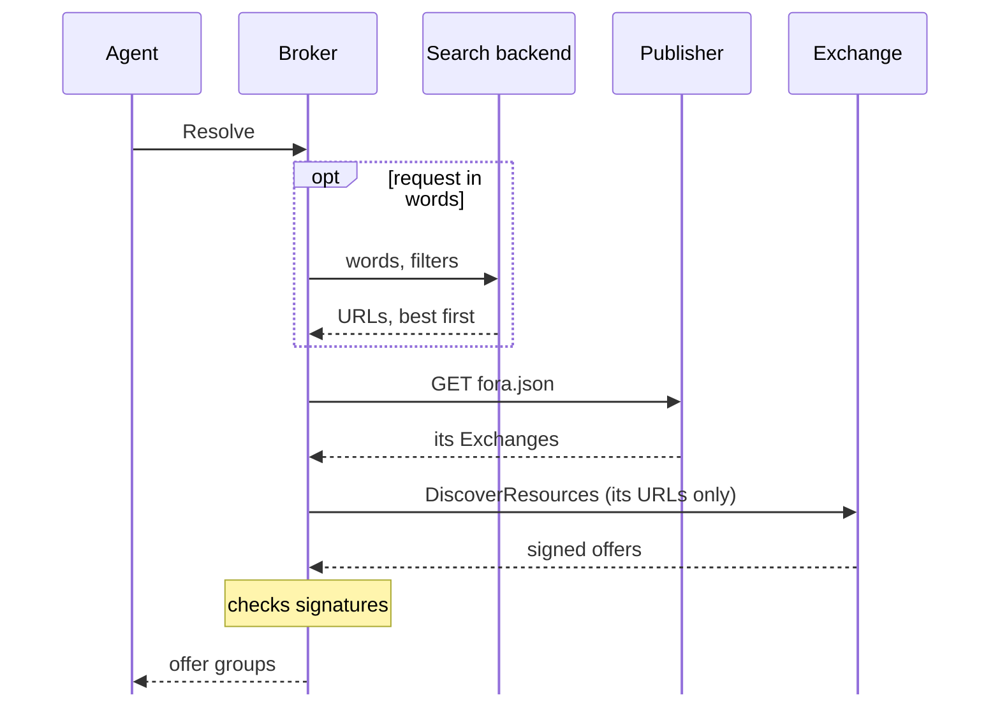

An AI agent often knows what it needs but not who sells it. Each publisher names the Exchanges that sell its content, and an agent that asks each one in turn spends its time on lookups. A Broker does that work in one step: the agent sends one request, a list of URLs or a description in plain words, and gets back signed offers from the Exchanges that sell those resources, grouped by resource.

Each offer is a full package: the license terms, the resource's identity and attestations, and the price, all signed by the Exchange. The Broker presents the offers in an order it chooses, which is why an agent works with a Broker it trusts, and the agent decides which offer to take. The Broker is optional: an agent can always call the Exchanges itself, with the same protocol.

## How a request becomes offers



1. **The agent asks.** It sends `BrokerService.Resolve` a `DiscoveryRequest` that lists URLs in `uris`, or describes the need in `query` with optional `search_filters`. When a request has both, FORA Server's Broker uses the URLs and ignores the words and filters.
2. **The search backend finds URLs.** For a request in words, the Broker's search backend turns the words and filters into a list of URLs, best match first. A request that lists URLs skips this step.
3. **The publisher names its Exchanges.** For each URL, the Broker reads the publisher's `/.well-known/fora.json`, which names the Exchanges that sell the site's content. It routes the URL to one of them that its operator trusts and that is reachable.
4. **The Exchange quotes.** The Broker sends each Exchange one `DiscoverResources` query that carries only the URLs routed to it, signed with the Broker's own key. The query names URLs and never carries the agent's words.
5. **The Broker checks.** The Exchange answers with offers it signed. The Broker checks each offer's signature and drops any offer that fails.
6. **The agent gets offer groups.** The Broker returns a `DiscoveryResponse`. When at least one URL has an offer, it holds one `OfferGroup` per URL, with the offers in the Broker's order or the reason there is none. When no URL has an offer, it holds no groups and states the reason once.

Prices and terms come only from the Exchange, so a search hit never becomes an offer the Exchange did not sign. `Resolve` only discovers: it never charges, and returning an offer reserves nothing.

## Two kinds of request

**By URL.** The agent already knows which resources it wants and lists them in `DiscoveryRequest.uris`, up to 256:

```json
{
  "uris": ["https://news.example/2026/11/central-bank-rates"]
}
```

**In plain words.** The agent describes what it needs in `DiscoveryRequest.query`, and can narrow the search with `DiscoveryRequest.search_filters`:

```json
{
  "query": "piano",
  "search_filters": {
    "music.vocals": false,
    "music.bpm_range": "80-100"
  }
}
```

Which filter keys a Broker accepts, and how they apply, depends on its search backend (see [Search backends](#search-backends)). The URLs a search finds take the same route as URLs the agent names. Their groups are marked `DISCOVERY_METHOD_SEARCH`, and groups for named URLs `DISCOVERY_METHOD_EXCHANGE`.

An agent that wants offers for named URLs and a search sends two requests.

## Search backends

FORA does not specify search. `DiscoveryRequest.query` is free text that the Broker interprets, and `ResourceQuery` has no field for it, so an Exchange only ever sees URLs. Whoever runs a Broker decides how its search works, through the search backend it plugs in. The backend only proposes URLs: the offers, prices and license terms always come from the Exchange.

A FORA Server Broker runs one search backend, chosen per deployment. FORA Server ships two.

**Elasticsearch.** The Broker runs the index owner's search template against an index the owner already runs. The template decides which fields are searched, how hits rank and how each filter applies. The Broker calls no model and does not interpret the words. The Broker accepts the `search_filters` keys the deployment's filter schema declares, never drops one, and passes each to the template, which applies it. An undeclared key is refused with `UNIMPLEMENTED` and a malformed value with `INVALID_ARGUMENT`, both naming `search_filters.<key>`, because results that ignore a filter would answer a different question.

**Tag search, for music.** A model on Amazon Bedrock reads music tags from the words, and the Broker matches them against an index it builds from the catalog feed. It applies the [fora-music-v1 filter keys](/protocol/ext-music/#query-vocabulary-discoveryrequestsearch_filters) it supports as required constraints, by the profile's [matching rules](/protocol/ext-music/#how-filters-match), so every result passes them. It ignores any other key.

A Broker with no search backend finds offers only for URLs the agent names. It refuses a [fora-music-v1](/protocol/ext-music/) filter key, with `INVALID_ARGUMENT` when the value is malformed and otherwise with `UNIMPLEMENTED`, and ignores a key the profile does not define, in the profile's [order of checks](/protocol/ext-music/#order-of-checks-and-errors).

With the Elasticsearch backend, the Broker needs only read access to the index. It refuses a template file that would insert the agent's text unescaped, because that text could then write query syntax. The Identity Service publishes the same filter schema in its `fora_discover` tool when its operator gives it the same file, so an agent sees the accepted keys before it calls. The index owner's guide is [Writing the Search Template](https://github.com/FORA-Protocol/reference-implementation/blob/main/src/broker/SEARCH-TEMPLATE.md) in the FORA Server repository.

A search that matches nothing is answered with `OFFER_ABSENCE_REASON_NOT_IN_CATALOG`, and a search that fails with `OFFER_ABSENCE_REASON_TEMPORARILY_UNAVAILABLE`. The Broker never falls back to another backend.

Another backend is an implementation of `Searcher`, in the Broker's `catalogsearch` package, wired as a new `BROKER_QUERY_PROVIDER` value. A `Searcher` takes the words and the parsed filters and returns URLs, best first. Web search APIs can sit behind it, such as [Exa](https://exa.ai/docs/reference/search), [Tavily](https://docs.tavily.com/documentation/api-reference/endpoint/search), [Brave Search API](https://api-dashboard.search.brave.com/app/documentation/web-search/get-started), [Perplexity](https://docs.perplexity.ai/api-reference/search-post) and [Parallel](https://docs.parallel.ai/api-reference/search/search) (API documentation checked November 2026), and so can any index a Broker operator already runs.

## Offers and absences

Each offer carries its Exchange's signature over the price, the terms, the expiry and `Offer.exchange`. The Broker returns the offers unchanged and cannot alter one without breaking that signature. It checks every signature before it returns an offer, so an agent behind a Broker gets only offers that verified.

When at least one URL has an offer, every requested URL comes back as one `OfferGroup`, in request order, or in search order for a request in words. A URL that no trusted Exchange serves, or that its Exchange does not catalog, has an empty group with `OFFER_ABSENCE_REASON_NOT_IN_CATALOG`, and an absence reason the Exchange gave for a URL is passed on.

When no URL has an offer, or no publisher's `fora.json` can be read, the response carries no groups and states the reason once, in `DiscoveryResponse.absence_reason`. "No offer" is a successful answer, not an error: `BrokerService.Resolve` returns OK with the reason.

## Buying through the Broker

An agent commits to offers in a separate call, one of two ways. The execute target of each offer is `Offer.exchange`, which the Exchange signed, so a Broker cannot redirect a purchase.

- **Directly**: one `ExchangeService.ExecuteTransaction` per Exchange, signed by the agent.
- **Through the Broker**: one `BrokerService.ExecuteTransaction` for offers from any number of Exchanges. The request is the same `TransactionRequest`, and it returns a `BrokerTransactionResponse`.

Either way, each Exchange charges the agent's own account there (see [Accounts](/protocol/authentication/#accounts)). The Broker never charges anyone.

Through the Broker, the purchase is re-packaged. What holds it together is the agent's own consent: `TransactionRequest.agent_request_acceptance`, a detached Ed25519 signature by the agent over the complete ordered list of offers, the requester and the idempotency key, and each item's `agent_acceptance`.

1. The agent signs one `AgentAcceptance` per offer and one `AgentRequestAcceptance` over every selected offer, in order, across all Exchanges. It sends the request to the Broker, RFC 9421-signed for the Broker's URL. The request ends at the Broker.
2. The Broker verifies the agent's signature and checks that `requester.domain` is the host of the key directory the agent signed from. It checks that every item's Exchange is one it routes to and approves for purchases. It refuses anything else before it sends a single sub-request.
3. It groups the items by `Offer.exchange` and sends each Exchange one `ExchangeService.ExecuteTransaction`, which the Broker authors and signs with its own key. Each sub-request carries only that Exchange's items, in request order, with their acceptances, plus the unchanged `AgentRequestAcceptance`, `requester` and idempotency key. See [Projected execute requests](/protocol/authentication/#projected-execute-requests) for who signs what.
4. Each Exchange verifies the acceptances and requires its sub-request to be the complete, in-order share of the signed set addressed to it. A sub-request that is not has every item denied with `DENIAL_REASON_SIGNATURE_INVALID`, in the body, and nothing is bought.
5. The Broker combines the answers into one `BrokerTransactionResponse`: one result per request item, in request order, one `ExchangeOutcome` per Exchange contacted, and the charged totals per currency.

**Why re-packaging is safe.** Each item is atomic, and its integrity is per resource. Each offer carries its own Exchange's signature, each acceptance binds the agent to that one offer, and each item's result comes from the Exchange that owns the resource. The Broker cannot alter an item without breaking that Exchange's signature or the agent's acceptance. In a result item, the one signed value is the `retrieval_endpoint`, signed by the issuing Exchange. The other fields are the Broker's report of what each Exchange answered.

**Upstream refusals ride in the body.** An Exchange that refuses the Broker's whole sub-request, or does not answer it, never becomes an error of the Broker's own. Each affected item carries `TransactionResultItem.refusal`, an `UpstreamRefusal` whose `party` is the Exchange, with the Connect code it answered with and its `ErrorDetail` unchanged. The other Exchanges' results come back unchanged. With the code `unavailable` or `deadline_exceeded`, the item's outcome is unknown, because the Exchange may have bought it before the answer was lost, and the charged totals do not count it. Retrying with the same key settles it, through this Broker, another one or directly. With any other code, the item was not purchased.

Every per-item denial is the Exchange's result item, in the body. Whether relayed purchases are accepted is decided per item, by the provider of each offer's resource. An item whose provider does not accept them is denied with `DENIAL_REASON_RELAY_NOT_ACCEPTED`, the other items may succeed, and the agent buys that offer directly.

**The Broker's own refusals** are non-OK errors with an `ErrorDetail`: `unauthenticated` with `request_auth_failure` for a bad agent signature, and `SIGNATURE_INVALID` for a `requester.domain` that is not the signing directory; `invalid_argument` for a malformed request; `failed_precondition` for an Exchange it does not route to or approve.

**Idempotency.** The Broker forwards the agent's `idempotency_key` unchanged to every Exchange. It cannot change it, because the acceptances sign it. A retry through the Broker therefore reaches each Exchange as a replay and is answered from that Exchange's stored result. Each Exchange scopes the key to the agent whatever the route, so two agents behind one Broker never collide, and the same key with different items is refused with `already_exists`.

**Delegation.** The Broker signs every sub-request, so each Exchange checks a delegation's `cnf.jkt` against the key the item's `AgentAcceptance` verifies under, not against the Broker. The agent does not delegate to the Broker.

## How the Broker signs

The Broker never forwards an agent's request unchanged. Every request it sends an Exchange is its own, signed by the Broker alone with one RFC 9421 HTTP Message Signature made to the [Web Bot Auth profile](/protocol/authentication/#the-web-bot-auth-profile):

- **Discovery is Broker-led.** The agent does not know the Exchange at discovery time; finding it is the Broker's job. The Broker originates each `DiscoverResources` query and signs it, so the Exchange authenticates the caller as the Broker.
- **A purchase is re-packaged**, as above. The Exchange authenticates the Broker and takes the agent's identity and consent from the `AgentAcceptance` in the body.

The Broker publishes its public keys in its own key directory, `/.well-known/http-message-signatures-directory`, and its `fora.json` carries `ROLE_BROKER`. A request the Broker sends names the agent in `requester.domain`, so the Exchange treats it as relayed. The Exchange acts on it only when its own policy admits that Broker, for example because the Broker is registered with it; the manifest role never decides that. See [Direct and relayed requests](/protocol/authentication/#direct-and-relayed-requests).

The Broker forwards `Requester.scopes` unchanged and in order, because the Exchange selects the terms it presents by them. It forwards `Requester.delegation` as a copy and is never a delegation holder itself. On a query the Broker originates, the Exchange does not honour a delegation, so a term the Exchange gates behind one stays hidden there. Through a Broker, a delegation counts on a purchase, through the agent's acceptances.

## What a Broker never does

- **Charge.** `Resolve` never charges, and on a purchase each Exchange charges the agent's account.
- **Hold the agent's keys.** The agent, or the [Identity Service](/components/identity/overview/) for an agent on MCP, signs the acceptances.
- **Issue signed URLs.** The Exchange issues each delivery URL, and the Broker passes it on.
- **See the content.** The Broker is not on the delivery path: the agent fetches the resource from the provider's CDN.
- **Relay usage reports or disputes.** `BrokerService` has two calls, `Resolve` and `ExecuteTransaction`. The agent files `ExchangeService.ReportUsage` and `ExchangeService.DisputeTransaction` itself, with the Exchange that issued the offer, for a purchase made through the Broker as for a direct one.

## Who runs a Broker

Anyone may run a Broker, with or without an Exchange of their own. It is a role of its own, with its own key and its own `fora.json`, and each Exchange decides which Brokers it admits. A search company, for example, can run only a Broker, behind its own search.

FORA Server's Broker is a separate service. It needs PostgreSQL, Redis, a public hostname with TLS, and a registry that lists the Exchanges its operator trusts. The address of each Exchange always comes from that Exchange's own `fora.json`, never from the registry. The [deployment guide](https://github.com/FORA-Protocol/reference-implementation/blob/main/src/broker/DEPLOYMENT.md) is in the FORA Server repository.

As of November 2026, Gutefrage runs the whole FORA stack itself, on its own servers, and has launched it on [helpster.de](https://www.helpster.de/), one of its properties. Its Broker searches the Elasticsearch index Gutefrage already runs, with a search template in which Gutefrage decides which fields are searched, how results rank and which filters agents may use.

## Related pages

- [Identity Service](/components/identity/overview/): the MCP endpoint whose `fora_discover` and `fora_execute` tools go through the Broker
- [Authentication](/protocol/authentication/): request signatures, relayed requests and projected execute requests
- [Exchange Manifest](/protocol/exchange-manifest/): the `fora.json` a publisher uses to name its Exchanges
- [Ext: Music](/protocol/ext-music/#query-vocabulary-discoveryrequestsearch_filters): the `search_filters` keys of the music profile
