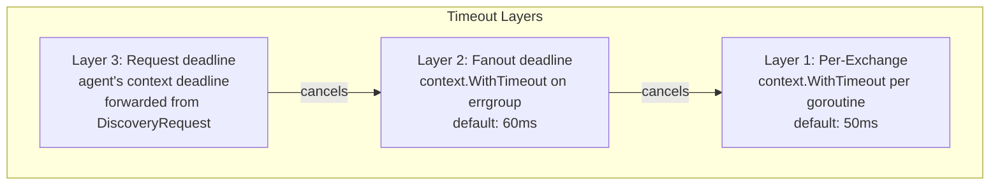
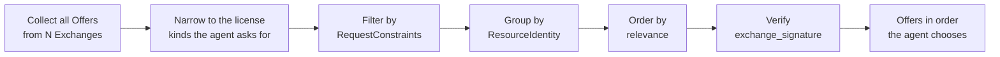
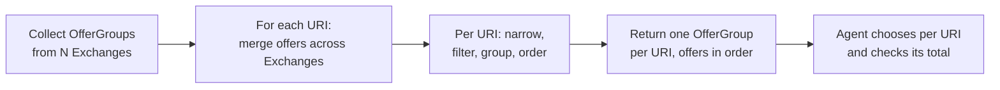
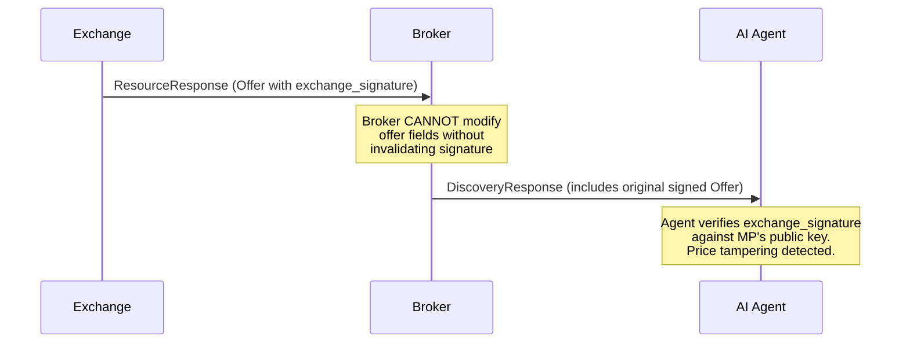

## Purpose

The Selection Engine turns the offers that Exchanges return into the answer the agent gets. It collects the offers, narrows them to the constraints the agent set, groups offers for the same content, and puts them in the Broker's order of relevance to the request.

The Selection Engine does not choose for the agent. The agent decides what it buys, where and why. Each offer reaches the agent as a full package, with its terms, brand, attestations and price, exactly as its Exchange signed it, and the Broker can't change one. The Broker's rules for its order are public, so an agent can inspect why each offer is where it is.

The Broker is a convenience layer. It never buys or resells under an account of its own: when the agent buys through it, each Exchange charges the agent's account.

### Discovery-Mode Agnostic

The Selection Engine operates on offers, not on how those offers were discovered. Whether the agent sent specific URIs (`DiscoveryRequest.uris`), structured search filters (`DiscoveryRequest.search_filters`), or a natural-language query (`DiscoveryRequest.query`), the Broker resolves all three into a set of offers from Exchanges. The Selection Engine then applies the same pipeline -- filter, group, order, verify -- to every offer identically.

This means the selection logic does not need to know or care about discovery mode. An offer discovered via structured search is treated the same as an offer from a specific URI request. The `OfferGroup.discovery_method` field records how each offer was found (for transparency and logging), but it does not influence the order.

## Multi-Exchange Query Fanout

The core value proposition of the Broker is parallel supply discovery. The Broker fans out `DiscoverResources` to N Exchanges concurrently, collecting their offers for the agent.

### Concurrency Model

Uses `errgroup.Group` with a semaphore for bounded concurrency and `context.WithTimeout` for per-Exchange deadlines. When the `DiscoveryRequest` contains multiple URIs, the Broker sends all URIs in a single `ResourceQuery` to each Exchange (not one query per URI). The Exchange returns `OfferGroups` -- one per URI -- so the Broker knows which offers map to which content.

```go
func (d *Discovery) FanOut(
    ctx context.Context,
    exchanges []ExchangeEntry,
    req *forav1.DiscoveryRequest,
) []FanOutResult {

    // Hard deadline: don't wait longer than this for any Exchange.
    ctx, cancel := context.WithTimeout(ctx, d.fanoutTimeout) // default: 60ms (p99 target)
    defer cancel()

    results := make([]FanOutResult, len(exchanges))
    g, gctx := errgroup.WithContext(ctx)
    g.SetLimit(d.maxConcurrency) // default: 20

    for i, mp := range exchanges {
        i, mp := i, mp
        g.Go(func() error {
            query := toResourceQuery(req, mp) // includes all req.Uris
            start := time.Now()

            resp, err := d.clients[mp.Domain].DiscoverResources(gctx, connect.NewRequest(query))

            results[i] = FanOutResult{
                Exchange: mp,
                Response:    resp,
                Err:         err,
                Latency:     time.Since(start),
            }

            // Don't return error -- we want partial results, not all-or-nothing.
            return nil
        })
    }

    g.Wait()
    return results
}
```

### Time Budget in ResourceQuery

`ResourceQuery` carries an optional `deadline` field (default: 500ms). This informs the Exchange how much time the agent has allocated for the entire discovery phase. Exchanges SHOULD prioritize speed when the deadline is tight.

```go
func (d *Discovery) perExchangeDeadline(mp ExchangeEntry, requestDeadline time.Duration) time.Duration {
    p99 := d.latencyTracker.P99(mp.Domain)
    if p99 == 0 {
        return requestDeadline // no history, use full budget
    }
    // Allow 2x historical p99, capped at request deadline
    budget := min(p99*2, requestDeadline)
    return budget
}
```

### Timeout Handling

Three timeout layers, each independently enforced:



| Layer | Default | Purpose |
|---|---|---|
| Per-Exchange | 50ms | Individual slow Exchange doesn't block others |
| Fanout deadline | 60ms | Overall discovery phase has a hard cap |
| Request deadline | From agent's context | Agent controls the total request timeout |

**Partial results are normal.** If 3 of 5 Exchanges respond within the deadline, the Broker proceeds with 3 responses. Timed-out Exchanges are recorded in metrics and their health status is degraded.

### Client Pool

Pre-established HTTP/2 connections to each Exchange. Connect-Go clients are created at startup and reused.

```go
type ClientPool struct {
    mu      sync.RWMutex
    clients map[string]forav1connect.ExchangeServiceClient
    signer  helpers.Signer // the Broker's own request-signing key
}

func (p *ClientPool) GetOrCreate(mp ExchangeEntry) forav1connect.ExchangeServiceClient {
    p.mu.RLock()
    if c, ok := p.clients[mp.Domain]; ok {
        p.mu.RUnlock()
        return c
    }
    p.mu.RUnlock()

    p.mu.Lock()
    defer p.mu.Unlock()

    // Double-check after acquiring write lock.
    if c, ok := p.clients[mp.Domain]; ok {
        return c
    }

    base := &http.Transport{
        MaxIdleConnsPerHost: 10,
        IdleConnTimeout:     90 * time.Second,
        ForceAttemptHTTP2:   true,
        TLSClientConfig:     &tls.Config{MinVersion: tls.VersionTLS13},
    }
    httpClient := &http.Client{
        // The Broker signs every request it sends alone, naming its own key
        // directory in its Signature-Agent member.
        Transport: core.NewSigningTransport(p.signer, base,
            core.WithSignatureAgent("https://broker.example")),
        Timeout: 5 * time.Second, // connection-level timeout
    }

    client := forav1connect.NewExchangeServiceClient(httpClient, mp.Endpoint)
    p.clients[mp.Domain] = client
    return client
}
```

## Selection Pipeline

### Single-URI Pipeline

For single-URI queries, five stages are executed sequentially on the combined offer set:



### Multi-URI Batch Pipeline

For multi-URI batch queries, the engine runs the same pipeline for each URI and returns the ordered offers for every URI. The agent chooses an offer per URI and checks the total against its own budget.



The batch algorithm:

1. For each URI, collect offers from all Exchange responses (flatten OfferGroups with matching URI).
2. Within each URI, run the single-URI pipeline (narrow, filter, group, order, verify).
3. Return one `OfferGroup` per URI, with its offers in the Broker's order. A URI whose offers the budget drops entirely is answered with `OFFER_ABSENCE_REASON_BUDGET_EXCEEDED` on its `OfferGroup`.
4. `Resolve` is discovery only: it charges nothing. The agent chooses the offers it buys and buys them in a separate call.

### Selection Interface

```go
type SelectionEngine interface {
    // Select handles single-URI queries. Returns the offers in this Broker's
    // order of relevance. The agent chooses among them.
    Select(
        ctx context.Context,
        responses []FanOutResult,
        req *forav1.DiscoveryRequest,
        budget BudgetTracker,
    ) (*Selection, error)

    // SelectBatch handles multi-URI queries. Returns the ordered offers for
    // each URI, in request order.
    SelectBatch(
        ctx context.Context,
        responses []FanOutResult,
        req *forav1.DiscoveryRequest,
        budget BudgetTracker,
    ) (*BatchSelection, error)
}

type Selection struct {
    URI       string
    Offers    []OrderedOffer // most relevant first
    Rationale SelectionRationale
}

type OrderedOffer struct {
    Exchange ExchangeEntry
    Offer    *forav1.Offer // unchanged, as the Exchange signed it
    Score    float64
}

type BatchSelection struct {
    Selections []Selection // one per URI, in request order
    Rationale  BatchSelectionRationale
}

type SelectionRationale struct {
    TotalOffers       int
    WithinAcceptable  int // offers inside the agent's acceptable_restrictions
    AfterConstraints  int
    SameContentGroups int // content groups with offers from more than one Exchange
    RejectedReasons   map[string]int // reason -> count
}
```

## Stage 1: Narrow to the License Kinds the Agent Asks For

Restrictions ride on the offer. Each offer's single `terms[0]` entry is a `LicenseTerm` carrying `repeated Restriction` (with kinds like `RESTRICTION_KIND_FUNCTION`, `RESTRICTION_KIND_GEOGRAPHY`, `RESTRICTION_KIND_USER_TYPE`). A resource licensed in two ways is two offers, one per term.

The agent states the kinds of license it asks for in `DiscoveryRequest.acceptable_restrictions`, per restriction axis, and the Broker forwards them to each Exchange in `ResourceQuery.acceptable_restrictions`. As a convenience, an Exchange or a Broker MAY drop offers whose restrictions fall outside those limits (see [Term semantics](/protocol/licensing-terms/#term-semantics)). A URI left with no offer is answered with `OFFER_ABSENCE_REASON_RESTRICTION_FILTERED`, with the filtered axes in `OfferGroup.restriction_filters`. When the agent states no `acceptable_restrictions`, the Broker drops no offer on this ground.

This narrowing is advisory, not enforcement. The Broker surfaces the restrictions carried on each offer's own term, and the agent chooses the offer whose restrictions it can honour and is responsible for complying with them. Real enforcement happens downstream at accept -> report -> reconcile. The function-token vocabulary is the hyphenated string form (`ai-train`, `ai-index`, `ai-input`, `crawl`, `search`, ...).

```go
// withinAcceptable reports whether an offer's term fits the functions the agent
// stated in acceptable_restrictions. Only the FUNCTION axis is shown here. When
// the agent stated no limits, every offer fits.
func withinAcceptable(offer *forav1.Offer, acceptable []*forav1.AcceptableRestriction) bool {
    for _, a := range acceptable {
        if a.Axis != forav1.RestrictionKind_RESTRICTION_KIND_FUNCTION {
            continue // geography / user-type evaluated the same way, or left to the agent
        }
        for _, use := range a.Values {
            if !restrictionsHonoured(offer.Terms[0].Restrictions, use) {
                return false
            }
        }
    }
    return true
}

func restrictionsHonoured(restrictions []*forav1.Restriction, declaredFunction string) bool {
    for _, r := range restrictions {
        if r.Kind != forav1.RestrictionKind_RESTRICTION_KIND_FUNCTION {
            continue // geography / user-type evaluated by the agent against its own context
        }
        // If prohibited contains the declared function, this term cannot be honoured.
        for _, prohibited := range r.Prohibited {
            if prohibited == declaredFunction {
                return false
            }
        }
        // If permitted is non-empty, the declared function must be in it.
        if len(r.Permitted) > 0 {
            found := false
            for _, perm := range r.Permitted {
                if perm == declaredFunction {
                    found = true
                    break
                }
            }
            if !found {
                return false
            }
        }
    }
    return true
}
```

## Stage 2: Filter by RequestConstraints

The agent's `DiscoveryRequest.constraints` specifies budget and preference limits. These are the agent's own limits: a price cap or a budget is a constraint the agent sets, and the Broker applies it as a filter, not as an order.

```go
func filterByConstraints(offers []rankedOffer, c *forav1.RequestConstraints, budget BudgetTracker) []rankedOffer {
    var passed []rankedOffer
    for _, o := range offers {
        p := o.Offer.Pricing

        // The price this Broker counts against the budget. Which price that is
        // is the Broker's own choice; the protocol does not specify it.
        price := budgetPrice(p)

        // max_price: drop offers above it
        if c.MaxPrice != nil && price > c.MaxPrice.Amount {
            continue
        }

        // max_unit_cost: reject offers with unit_cost above threshold
        if c.MaxUnitCost != nil && p.UnitCost != nil && *p.UnitCost > *c.MaxUnitCost {
            continue
        }

        // reporting_capable: if agent can't report, skip offers that require it
        if c.ReportingCapable != nil && !*c.ReportingCapable {
            if o.Offer.Reporting != nil && o.Offer.Reporting.Required {
                continue
            }
        }

        // delivery_preference: filter by supported delivery methods
        if len(c.DeliveryPreference) > 0 {
            if !deliveryMethodAccepted(o.Offer.DeliveryMethod, c.DeliveryPreference) {
                continue
            }
        }

        // Period and session budget: drop the offer if buying it would take the
        // spend past the budget. This filter reserves nothing.
        if !budget.CanAfford(price, p.Currency) {
            continue
        }

        passed = append(passed, o)
    }
    return passed
}
```

When the budget drops every offer for a URI, that URI is answered with `OFFER_ABSENCE_REASON_BUDGET_EXCEEDED`, a successful "no result". A budget is never reported as `OFFER_ABSENCE_REASON_NOT_AUTHORIZED`, and never as an error such as `RESOURCE_EXHAUSTED`.

## Stage 3: Group by ResourceIdentity

The same article may be offered by multiple Exchanges (e.g., an AP wire story available from Exchange A and Exchange B). The Broker groups these offers by resource identity and keeps every one of them. The agent sees each offer as a full package, in the Broker's order of relevance, and decides which one it buys. The Broker never keeps one offer of a group and drops the others.

```go
// contentIdentityKey produces a deduplication key from layered identity fields.
// Matching priority: iptc_guid > doi > content_hash > canonical_url
func contentIdentityKey(id *forav1.ResourceIdentity) string {
    if id == nil {
        return uuid.NewString() // no identity = unique (no dedup)
    }
    if id.IptcGuid != nil && *id.IptcGuid != "" {
        return "iptc:" + *id.IptcGuid
    }
    if id.Doi != nil && *id.Doi != "" {
        return "doi:" + *id.Doi
    }
    if id.ContentHash != nil && *id.ContentHash != "" {
        return "hash:" + *id.ContentHash
    }
    if id.CanonicalUrl != nil && *id.CanonicalUrl != "" {
        return "url:" + *id.CanonicalUrl
    }
    return uuid.NewString()
}
```

For the full deduplication logic, see the [Content Deduplication](/components/broker/content-dedup/) page.

## Stage 4: Order by Relevance

After grouping, the Broker puts the offers for each URI in its order of relevance to the agent's request. Relevance is the Broker's judgement of how well an offer answers the request, and the Broker's rules for it are public. The default engine draws on these signals:

1. **Match to the request.** How well the resource answers the agent's `uris`, `query` or `search_filters`. For a request in words, this is the search backend's order.

2. **The agent's preferred Exchanges.** The agent names the Exchanges it has relationships with, such as subscriptions or contracts, in `RequestConstraints.preferred_exchanges`. The Broker SHOULD put their offers first when they have the resource.

3. **Content attestation level (v1.0).** Level 2 (third-party attested) > Level 1 (self-attested) > Level 0 (no attestation). Offers with `ResourceAttestation` entries from trusted verification vendors carry independently verifiable claims about the content.

4. **Exchange track record.** Exchanges that consistently deliver accurate, well-structured content, and whose `estimated_quantity` values have proven accurate, rank higher.

Price is not a signal. The agent compares prices itself: each offer carries its price, and `Pricing.unit_cost` normalizes it to a cost per unit, so an agent can compare offers across Exchanges and pricing models by its own policy.

```go
// rankOffers puts the offers for one URI in this Broker's order of relevance.
// Price is not an input: the agent compares prices itself.
func (e *defaultEngine) rankOffers(offers []rankedOffer, req *forav1.DiscoveryRequest) []rankedOffer {
    for i := range offers {
        score := 0.0

        // How well the resource answers the request: the search backend's
        // score for a request in words, equal for every offer on a named URI.
        score += e.matchScore(offers[i], req) * 1000.0

        // Exchanges the agent named, such as those it holds subscriptions with.
        if isPreferred(offers[i].Exchange.Domain, req.GetConstraints().GetPreferredExchanges()) {
            score += 500.0
        }

        // Content attestation level (v1.0)
        // Level 2 (third-party) > Level 1 (self-attested) > Level 0 (none)
        score += float64(attestationLevel(offers[i].Offer)) * 100.0

        // Exchange track record: accurate content and estimated_quantity (historical)
        score += e.exchangeRecord.Score(offers[i].Exchange.Domain) * 50.0

        offers[i].Score = score
    }

    // Stable sort: offers with equal scores keep the order the Exchanges returned.
    sort.SliceStable(offers, func(i, j int) bool {
        return offers[i].Score > offers[j].Score // descending: most relevant first
    })
    return offers
}
```

## Stage 5: Verify exchange_signature

The Broker SHOULD verify `exchange_signature` on every Offer before it returns it, and drops an offer whose signature fails. This prevents an Exchange from tampering with its own offer fields after signing.

```go
func verifyOfferSignature(offer *forav1.Offer, exchange string, pubKeys map[string]ed25519.PublicKey) error {
    if offer.Signature == "" {
        return fmt.Errorf("offer signature is required but empty")
    }

    key, ok := pubKeys[exchange]
    if !ok {
        return fmt.Errorf("no public key for exchange %q", exchange)
    }

    return helpers.VerifyOffer(offer, offer.Signature, key)
}
```

## Pluggable Selection Policies

The default policy orders offers by relevance, as described above. A Broker can plug in another policy for how it orders offers, and publishes its rules either way:

```go
type SelectionPolicy interface {
    // Rank puts offers in this Broker's order of relevance. Index 0 is the
    // offer it judges most relevant; the agent chooses among all of them.
    Rank(offers []rankedOffer, req *forav1.DiscoveryRequest) []rankedOffer
}

// Built-in policies
type RelevancePolicy struct{}         // Default: match, preferred Exchanges, attestation, track record
type PreferredExchangePolicy struct{} // The agent's preferred Exchanges first, then relevance
type FreshnessWeightedPolicy struct{} // Newer content first, weighted against relevance
type QualityScorePolicy struct{}      // Exchange reputation scores
```

No policy orders offers by price. The policy is set at Broker construction time, not per-request. Per-request behavior is controlled through `acceptable_restrictions` and `RequestConstraints`.

## Exchange Authorization Verification

Before it returns an offer, the Broker SHOULD verify that the Exchange is authorized by the provider whose content is being licensed. This is the FORA equivalent of ads.txt verification in programmatic advertising.

```go
func (o *Broker) verifyExchangeAuthorization(
    ctx context.Context,
    contentDomain string,
    exchangeDomain string,
) (bool, error) {
    manifest, err := o.parseJSONCache.Get(ctx, contentDomain)
    if err != nil {
        return false, fmt.Errorf("fetching fora.json for %s: %w", contentDomain, err)
    }
    for _, authorized := range manifest.AuthorizedExchanges {
        if authorized.Domain == exchangeDomain {
            return true, nil
        }
    }
    return false, nil // Exchange not authorized by provider
}
```

This check runs before the Broker returns the offers. The Broker drops an offer whose Exchange the provider has not authorized. It never puts another offer in place of one the agent chose, and can't: the agent's acceptance signs the offer it chose.

## Selection Rationale Logging

Every answer is logged with the order the Broker returned and the reasons for it, for audit:

```go
type SelectionLog struct {
    // Broker-internal audit key correlating this decision to the inbound request.
    // Request/response correlation rides the X-Request-ID HTTP header, not a message field.
    FORARequestID      string         `json:"fora_request_id"`
    Timestamp          time.Time      `json:"timestamp"`
    ExchangesQueried   []string       `json:"exchanges_queried"`
    ExchangesResponded []string       `json:"exchanges_responded"`
    TotalOffers        int            `json:"total_offers"`
    FilteredOffers     int            `json:"filtered_offers"`
    SameContentGroups  int            `json:"same_content_groups"`
    Order              []OrderEntry   `json:"order"`
    RejectionReasons   map[string]int `json:"rejection_reasons"`
    SelectionPolicy    string         `json:"selection_policy"`
    LatencyMs          int64          `json:"latency_ms"`
}

// OrderEntry records one returned offer: where it stood and why.
type OrderEntry struct {
    URI      string             `json:"uri"`
    OfferID  string             `json:"offer_id"`
    Exchange string             `json:"exchange"`
    Position int                `json:"position"`
    Score    float64            `json:"score"`
    Signals  map[string]float64 `json:"signals"` // each signal's share of the score
}
```

## Transparency and Auditability

The Broker is an intermediary. FORA addresses transparency through:

### Signed Offer Pass-Through

The Exchange signs the Offer using its private key. The Broker passes the signed offer through to the agent. **The Broker cannot inflate prices** because the Exchange's signature covers the pricing fields.



### Fee Disclosure

`DiscoveryResponse` carries the signed Offers unchanged (one `OfferGroup` per requested URI); it has no `broker_fee` field, so the Broker cannot fold a fee into the discovery result. Any Broker fee is additive and disclosed out of band, never hidden in the offer price — the Exchange's signature over the Offer's pricing fields makes silent inflation detectable. The agent sees: Exchange price + Broker fee = total cost.

### Audit Trail

For full auditability, the agent operator should:

1. **Verify offer signatures** on every DiscoveryResponse
2. **Retain selection logs**, which record the order the Broker returned and the signals behind it, and check them against the Broker's published rules
3. **Spot-check by going direct** -- query Exchanges directly to verify the Broker isn't hiding offers
