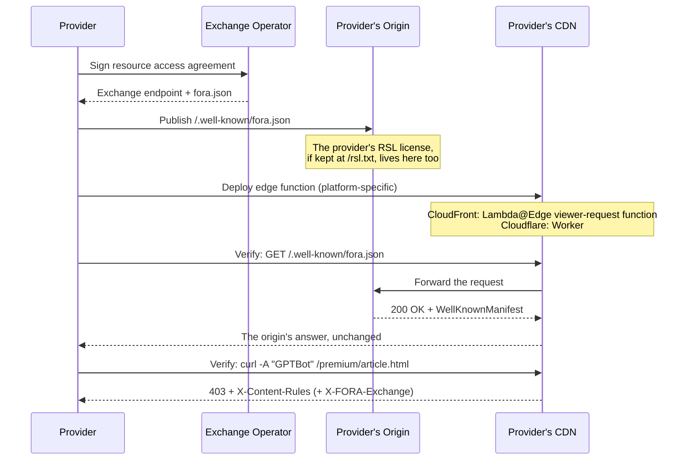

The Edge Function is the only FORA component that providers deploy. This page covers the deployment model, configuration, secrets management, and onboarding procedure.

## Provider Onboarding Flow



Where the Exchange operator runs a publisher console, the console generates the file and the edge package for the provider: see [Publisher Onboarding](/getting-started/publisher-onboarding/).

## Simplest Possible Onboarding

The absolute minimum a provider needs to do:

1. **Get an Exchange endpoint** from their Exchange operator (one-time business relationship).
2. **Publish `fora.json`** on their own origin, at `/.well-known/fora.json`.
3. **Deploy the edge function** from the package the Exchange operator's console builds, or with a Terraform module (see [Distribution Formats](#distribution-formats)).
4. **Verify** -- `curl -I https://news.example.com/.well-known/fora.json` returns the origin's file through the edge function.

## Distribution Formats

The edge function is the edge worker in the reference implementation, [`src/edge`](https://github.com/FORA-Protocol/reference-implementation/tree/v1.1.0/src/edge). It runs on Cloudflare Workers and AWS Lambda@Edge. The reference implementation also has a Fastly Compute entry point, `src/entries/fastly.ts`, which its tests run locally under Viceroy. The edge worker reaches a provider's CDN in one of two formats.

### Format 1: Console Package

The Exchange operator's publisher console builds a package for the provider's domain, with the provider's settings in it: a Worker for Cloudflare, or a Lambda@Edge function for CloudFront. [Publisher Onboarding](/getting-started/publisher-onboarding/#install-the-package-on-your-cdn) gives the steps to install it.

### Format 2: Terraform Modules

The reference implementation's Terraform modules deploy the edge worker to the provider's own CDN account. They are in [`deploy/terraform/modules/`](https://github.com/FORA-Protocol/reference-implementation/tree/v1.1.0/deploy/terraform/modules) at release `v1.1.0`, and the examples below pin their `source` to that tag.

Each module deploys a bundle that you build first, from a checkout of the reference implementation. The build needs Node.js, npm, git, and either `uv` or a `python3` that can import `cryptography`. Neither module builds the bundle, and each fails the plan if the bundle is missing.

#### CloudFront

The [`aws-cloudfront-edge`](https://github.com/FORA-Protocol/reference-implementation/blob/v1.1.0/deploy/terraform/modules/aws-cloudfront-edge/README.md) module creates a CloudFront distribution in front of your origin, with the edge worker as its Lambda@Edge viewer-request function and an ACM certificate for your hostname. The distribution caches nothing: it uses CloudFront's `Managed-CachingDisabled` cache policy. The hostname's DNS must be in a Route 53 hosted zone, because the module validates the certificate with a record in that zone; `zone_id` is the zone that serves the hostname. The module creates no DNS record for the hostname itself. The [`route53-dns`](https://github.com/FORA-Protocol/reference-implementation/tree/v1.1.0/deploy/terraform/modules/route53-dns) module points the hostname at the distribution.

Lambda@Edge has no environment variables, so the edge worker's settings go inside the bundle. Write them to a JSON file, then build the bundle for the hostname the function serves. The build also needs `zip`.

```bash
git clone --branch v1.1.0 https://github.com/FORA-Protocol/reference-implementation.git
cd reference-implementation
cat > lambda-edge-config.json <<'EOF'
{
  "EXCHANGE_URL": "https://exchange.example.net",
  "EXCHANGE_WBA_URL": "https://exchange.example.net/.well-known/http-message-signatures-directory",
  "LICENSED_PATHS_JSON": "[\"/premium/\", \"/archive/\"]"
}
EOF
deploy/terraform/scripts/build-lambda-edge.sh lambda-edge-config.json news.example.com
```

The script writes `src/edge/dist/lambda-edge.zip` in the checkout. Every value in the settings file is a string. [`CONFIGURATION.md`](https://github.com/FORA-Protocol/reference-implementation/blob/v1.1.0/src/edge/CONFIGURATION.md) lists the settings. After a change to the settings, build the bundle again and apply again: the function runs what is in the zip.

Then write the Terraform configuration in the directory that holds the checkout:

```hcl
provider "aws" {
  region = "us-east-1" # Lambda@Edge and the CloudFront certificate live here
}

data "aws_route53_zone" "site" {
  name = "example.com"
}

module "fora_edge" {
  source = "github.com/FORA-Protocol/reference-implementation//deploy/terraform/modules/aws-cloudfront-edge?ref=v1.1.0"

  lambda_zip_path = "${path.root}/reference-implementation/src/edge/dist/lambda-edge.zip"
  hostname        = "news.example.com"
  zone_id         = data.aws_route53_zone.site.zone_id
  origin_domain   = "origin.example.com"
}

module "fora_dns" {
  source = "github.com/FORA-Protocol/reference-implementation//deploy/terraform/modules/route53-dns?ref=v1.1.0"

  zone_id   = data.aws_route53_zone.site.zone_id
  a_records = {}
  alias_records = {
    news = {
      target_domain  = module.fora_edge.distribution_domain_name
      target_zone_id = module.fora_edge.distribution_hosted_zone_id
    }
  }
}
```

The module needs an AWS provider in `us-east-1`, because Lambda@Edge functions and the certificate CloudFront serves are created there. With any other region, the plan fails. If your configuration's default AWS provider is in another region, declare a second provider with `alias = "us_east_1"` and `region = "us-east-1"`, and pass it to the module with `providers = { aws = aws.us_east_1 }`.

`origin_domain` is the host CloudFront fetches content from, and it must serve TLS for its own name. The module README describes the two optional inputs, `name_prefix` and `price_class`, and the outputs.

The module always creates a new distribution. To run the edge worker on a distribution you already have, create the function from the same zip and attach it, as the [AWS CloudFront steps](/getting-started/publisher-onboarding/#aws-cloudfront) in Publisher Onboarding describe.

#### Cloudflare

The [`cloudflare-edge`](https://github.com/FORA-Protocol/reference-implementation/blob/v1.1.0/deploy/terraform/modules/cloudflare-edge/README.md) module uploads the edge worker as a Worker and creates its routes. The Worker's settings are module inputs, so the bundle needs none. Build it:

```bash
git clone --branch v1.1.0 https://github.com/FORA-Protocol/reference-implementation.git
reference-implementation/deploy/terraform/scripts/build-cloudflare-edge.sh
```

The script writes `src/edge/dist/worker.mjs` in the checkout. Then write the Terraform configuration in the directory that holds the checkout:

```hcl
terraform {
  required_providers {
    cloudflare = {
      source  = "cloudflare/cloudflare"
      version = "~> 4.52"
    }
  }
}

provider "cloudflare" {} # reads the API token from CLOUDFLARE_API_TOKEN

data "cloudflare_zone" "site" {
  name = "example.com"
}

module "fora_edge" {
  source = "github.com/FORA-Protocol/reference-implementation//deploy/terraform/modules/cloudflare-edge?ref=v1.1.0"

  account_id         = data.cloudflare_zone.site.account_id
  zone_id            = data.cloudflare_zone.site.id
  worker_bundle_path = "${path.root}/reference-implementation/src/edge/dist/worker.mjs"
  route_patterns     = ["news.example.com/*"]

  exchange_url        = "https://exchange.example.net"
  exchange_wba_url    = "https://exchange.example.net/.well-known/http-message-signatures-directory"
  same_zone_origin    = "true"
  licensed_paths_json = jsonencode(["/premium/", "/archive/"])
}
```

Every hostname in `route_patterns` needs a proxied DNS record on the zone, or the Worker never runs for it. The example assumes `news.example.com` already has one.

The module requires an origin mode. `same_zone_origin = "true"` sends the requests the Worker lets through on to the origin that the hostname's existing proxied record routes to. To send them to another host, set `origin_url` to its URL instead.

If the hostname has no DNS record yet, set `worker_hostname` to it. The module then creates a proxied placeholder record, `AAAA 100::`, which has no origin behind it. With that record, set `origin_url`, not `same_zone_origin`.

Cloudflare's zone protections, such as WAF managed rules and Bot Fight Mode, run before the Worker. The module README describes how to exempt the Worker's hostnames. The module's [`variables.tf`](https://github.com/FORA-Protocol/reference-implementation/blob/v1.1.0/deploy/terraform/modules/cloudflare-edge/variables.tf) lists every input. The reference implementation also has a ready-made root configuration for this module, [`deploy/terraform/stacks/edge`](https://github.com/FORA-Protocol/reference-implementation/tree/v1.1.0/deploy/terraform/stacks/edge), with a [step-by-step guide](https://github.com/FORA-Protocol/reference-implementation/blob/v1.1.0/deploy/terraform/docs/deploy-edge-standalone.md).

## Environment Configuration

### What the Edge Function Needs to Know

The edge worker reads a flat set of string settings. On Cloudflare Workers they are the Worker's variables, which the `cloudflare-edge` module sets from its inputs. On Lambda@Edge they are the JSON file built into the bundle. The worker reads no KV store and stores nothing of its own. [`CONFIGURATION.md`](https://github.com/FORA-Protocol/reference-implementation/blob/v1.1.0/src/edge/CONFIGURATION.md) describes every setting, its default and what happens when it is wrong.

- `EXCHANGE_URL` (required): the Exchange's base URL. The worker never calls it. Its only effect is that the worker sends it as `X-FORA-Exchange` on a refusal.
- `EXCHANGE_WBA_URL` (required): the Exchange's key directory, which the worker fetches to verify signed URLs.
- `ORIGIN_URL` or `SAME_ZONE_ORIGIN` (one of the two, on Cloudflare): where the worker sends the requests it lets through. On CloudFront, neither is set, and CloudFront fetches the origin itself.
- `FORA_VERIFY_KEYS` (optional): pinned Exchange public keys, which skip the directory fetch.
- `LICENSED_PATHS_JSON` (optional): the path prefixes the provider licenses. Unset means the whole site.
- `BOT_UA_ALLOW_JSON` and `BOT_UA_DENY_JSON` (optional): replace the built-in lists of search crawlers and AI bots.
- `FORA_ENFORCE_BINDING` (optional): `"false"` turns off the agent-binding check. Unset means the check runs.
- `WBA_KEYS_JSON`, `WBA_REVOCATION_URL` and `WBA_SIGNED_DIRECTORY_JSON` (optional): the provider's own key directory, for a provider that self-attests.

### Discovery Headers on the 403

The edge function's refusal of an unlicensed bot carries the two FORA edge discovery headers. Neither header carries the Exchange endpoint URL.

| Header | Value | Built from |
|---|---|---|
| `X-Content-Rules` | `https://news.example.com/.well-known/fora.json` | The host of the refused request. It is the URL of the provider's own manifest, which the provider serves from its origin, never an Exchange URL. |
| `X-FORA-Exchange` | `exchange.example.net` | The Exchange domain, as a bare domain in the form of `Offer.exchange`. Send it only for an Exchange the provider's manifest lists, and only together with `X-Content-Rules`. |

An agent that receives `X-FORA-Exchange` resolves the Exchange's endpoint from the Exchange's own `/.well-known/fora.json`, and treats the provider's manifest as the authority on which Exchanges sell the content. See [Edge discovery headers](/protocol/discovery-paths/#edge-discovery-headers) for the rules.

## Secrets Management

The edge function holds no secret. It verifies signed URLs with the Exchange's public keys, fetched from the key directory or pinned in `FORA_VERIFY_KEYS`, so every setting is plain configuration and none needs a secret store.

### Platform-Specific Wrangler Deployment (Cloudflare)

To deploy the Cloudflare Worker with Wrangler instead of Terraform, set its routes and variables in `src/edge/wrangler.toml`, in an environment block such as `[env.production]`. With `SAME_ZONE_ORIGIN`, that block also sets `workers_dev = false`, because same-zone forwarding works only on a zone route. Then deploy from a checkout of the reference implementation:

```bash
cd src/edge
npm ci

# Local development
npx wrangler dev

# Deploy the environment block you filled in
npx wrangler deploy --env production
```

[`DEPLOYMENT.md`](https://github.com/FORA-Protocol/reference-implementation/blob/v1.1.0/src/edge/DEPLOYMENT.md) walks through each step, including the zone settings Wrangler does not change.

### CDN-Specific Deployment Commands

| CDN | Deploy Command |
|---|---|
| Cloudflare | `npx wrangler deploy --env production` from `src/edge`, or the `cloudflare-edge` module |
| CloudFront | `terraform apply` with the `aws-cloudfront-edge` module |

## The Provider's Own Documents

`/.well-known/fora.json` and `/rsl.txt` are files on the provider's origin. The edge function forwards both addresses there for every client, ahead of all its checks, and has no setting for either: see [fora.json and rsl.txt Pass-Through](/components/edge-function/overview/#forajson-and-rsltxt-pass-through). The origin's `Cache-Control` reaches the agent unchanged, so the provider decides how long a document may be cached, and a change to either file takes effect without redeploying anything.

## Preventing Edge Function Bypass

The edge function is only effective if all requests to protected content pass through it. Bypass vectors and mitigations:

| Bypass Vector | Mitigation |
|---|---|
| Direct origin access (skipping CDN) | Origin should only accept requests from CDN IPs. Use origin shield, security groups, or origin access identity (CloudFront OAI/OAC). |
| Alternate domain pointing to same origin | All domains serving protected content must have the edge function deployed. |
| CDN cache serving content without re-verification | The edge function runs before the cache. On CloudFront it runs at viewer-request, which also runs on cache hits. On Cloudflare the Worker runs before the zone's cache. |
| Agent using a different path to the same content (URL alias) | `LICENSED_PATHS_JSON` must cover every path that serves the content. Unset, it covers the whole site. |

## Verification Procedure

After deployment, verify with these checks:

1. `GET /.well-known/fora.json` with bot User-Agent returns the origin's file with `200 OK`. A `404` means the site has no file at that address. A `403` means something on the site refuses AI agents there, and they have to be let through.
2. `GET /rsl.txt` with bot User-Agent returns the origin's answer: valid RSL content with `200 OK`, or the origin's `404` if the provider keeps no RSL license there.
3. `GET /premium/article.html` with bot User-Agent returns `403` with `X-Content-Rules` set to the provider's own `https://<domain>/.well-known/fora.json`, and, when configured, `X-FORA-Exchange` set to the bare domain of an Exchange that manifest lists (for example `exchange.example.net`, not a URL).
4. `GET /premium/article.html` with valid signed URL returns `200`.
5. `GET /premium/article.html` with expired signed URL returns `403`.
6. `GET /premium/article.html` with tampered signed URL returns `403`.
7. With `LICENSED_PATHS_JSON` set and leaving `/free/` out, `GET /free/article.html` with bot User-Agent returns `200` (open content).
