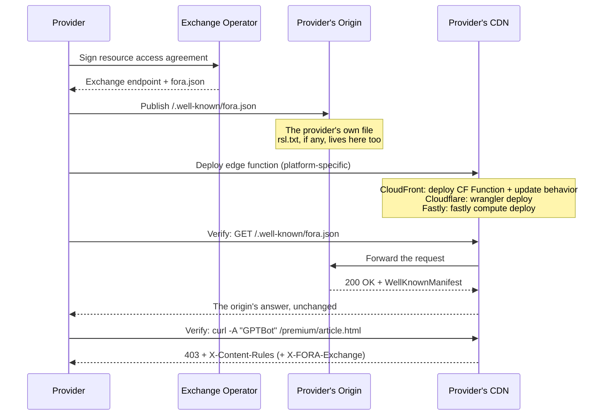
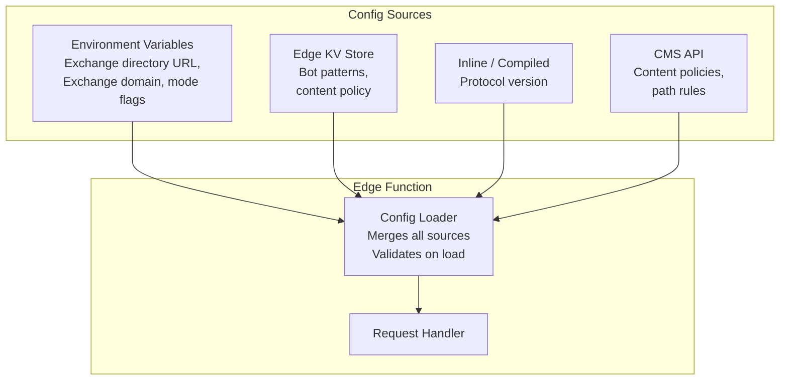

The Edge Function is the only FORA component that providers deploy. This page covers the deployment model, configuration, secrets management, and onboarding procedure.

## Provider Onboarding Flow



Where the Exchange operator runs a publisher console, the console generates the file and the edge package for the provider: see [Publisher Onboarding](/getting-started/publisher-onboarding/).

## Simplest Possible Onboarding

The absolute minimum a provider needs to do:

1. **Get an Exchange endpoint** from their Exchange operator (one-time business relationship).
2. **Publish `fora.json`** on their own origin, at `/.well-known/fora.json`.
3. **Deploy the edge function** using the Terraform module or manual deployment (see below).
4. **Verify** -- `curl -I https://techcrunch.com/.well-known/fora.json` returns the origin's file through the edge function.

import { Aside } from '@astrojs/starlight/components';

<Aside type="tip">
The `@fora/cli` tool is planned. For now, deploy manually using the [Terraform module](https://github.com/FORA-Protocol/protocol/tree/main/terraform/aws-fora-edge/) or follow the CDN-specific deployment steps below.
</Aside>

Target: **under 10 minutes** from Exchange operator contract to live edge function.

## Distribution Formats

The edge function is distributed in multiple formats to match provider deployment practices.

### Format 1: CloudFront Function (Reference Implementation)

The reference implementation is a vanilla JavaScript CloudFront Function that handles bot detection and signed URL verification.

<Aside type="note">
The `@fora/edge-function` npm package is planned. For now, use the reference implementation directly or deploy via the Terraform module.
</Aside>

### Format 2: Terraform Module

```hcl
module "fora_edge" {
  source = "github.com/FORA-Protocol/protocol//terraform/aws-fora-edge"

  cloudfront_distribution_id = aws_cloudfront_distribution.main.id
  exchange_endpoint       = "https://exchange.ssp.com/fora/v1"
  exchange_domain         = "exchange.ssp.com"
  protected_paths            = ["/premium/*", "/archive/*"]
  signing_key_pair_id        = aws_cloudfront_public_key.fora.id
}
```

The Terraform module provisions: CloudFront Function, cache behavior update, trusted key group association, and optional Lambda@Edge + DynamoDB table for single-use enforcement.

### Format 3: CDN Exchange App

For providers who prefer click-to-deploy:

- **Cloudflare Apps** -- installable from Cloudflare dashboard. Provider enters Exchange endpoint, protected paths. The app deploys a Worker.
- **AWS CloudFormation StackSet** -- one-click deploy via AWS Exchange or a shared CloudFormation template.

### Format 4: CLI Tool (Planned)

<Aside type="caution">
The `@fora/cli` tool is planned but not yet available. For now, use the [Terraform module](https://github.com/FORA-Protocol/protocol/tree/main/terraform/aws-fora-edge/) for automated deployment.
</Aside>

When available, the CLI will generate the platform-specific deployment artifact (CloudFront Function JS, Cloudflare Worker, etc.) and output deployment instructions.

## Environment Configuration

### What the Edge Function Needs to Know

| Configuration Item | Source | Change Frequency | Example |
|---|---|---|---|
| Exchange domain | Provider-Exchange contract | Rarely | `exchange.ssp.com` |
| Origin | Deployment config | Rarely | `https://origin.techcrunch.com`, or the CDN's own configured origin |
| Protected path patterns | Provider editorial policy | Monthly | `["/premium/*", "/archive/*"]` |
| Bot User-Agent patterns | FORA community list | Weekly | `["ClaudeBot", "GPTBot", ...]` |
| Exchange key directory | Provider-Exchange contract | Rarely | `https://exchange.example/.well-known/http-message-signatures-directory` |
| Pinned verify keys | Optional; skips the directory fetch | Rarely | `[{"kty":"OKP","crv":"Ed25519",...}]` |
| Max URL TTL | Policy | Rarely | `300` (seconds) |
| Single-use enabled | Policy | Rarely | `true` |
| Agent binding enabled | Policy | Rarely | `false` |

### Discovery Headers on the 403

The edge function's refusal of an unlicensed bot carries the two FORA edge discovery headers. Neither header carries the Exchange endpoint URL.

| Header | Value | Built from |
|---|---|---|
| `X-Content-Rules` | `https://techcrunch.com/.well-known/fora.json` | The host of the refused request. It is the URL of the provider's own manifest, which the provider serves from its origin, never an Exchange URL. |
| `X-FORA-Exchange` | `exchange.ssp.com` | The Exchange domain, as a bare domain in the form of `Offer.exchange`. Send it only for an Exchange the provider's manifest lists, and only together with `X-Content-Rules`. |

An agent that receives `X-FORA-Exchange` resolves the Exchange's endpoint from the Exchange's own `/.well-known/fora.json`, and treats the provider's manifest as the authority on which Exchanges sell the content. See [Edge discovery headers](/protocol/discovery-paths/#edge-discovery-headers) for the rules.

### Configuration Sources



**Merge order** (later overrides earlier):

1. **Inline / compiled defaults** -- protocol version.
2. **Environment variables** -- the Exchange key directory URL, the Exchange domain, mode flags. No secret: the edge holds public keys only.
3. **Edge KV** -- bot patterns (updated frequently), content policy rules.
4. **CMS API** -- dynamic content policy (which paths are newly protected/released). Only fetched if CMS integration is configured. Cached at edge with TTL.

### Configuration Schema

```typescript
/**
 * Complete edge function configuration.
 * Serializable to JSON for storage in KV.
 * Secrets are resolved from environment, not stored here.
 */
interface EdgeConfigDocument {
  /** Config schema version (for forward compatibility). */
  config_version: "1.0";

  /** The X-FORA-Exchange value on a 403: the bare domain of an Exchange the
   * provider's fora.json lists (e.g. "exchange.example"), never a URL. */
  exchange_domain?: string;

  /** Content access policy. */
  content_policy: {
    /** Default policy for paths not matching any rule. */
    default: "open" | "licensed" | "blocked";
    /** Path-specific rules. Evaluated in order, first match wins. */
    rules: Array<{
      /** Glob pattern (e.g. "/premium/*"). */
      pattern: string;
      /** Policy for matching paths. */
      policy: "open" | "licensed" | "blocked";
    }>;
  };

  /** Bot detection configuration. */
  bot_detection: {
    /** User-Agent substrings to match (case-insensitive). */
    user_agent_patterns: string[];
    /** Whether to use CDN-native bot scoring (platform-specific). */
    use_cdn_bot_score: boolean;
    /** CDN bot score threshold (0-100, lower = more likely bot). */
    cdn_bot_score_threshold?: number;
  };

  /** Signed URL verification configuration. */
  signing: {
    /** Exchange key directory the edge resolves `kid` against. */
    exchange_wba_url: string;
    /** Optional pinned public keys; a covering `kid` skips the fetch. */
    verify_keys?: JsonWebKey[];
    /** Whether to enforce agent identity binding. Defaults to true. */
    enforce_binding: boolean;
    /** Whether to enforce single-use URLs (best-effort, see Section 5.3). */
    single_use_enabled: boolean;
  };
}
```

## Secrets Management

- **The edge function holds no secret.** It verifies with a public key, so its signing configuration is a directory URL and, optionally, pinned public keys. Neither is confidential, and both may live in plain configuration or KV.
- Configuration is loaded once at function initialization (cold start), not per-request. Where a deployment does carry a secret for unrelated reasons, it belongs in the platform secret store, never in KV.

### Platform-Specific Wrangler Deployment (Cloudflare)

For Cloudflare Workers, use `wrangler` for deployment:

```bash
# Local development
cd packages/edge-function && npx wrangler dev

# Production deploy
cd packages/edge-function && npx wrangler deploy

# Point the worker at the Exchange key directory
npx wrangler deploy --var EXCHANGE_WBA_URL=https://exchange.example/.well-known/http-message-signatures-directory
```

### CDN-Specific Deployment Commands

| CDN | Deploy Command |
|---|---|
| Cloudflare | `npx wrangler deploy` |
| CloudFront | Deploy CF Function + update behavior via AWS CLI or Terraform |
| Fastly | `fastly compute deploy` |

## The Provider's Own Documents

`/.well-known/fora.json` and `/rsl.txt` are files on the provider's origin. The edge function forwards both addresses there for every client, ahead of all its checks, and has no setting for either: see [fora.json and rsl.txt Pass-Through](/components/edge-function/overview/#forajson-and-rsltxt-pass-through). The origin's `Cache-Control` reaches the agent unchanged, so the provider decides how long a document may be cached, and a change to either file takes effect without redeploying anything.

## Preventing Edge Function Bypass

The edge function is only effective if all requests to protected content pass through it. Bypass vectors and mitigations:

| Bypass Vector | Mitigation |
|---|---|
| Direct origin access (skipping CDN) | Origin should only accept requests from CDN IPs. Use origin shield, security groups, or origin access identity (CloudFront OAI/OAC). |
| Alternate domain pointing to same origin | All domains serving protected content must have the edge function deployed. |
| CDN cache serving stale content without re-verification | Set `Cache-Control: private` or short TTL on protected content. Or use CDN-native signed URL verification which applies to cached responses too. |
| Agent using a different path to the same content (URL alias) | Content policy rules must cover all URL patterns that resolve to protected content. |

## Verification Procedure

After deployment, verify with these checks:

1. `GET /.well-known/fora.json` with bot User-Agent returns the origin's file with `200 OK`. A `404` means the site has no file at that address. A `403` means something on the site refuses AI agents there, and they have to be let through.
2. `GET /rsl.txt` with bot User-Agent returns the origin's answer: valid RSL content with `200 OK`, or the origin's `404` if the provider has no RSL file.
3. `GET /premium/article.html` with bot User-Agent returns `403` with `X-Content-Rules` set to the provider's own `https://<domain>/.well-known/fora.json`, and, when configured, `X-FORA-Exchange` set to the bare domain of an Exchange that manifest lists (for example `exchange.ssp-example.com`, not a URL).
4. `GET /premium/article.html` with valid signed URL returns `200`.
5. `GET /premium/article.html` with expired signed URL returns `403`.
6. `GET /premium/article.html` with tampered signed URL returns `403`.
7. `GET /free/article.html` with bot User-Agent returns `200` (open content).
