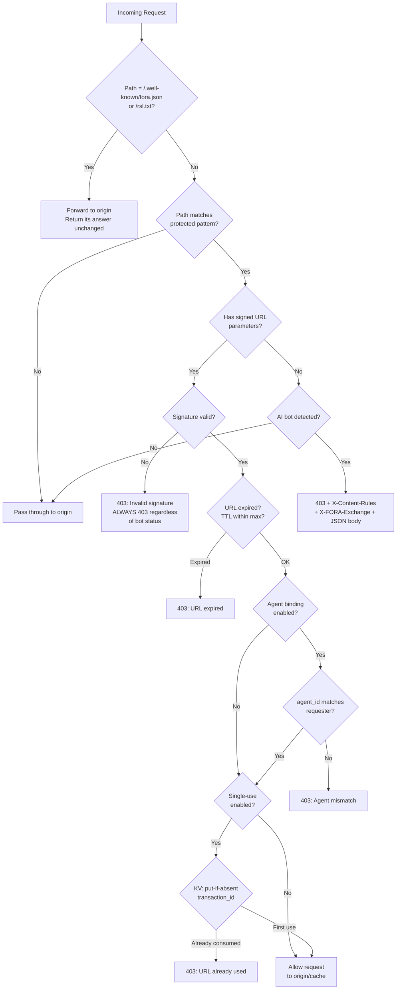

The Edge Function is the provider-side enforcement point of the FORA protocol. It runs on the provider's existing CDN infrastructure and is the only FORA component that providers deploy. Everything else (Exchange, Broker, Client SDK) is deployed by Exchange operators, AI companies, or third parties.

## What It Does

The Edge Function has four jobs:

1. **Block unauthorized bots** -- detect AI crawlers hitting protected content without a signed URL and return `403` with an `X-Content-Rules` header pointing them at the provider's own `fora.json`, and optionally an `X-FORA-Exchange` header naming an Exchange that sells the content.
2. **Verify signed URL access** -- validate that incoming signed URLs are authentic, unexpired, bound to the correct agent identity, and (optionally) single-use.
3. **Pass fora.json and rsl.txt through to the origin** -- forward `/.well-known/fora.json` and `/rsl.txt` to the provider's own origin for every client, ahead of both checks above, so protocol-aware agents discover the Exchange without triggering a 403.
4. **Serve verifier keys via the WBA directory (v1.0)** -- serve the JWK Set at `/.well-known/http-message-signatures-directory` for providers that self-attest resources. This publishes the provider's Ed25519 public keys in its WBA directory (the JWK Set at `/.well-known/http-message-signatures-directory`), with the claims schema in the `fora.json` `ext["fora.attestation.claims_schema"]`, so agents and Exchanges can verify attestation signatures. FORA has no dedicated verifier role; a verifier publishes under its operator's role (`role=ROLE_PUBLISHER` when a publisher self-attests).

## Single Deploy for Providers

The absolute minimum a provider needs to do:

1. **Get an Exchange endpoint** from their Exchange operator (one-time business relationship).
2. **Publish `fora.json`** on their own origin, at `/.well-known/fora.json`.
3. **Deploy the edge function** using the [Terraform module](https://github.com/FORA-Protocol/protocol/tree/main/terraform/aws-fora-edge/).
4. **Verify** -- `curl -I https://example.com/.well-known/fora.json` returns the origin's file through the edge function.

import { Aside } from '@astrojs/starlight/components';

<Aside type="tip">
The `@fora/cli` tool is planned to automate this process. For now, deploy manually -- see [Edge Function Deployment](/components/edge-function/deployment/).
</Aside>

Target: **under 10 minutes** from Exchange operator contract to live edge function.

## Signing Scope

The edge function deals exclusively with **signed URL verification**. It does NOT verify offer signatures. Both subsystems use Ed25519; they differ in which key signs and who verifies:

- **Signed URLs** (Exchange to delivery endpoint): the Exchange signs with the tenant's key; the edge verifies with the published public key, or CloudFront verifies an RSA signature natively.
- **Offer signatures** (Exchange to Agent/Broker): the Exchange signs with its offer key; agents and Brokers verify with the published public key.

One primitive, two audiences. Neither carries a shared secret.

## How It Fits in the FORA Architecture

The Edge Function sits at the CDN layer between AI agents and provider content. It intercepts requests before they reach origin servers.



## Core Decision Logic

The decision logic is CDN-agnostic. Every adapter calls the same core function:

```
handleRequest(ctx):
  1. If method is GET or HEAD and path is exactly "/.well-known/fora.json"
     or "/rsl.txt":
       -> Forward to the origin, for every client, ahead of every step below
       -> Return the origin's status, headers and body unchanged
       -> Return 502 if the origin cannot be reached, never a document
          of the edge function's own

  1b. If path == "/.well-known/http-message-signatures-directory":
       -> Serve the WBA directory of a self-attesting provider's verifier keys
          (the claims schema stays in fora.json, in
          ext["fora.attestation.claims_schema"])
       -> Return 404 if no keys are configured

  2. If path does not match any protected pattern in contentPolicy:
       -> Pass through (no edge function involvement)

  3. If request has signed URL parameters:
       a. Verify the Ed25519 signature (or CDN-native RSA)
       b. If signature invalid -> 403 (always, regardless of bot status)
       c. Check expiry (reject if exp has passed)
       d. Agent binding is enforced by default: validate agent_id param
       e. If singleUseEnabled: atomic check-and-consume via KV
       f. All pass -> allow request through to origin/cache
       g. Any fail -> 403 with specific error

  4. If request is from detected bot (no signed URL):
       -> 403 + X-Content-Rules + X-FORA-Exchange headers + JSON body

  5. If request is from a regular browser (no signed URL):
       -> Pass through (normal website traffic)
```

**Key invariant**: A request with signed URL parameters that fails signature verification always gets a 403, regardless of whether the requester is a bot or a browser. Bot detection only applies to requests *without* signed URL parameters. Step 1 comes before both: the two provider documents are forwarded whatever a request carries.

## Responsibilities

### Bot Detection and 403 Redirect

When an AI crawler requests protected content without signed URL parameters, the edge function detects the request is from a bot and returns `403 Forbidden` with an `X-Content-Rules` header carrying the URL of the provider's `/.well-known/fora.json`, and optionally an `X-FORA-Exchange` header carrying the bare domain of an Exchange that manifest lists. This is the "accidental discovery" path (Path C in the protocol flow). The 403 is not punitive -- it is a protocol handshake directing the bot to the provider's terms and the Exchanges that sell its content. See [Bot Detection](/components/edge-function/bot-detection/) for details.

### fora.json and rsl.txt Pass-Through

`/.well-known/fora.json`, containing the `WellKnownManifest` message (`role=ROLE_PUBLISHER`), and `/rsl.txt`, containing the machine-readable licensing signal, are files on the provider's own origin. The edge function generates neither and keeps no copy of either. It forwards GET and HEAD of exactly those two paths to the origin for every client, an AI bot included, ahead of bot detection, the protected-path check and signed URL verification, and returns the origin's status, headers and body unchanged. Where the CDN fetches the origin itself, as CloudFront does, the function hands the request back to it. If the origin cannot be reached the answer is a `502`: the edge function never makes a document of its own. Any other spelling of either path, such as `/.well-known/fora.json/`, is an ordinary path, gated like the rest of the site.

This keeps one copy of each document, under the provider's control, and it works the same on every CDN and cache-behavior layout. The file an agent is sent to by a 403, the file an Exchange reads and the file the provider edits are the same file, so a provider adds an Exchange or changes its catalog contributors by editing it, with nothing to redeploy.

### Signed URL Passthrough with Agent Identity Validation

When a request arrives with signed URL parameters, the edge function verifies the signature, checks expiry, validates agent identity binding (on by default), and enforces single-use (off by default, and best-effort). See [Signed URL Verification](/components/edge-function/signed-url-verification/) for the full verification flow.

## Performance Budget

The edge function must add **< 5ms** to request latency (p99). Per-request operations are strictly limited to:

- String comparison (User-Agent matching against bot patterns)
- Signature verification (Ed25519 via Web Crypto, or CDN-native RSA)
- KV read (agent_id check, if agent binding is enabled)
- URL parameter parsing

HTTP calls to external services, database queries (except edge KV for single-use), DNS resolution, signing key loading, and config parsing are all **forbidden** in the per-request hot path.

## Failure Mode Summary

The edge function degrades gracefully:

```
Full functionality
  | KV unavailable
Single-use disabled, everything else works
  | Config refresh fails
Stale config, core functionality preserved
  | Origin cannot be reached
fora.json and rsl.txt answer 502, bot detection + 403 redirect still work
  | Verification key unavailable
Bot detection works, paid access broken (503 verify_unavailable)
  | Edge function itself crashes
CDN serves content normally (no protection)
```

The bottom of the hierarchy (edge function crash) is acceptable because the edge function is defense-in-depth. The CDN still serves content, and the Exchange's transaction log + CDN access logs enable reconciliation to detect unauthorized access.
