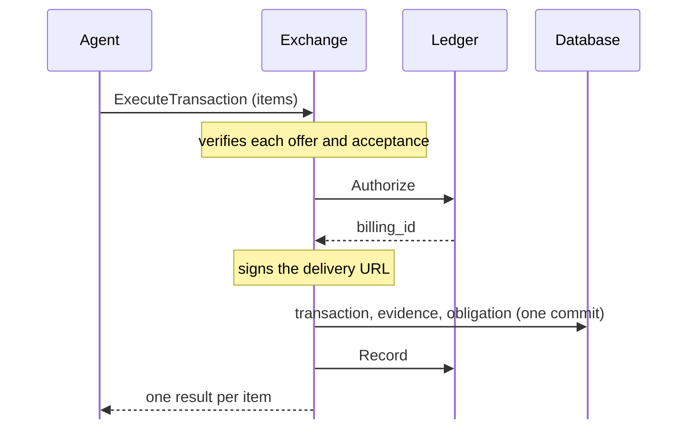

An AI agent that wants a publisher's content needs a price, license terms, and a way to pay. Each publisher names, in its `fora.json`, the Exchanges that sell its content. An Exchange holds the catalogs and license terms of many publishers, and it answers an agent's query with offers that it signs. When the agent buys, the Exchange charges the agent's account and returns a signed delivery URL. The agent fetches the content with that URL. Afterward, the agent reports to the Exchange how much it used.

The protocol defines what every Exchange does (see [Transaction Flow](/protocol/transaction-flow/) and [Authentication](/protocol/authentication/)). [FORA Server](https://github.com/FORA-Protocol/reference-implementation), the open-source reference implementation, includes an Exchange.

## From publisher to catalog

The Exchange can sell a publisher's content only after the content is in its catalog. The catalog receives entries only through `CatalogService.PushResources`, which the pushing party signs. The Exchange accepts a push only when all of the following conditions are true:

- The pusher's signature verifies.
- Each entry's site is registered, and the seat lists that site as active.
- The site's `fora.json` lists the pusher in `catalog_contributors`, and attests the publisher as the resource owner for this Exchange.
- Each entry's license terms pass the SDK's term checks.
- No URL moves from one resource to another.

Together, these checks mean that only a party that the publisher names in its own `fora.json` can put the publisher's content up for sale.

A push is atomic. When one entry fails, the Exchange stores nothing and answers `invalid_argument`, with the failing URLs and their reasons in the error message. The Exchange stores the attestations that a push carries, and returns them on offers without verifying their signatures.

FORA Server includes two pushers. `fora-import`, in the Exchange image, imports the sitemap of each active site listing, with the terms that the publisher chose. `fora-ingest` pushes a JSON Lines feed. See [Run the ingestion pipeline](https://github.com/FORA-Protocol/reference-implementation/blob/main/src/exchange/RUNBOOK.md#run-the-ingestion-pipeline) and [Automatic catalog import](https://github.com/FORA-Protocol/reference-implementation/blob/main/src/exchange/RUNBOOK.md#automatic-catalog-import) in the runbook.

## Discovery and offers

An agent asks for offers with `DiscoverResources`, which carries a `ResourceQuery` with the URLs that the agent wants. Discovery reads no account and changes no data, so an agent can ask before it registers.

1. **The Exchange finds the entry.** For each URL, the Exchange finds the catalog entry with the longest matching prefix. For a URL with no entry, it returns an `OfferGroup` with `OFFER_ABSENCE_REASON_NOT_IN_CATALOG`.
2. **The Exchange picks the terms that the requester can see.** It shows a normal term when the requester's stated `scopes` cover that term. It shows a subscription term only when the request carries a delegation that verifies, and the key that signed the request holds that delegation. On a query that the Broker originates, it hides subscription terms. See [Scope Matching](/protocol/authentication/#scope-matching).
3. **The Exchange hides what the requester cannot see.** For a resource whose terms the requester cannot see, the Exchange returns an empty `OfferGroup` with no reason. This answer is the same as the answer for a resource with nothing to offer, so it does not reveal that hidden terms exist.
4. **The Exchange signs each offer.** Each offer has a random `offer_id`, the price from its license term, and an expiry 5 minutes later. The Exchange signs the whole offer with its Ed25519 key, so nobody between the Exchange and the agent can change the price or the terms.
5. **The agent gets offer groups.** The response holds one `OfferGroup` for each URL.

## Purchase

The agent buys with `ExecuteTransaction`. Each item of the request presents a signed offer and the agent's signed acceptance of that offer. The agent can send the request directly, or through a Broker (see [Buying through the Broker](/components/broker/overview/#buying-through-the-broker)).

1. **The Exchange identifies the agent.** On a direct request, the agent is the owner of the key directory that the request signature names. On a request that the Broker relays, `requester.domain` names the agent, and the agent's signed acceptances prove that identity. See [Direct and relayed requests](/protocol/authentication/#direct-and-relayed-requests).
2. **The Exchange recognizes a retry.** The Exchange stores each agent's `idempotency_key` values, with a digest of the items. For a retry with the same key and the same items, it returns the stored response, so a retry after a lost answer never buys twice. It refuses the same key with other items as `already_exists`.
3. **The Exchange handles each item on its own.** The items are independent. For each item, the Exchange performs the following actions:
   1. Verifies the offer's signature and expiry, and finds the offer's catalog entry by the signed `canonical_url`.
   2. Verifies the agent's `AgentAcceptance`. For a subscription term, it also verifies the delegation.
   3. Refuses the item when the agent has too many overdue usage reports: more than 10, or more than one in five of the reports that are due.
   4. Checks the agent's account, and reserves the charge in the ledger with `Authorize`. An item whose `unit_cost` is 0 skips billing. See [Billing and Ledgers](/components/exchange/billing-adapter/).
   5. Signs the delivery URL. The URL is valid for 5 minutes, and it is bound to the key that the agent's acceptance verifies under.
   6. Writes the transaction, its evidence, and the reporting obligation in one database commit. The evidence is the offer, the signatures, and the URL's hash.
   7. Confirms the charge with `Record`, after the commit.
4. **The agent gets one result per item.** A purchased item carries its delivery URL, its `billing_id`, and its reporting obligation. A refused item carries a `denial_reason`, such as `DENIAL_REASON_INSUFFICIENT_BALANCE`, and the other items continue. The Exchange returns a URL only after it commits the URL's transaction. So every URL that an agent holds has a transaction record behind it. If the Exchange cannot sign a URL or write a transaction, it releases the reservation and fails the whole request.

A seat can refuse purchases that the Broker relays (`allow_broker_relay`). In that case, the Exchange refuses the whole relayed request with `permission_denied`, and sets `ErrorDetail.transaction_denial` to `DENIAL_REASON_RELAY_NOT_ACCEPTED`.

## After the purchase

The agent fetches the content from the publisher's CDN with the delivery URL. The CDN checks the URL's signature before it serves the content (see [Signed URL Verification](/components/edge-function/signed-url-verification/)).

Then the agent reports how much it used, with `ReportUsage`. A report moves no money, because the charge is final at purchase. The Exchange applies the following rules to a report:

- The report must carry the transaction's `billing_id` and the fields that the seat's reporting policy requires. Its timestamp must not be earlier than the transaction.
- The Exchange accepts a report whatever `consumed_quantity` it states, above or below the estimate or with no estimate at all: a report is a record of the quantity consumed.
- The Exchange accepts a report after its reporting window closes.
- If the agent sends an accepted report again, with the same `UsageReport.idempotency_key`, the Exchange returns the same `report_id`. It refuses a second, different report on the same transaction as `failed_precondition`.
- The Exchange refuses a report on another agent's transaction as `permission_denied`.
## Agent accounts

Free content needs no account. To buy paid content, the agent calls `Register` once. The Exchange identifies the agent by the key directory that the request signature names, never by the request body. On the first call, the Exchange performs the following actions:

1. Checks the payload against the published registration schema and the accepted terms.
2. Creates the account in the account registry.
3. Opens the agent's ledger account.
4. Grants the welcome credit.
5. Returns a `billing_ref`.

Each later call returns the same `billing_ref`.

`GetAccountStatus` returns the `billing_ref`, whether the account is active, the digest of the accepted terms, and the balances. With the default `free` ledger, it reports no balance. For an agent that is not registered, it returns `not_found`.

## Request verification

Every call reaches the Exchange as a signed HTTP request. Before the Exchange acts on any call, it checks the request in the following order:

1. **The message is well formed.** The message must pass the proto's validation rules.
2. **The request is for this Exchange.** The request must name this Exchange in its `exchange` field, so a request signed for another Exchange cannot be used here. Otherwise, the Exchange refuses it as `invalid_argument`.
3. **The request has few enough signatures.** The Exchange refuses a request that has more signatures than `max_intermediary_hops`. It does so before it verifies any signature, so a refusal costs little work.
4. **Each signature verifies.** The Exchange verifies each RFC 9421 signature under the Web Bot Auth profile. It uses the key from the directory that the signature's own `Signature-Agent` names.
5. **The request is not a replay.** The Exchange refuses a signature that it already accepted, so a copied request cannot be sent again.

The [Authentication](/protocol/authentication/#verification-at-the-exchange) page defines these rules.

The Exchange admits one Broker, which its operator configures. The Exchange reads that Broker's list of withdrawn keys from the Broker. While the Exchange cannot read the list, it refuses every request that the Broker signed. A request that only the agent signed is not affected.

## What an Exchange never does

- **Deliver the content.** The publisher's CDN serves the content. The Exchange signs the URL that opens it.
- **Charge for a usage report.** The charge is final at purchase, and a report moves no money.
- **Take the agent's identity from the request body.** The Exchange identifies the agent by the request signature, and reads the agent's `billing_ref` from its own records.
- **Hold the agent's keys.** The agent signs its acceptances, and the Exchange only verifies them.
- **Return a URL before the sale is recorded.** The Exchange commits the transaction first.

## Who runs an Exchange

An Exchange operator runs the Exchange and registers the publishers that it sells for.

FORA Server's Exchange is one Go binary in a container. Its public listener serves the Connect RPCs, the manifest at `/.well-known/fora.json`, and the key directory at `/.well-known/http-message-signatures-directory`. A separate admin listener serves only `AdminService`, behind an IP allowlist. Through `AdminService`, the operator sets the fee rate and the reporting policy, and a change applies immediately. The other seat settings are stored in the database with the seat. Every other setting is an environment variable, and a change takes effect after a restart.

**Seats.** The Exchange registers publishers under a seat. A seat holds the operator's settings for every publisher under it, and many publishers, each with its sites, can share one seat.

**Keys.** An Ed25519 key signs the offers and the Ed25519 delivery URLs. The Exchange publishes the public key in its key directory. A publisher site that uses the AWS CloudFront signing scheme also needs an RSA key. To rotate a key, see [Rotate the tenant signing key](https://github.com/FORA-Protocol/reference-implementation/blob/main/src/exchange/RUNBOOK.md#rotate-the-tenant-signing-key) in the runbook.

**Data.** The Exchange keeps its data in the following places:

- **Main database (PostgreSQL):** The seat settings, the publishers, their sites and listings, the agents, the catalog, the transaction log, the transaction evidence, the reporting obligations, and the audit log. The database refuses any change to a stored evidence row.
- **Account registry (PostgreSQL, a separate database):** The agents' accounts.
- **Replay cache (Redis):** The signatures that the Exchange already accepted. Without Redis, the Exchange keeps them in its own memory.
- **Ledger (selected by the operator):** Balances and charges. See [Billing and Ledgers](/components/exchange/billing-adapter/).

The Exchange also keeps the catalog in memory, as a radix trie. At boot and after each accepted push, it rebuilds the trie from PostgreSQL and swaps it in atomically. None of the stores holds the keys. The two PostgreSQL databases hold the durable state, so back up both of them. See [Backup and recovery](https://github.com/FORA-Protocol/reference-implementation/blob/main/src/exchange/RUNBOOK.md#5-backup-and-recovery).

The FORA Server repository has the full reference:

- The [configuration reference](https://github.com/FORA-Protocol/reference-implementation/blob/main/src/exchange/CONFIGURATION.md) describes every variable.
- The [deployment guide](https://github.com/FORA-Protocol/reference-implementation/blob/main/src/exchange/DEPLOYMENT.md) covers a first installation.
- The [runbook](https://github.com/FORA-Protocol/reference-implementation/blob/main/src/exchange/RUNBOOK.md) covers monitoring, troubleshooting, and routine procedures.

## Related pages

- [FORA for Exchange Operators](/getting-started/for-exchange-operators/): how to set up an Exchange and register publishers
- [Billing and Ledgers](/components/exchange/billing-adapter/): how the Exchange charges an agent's account
- [Broker](/components/broker/overview/): the service that relays queries and purchases to Exchanges
- [Transaction Flow](/protocol/transaction-flow/): discovery, purchase, and usage reports in the protocol
- [Authentication](/protocol/authentication/): request signatures, relayed requests, and accounts
