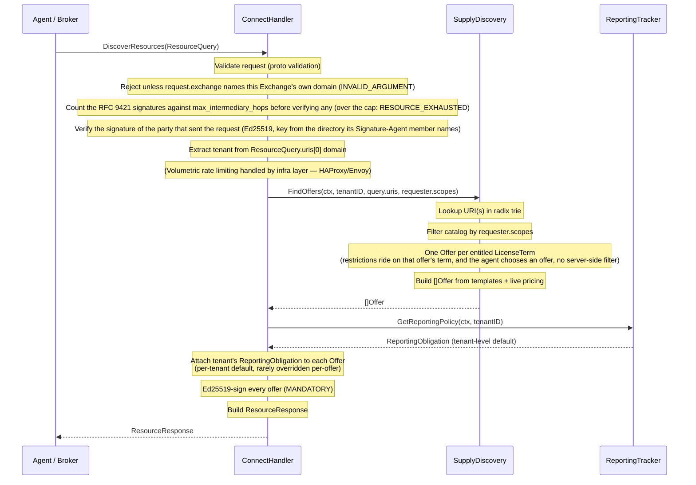
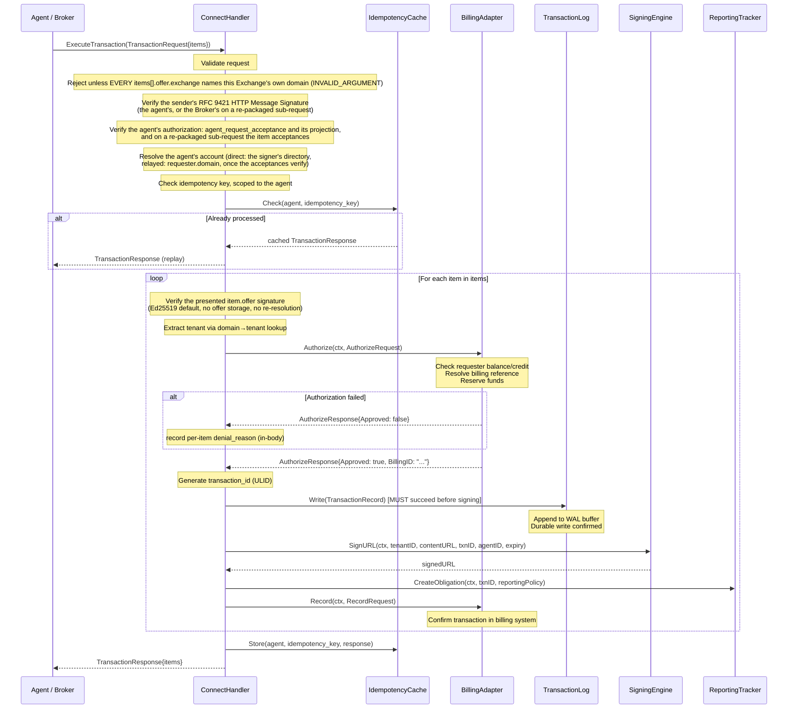
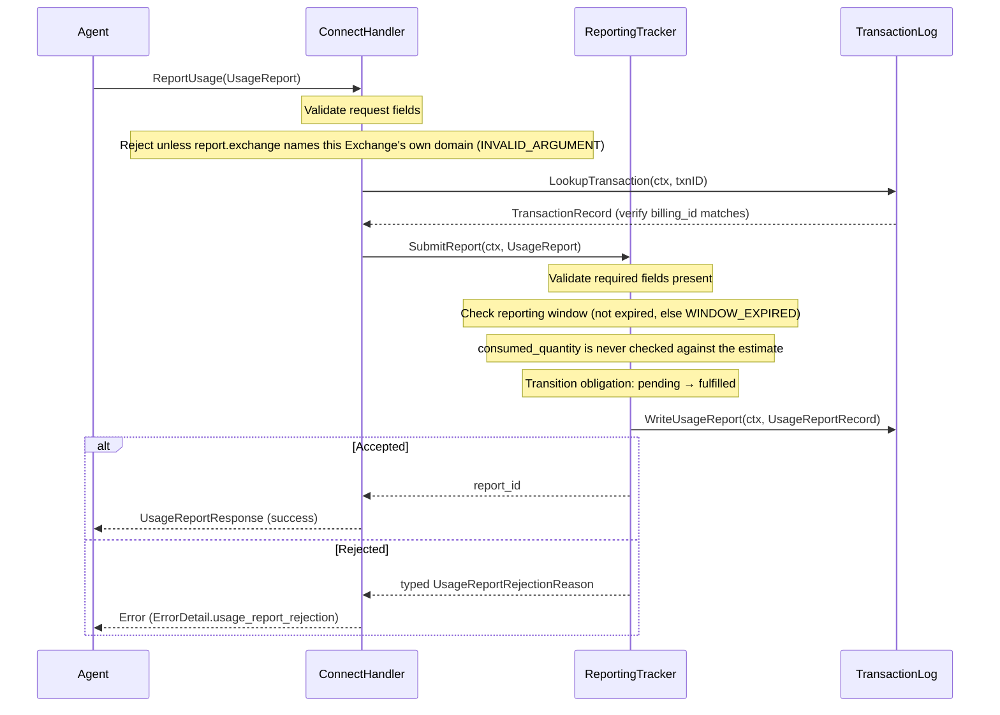
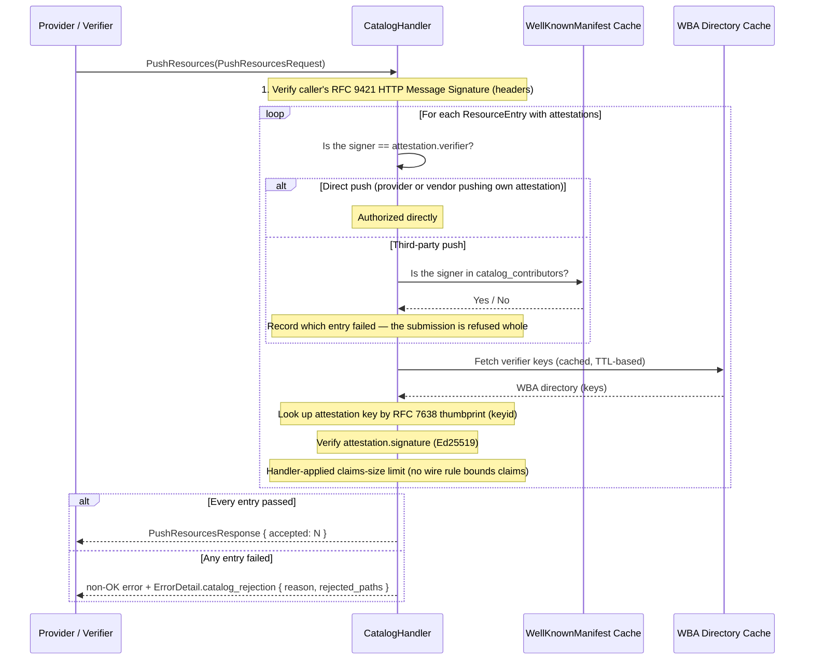
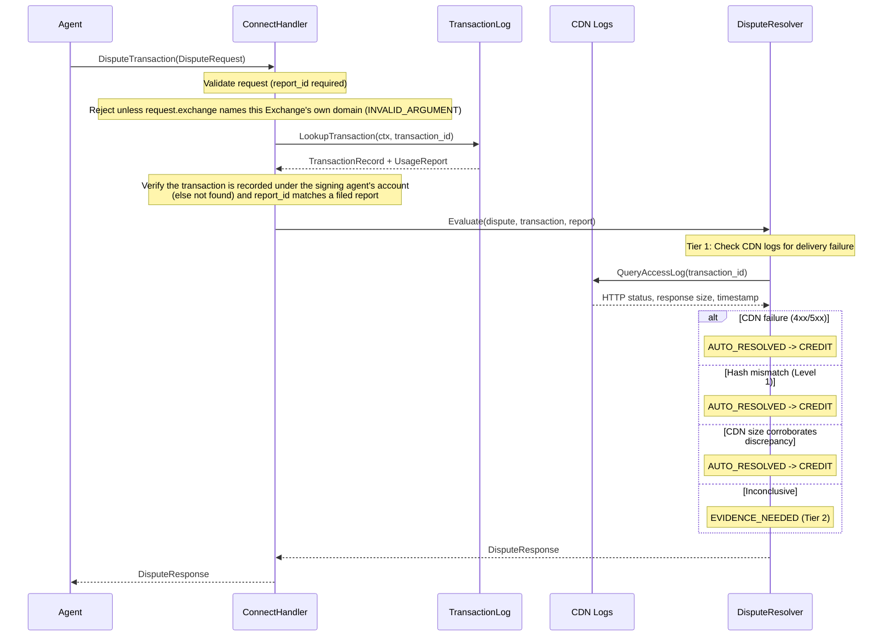

## DiscoverResources

The fastest path. No external I/O. In-memory catalog lookup, offer construction, and response serialization.



### Handler Implementation

```go
func (h *ExchangeHandler) DiscoverResources(
    ctx context.Context,
    req *connect.Request[forav1.ResourceQuery],
) (*connect.Response[forav1.ResourceResponse], error) {
    // 1. Validate
    if err := validate(req.Msg); err != nil {
        return nil, connect.NewError(connect.CodeInvalidArgument, err)
    }

    // 1b. Respect deadline field from ResourceQuery.
    //     If req.Msg.Deadline is set, use it as the context timeout.
    //     If absent, use a 500ms default timeout for the entire handler.
    if req.Msg.Deadline != nil {
        var cancel context.CancelFunc
        ctx, cancel = context.WithTimeout(ctx, req.Msg.Deadline.AsDuration())
        defer cancel()
    } else {
        var cancel context.CancelFunc
        ctx, cancel = context.WithTimeout(ctx, 500*time.Millisecond)
        defer cancel()
    }

    // 2. Requester identity. Verification already happened at the HTTP seam:
    //    the SDK's verify middleware checked the RFC 9421 signature of the
    //    party that sent the request — the agent, or a Broker that originated
    //    or re-packaged it (Authentication > Multi-hop forwarding) — resolving the signer's key
    //    by its signed keyid (an RFC 7638 thumbprint) in the key directory
    //    named by the `Signature-Agent` member that signature covers. The
    //    self-asserted Requester.domain field never drives request-signing key
    //    lookup.
    //    The handler consumes the proof from the context; it never re-fetches
    //    keys or re-verifies bytes, and it fails closed when the proof is
    //    absent (a route the middleware does not guard).
    requester := req.Msg.Requester
    verified := helpers.FromContext(ctx) // the first verified signature in header order; all of them via helpers.AllSignaturesFromContext
    if verified == nil {
        return nil, connect.NewError(connect.CodeUnauthenticated,
            errors.New("request reached the handler without a verified signature"))
    }

    // 2b. Direct or Broker-led ("Direct and relayed requests" in the protocol).
    //     Requester.domain is the host of the agent's key directory, never a
    //     free label. When it names the directory the signature resolved from
    //     (the host of the covered Signature-Agent URL, compared by the
    //     request-recipient identity rule: case-folded, an absent port the same
    //     as :443), the query is DIRECT: the agent signed it. When it names
    //     another directory, the query is one a Broker originated, which this
    //     Exchange acts on only when it admits the signer as a Broker; there the
    //     domain is the Broker's statement of whom it queries for, and nothing
    //     on this leg authenticates the agent. Any other mismatch is a signature
    //     that verifies, but not for the requester the body names.
    host, err := helpers.HostOf(verified.SignatureAgent)
    verdict := helpers.AudienceMalformed
    if err == nil {
        verdict, err = helpers.CheckAudience(host, requester.GetDomain())
    }
    direct := err == nil && verdict == helpers.AudienceAccepted
    brokerLed := err == nil && verdict == helpers.AudienceMismatch &&
        h.brokers.Admits(verified.SignatureAgent)
    if !direct && !brokerLed {
        return nil, connectserver.AttachDetail(
            connect.NewError(connect.CodeUnauthenticated, errors.New("requester.domain is not the signing directory")),
            helpers.RequestAuthFailureDetail("fora.v1.ExchangeService", "requester.domain is not the signing directory",
                forav1.RequestAuthFailureReason_REQUEST_AUTH_FAILURE_REASON_SIGNATURE_INVALID))
    }

    // 2c. On a DIRECT query, resolve the agent's registered account from the
    //     directory the signature resolved from (verified.SignatureAgent; see
    //     "Accounts" on the authentication page). Every currently valid key that
    //     directory publishes acts for the account, so the key that verified
    //     does not select it, and neither does requester.id, a free label. A
    //     query a Broker originated authenticates no agent, so this Exchange
    //     consults no account for it (its own choice; the protocol leaves it
    //     open) and presents on the stated scopes alone.
    var account *Account
    if direct {
        account, err = h.accounts.ForDirectory(ctx, verified.SignatureAgent)
        if err != nil {
            return nil, connect.NewError(connect.CodePermissionDenied, err)
        }
    }

    // 3. Resolve tenant
    tenantCfg, err := h.tenants.ResolveFromURIs(req.Msg.Uris)
    if err != nil {
        return nil, connect.NewError(connect.CodeNotFound, err)
    }

    // 3b. Verify the delegation (if present) on a DIRECT query, once per
    //     subscription record. Trust is per record: the SDK verifier is given
    //     the keys that record lists, so an issuer trusted for one subscription
    //     grants nothing on another. A record whose keys refuse the chain keeps
    //     its gated terms hidden; the refusal is journaled, never reported. The
    //     holder is the RFC 9421 signer's key from the HTTP proof of step 2,
    //     which stays separate from the delegation result. On a query a Broker
    //     originated the Broker signs alone, so nothing can pass the holder
    //     binding: the delegation is not honoured, and the query is answered
    //     as if none were present. A token over the size limit never gets
    //     here: step 1 refused the request.
    grants := map[string]*helpers.VerifiedDelegation{} // subscription record ID -> verified grant
    if direct && requester.GetDelegation() != nil {
        holder, err := helpers.Thumbprint(verified.PublicKey)
        if err != nil {
            return nil, connect.NewError(connect.CodeInternal, err)
        }
        for _, record := range h.subscriptions.RecordsForTenant(ctx, tenantCfg.ID) {
            grant, err := helpers.VerifyDelegation(helpers.DelegationInput{
                Token:          requester.GetDelegation().GetToken(),
                TrustedIssuers: record.TrustedIssuers,
                Audience:       tenantCfg.Identity,
                Holder:         holder,
                Now:            h.clock.Now(),
            })
            if err != nil {
                h.journal.DelegationRefused(ctx, record.ID, err)
                continue
            }
            grants[record.ID] = grant
        }
    }

    // 4. Application-level abuse check (optional — volumetric rate limiting is at infra layer)
    // The Exchange MAY return 429 for application-level abuse, e.g., query-to-transaction
    // ratio too low (agent discovering but never buying). Volumetric rate limiting (per-IP,
    // per-tenant RPS caps) belongs in HAProxy/Envoy/API Gateway in front of this service.

    // 5. Catalog lookup (lock-free read, scope-filtered)
    //    A non-gated term is filtered by requester.scopes, the requester's own
    //    statement — terms outside the stated scopes are not returned. A gated
    //    term (a subscription term) is presented only when the grant verified
    //    under the term's own subscription record covers the term's scopes, by
    //    the one matching rule on Requester.scopes; requester.scopes is ignored
    //    for it, and a record with no grant — every record on a query a Broker
    //    originated (3b) — keeps its gated terms hidden, as if they did not
    //    exist. The catalog bounds each gated offer's expires_at by its grant's
    //    ExpiresAt, so the offer never outlives the chain.
    offers, err := h.catalog.FindOffers(ctx, tenantCfg.ID, req.Msg.Uris, requester.Scopes, grants)
    if err != nil {
        return nil, connect.NewError(connect.CodeInternal, err)
    }

    // 5b. Check for active subscription, on a DIRECT query (step 2d).
    //     If the requester has an active subscription with this tenant, include a
    //     subscription offer variant (rate=0) for each catalog offer with
    //     SubscriptionQuotaInfo attached. Quota enforcement is deferred to
    //     ExecuteTransaction time — DiscoverResources checks subscription status
    //     and populates quota visibility. Subscription/entitlement is resolved
    //     from the registered account of step 2d (plus any delegation) — never
    //     from the caller-written requester.id. A query a Broker originated has
    //     no account here, so it gets no subscription variant.
    var subStatus *SubscriptionStatus
    if account != nil {
        if sub, err := h.billing.CheckSubscription(ctx, account.BillingRef, tenantCfg.ID); err == nil && sub.Active {
            subStatus = sub
        }
    }

    // Build subscription offer variants per catalog offer (if subscription active).
    // Each subscription offer includes SubscriptionQuotaInfo so agents can see
    // remaining quota before committing to a transaction.
    if subStatus != nil {
        var subOffers []*forav1.Offer
        for _, offer := range offers {
            subOffer := proto.Clone(offer).(*forav1.Offer)
            // A subscription variant is a distinct offer, so it gets a fresh
            // opaque offer_id — never one derived from the base offer's id.
            subOffer.OfferId = "offer-" + newOpaqueID()
            subOffer.SubscriptionId = proto.String(subStatus.SubscriptionID)
            subOffer.Pricing = &forav1.Pricing{
                Model:             offer.Pricing.Model,
                Rate:              "0", // zero marginal cost under subscription; money is a decimal string
                Currency:          offer.Pricing.Currency,
                UnitCost:          proto.String("0"),
                EstimatedQuantity: offer.Pricing.EstimatedQuantity,
            }
            // Populate SubscriptionQuotaInfo for proactive quota signaling
            subOffer.SubscriptionQuota = h.billing.SubscriptionQuota(
                ctx, subStatus.SubscriptionID, tenantCfg.ID,
            )
            subOffers = append(subOffers, subOffer)
        }
        offers = append(offers, subOffers...)
    }

    // 6. Attach reporting obligations (per-tenant default, not per-offer lookup)
    //    Reporting obligation is set once in tenant config. All offers inherit the
    //    tenant's reporting obligation unless explicitly overridden (rare).
    tenantReporting := h.reporting.GetPolicy(tenantCfg.ID)
    for _, offer := range offers {
        offer.Reporting = tenantReporting
    }

    // 7. Ed25519-sign every offer (MANDATORY — enables stateless ExecuteTransaction)
    //    Ed25519 is the default for offers because agents and Brokers must
    //    verify signatures without holding the signing key. The Exchange signs
    //    with its Ed25519 private key; anyone verifies with the public key.
    for _, offer := range offers {
        sig, err := h.offerSigner.Sign(offer)
        if err != nil {
            return nil, connect.NewError(connect.CodeInternal, err)
        }
        offer.Signature = sig
        offer.SignatureAlgorithm = "EdDSA"
    }

    // 8. Build response — flat offers or OfferGroups depending on URI count.
    //    When the ResourceQuery contains multiple URIs, return OfferGroups
    //    (one per URI) so the caller knows which offers map to which resource.
    //    When a single URI is queried, use the flat offers field.
    uris := req.Msg.Uris
    if len(uris) > 1 {
        // Batch mode: group offers by requested URI.
        groups := make([]*forav1.OfferGroup, 0, len(uris))
        for _, uri := range uris {
            var uriOffers []*forav1.Offer
            for _, offer := range offers {
                if offerMatchesURI(offer, uri) {
                    uriOffers = append(uriOffers, offer)
                }
            }
            groups = append(groups, &forav1.OfferGroup{
                Uri:    uri,
                Offers: uriOffers, // empty slice = resource not available for this URI
            })
        }
        return connect.NewResponse(&forav1.ResourceResponse{
            Ver:         helpers.ProtocolVersion,
            Exchange: h.exchangeDomain,
            OfferGroups: groups,
        }), nil
        // Correlation is not echoed in the body: it rides the X-Request-ID
        // HTTP header, propagated across the request/response round-trip.
    }

    return connect.NewResponse(&forav1.ResourceResponse{
        Ver:         helpers.ProtocolVersion,
        Exchange: h.exchangeDomain,
        Offers:      offers,
    }), nil
}
```

**IAB Content Taxonomy**: When building offers, the DiscoverResources handler includes `iab_categories` from the catalog entry on each Offer. This enables agents and Brokers to filter offers by topic (e.g., "only finance resources"). Categories use IAB Content Taxonomy 3.1 codes and are populated during resource ingestion — either from FORA sitemap extensions, CMS metadata, or third-party intelligence providers via CatalogService.

**Latency budget**: 10ms p50, 50ms p99. All in-memory. The only variable is offer count and serialization cost.

### Requester Authentication

Requester authentication uses an RFC 9421 HTTP Message Signature in the HTTP headers, signed with a domain-bound Ed25519 key and made to the [Web Bot Auth profile](/protocol/authentication/#the-web-bot-auth-profile). The public key is published in the signer's key directory (`{origin}/.well-known/http-message-signatures-directory`); the verifier resolves that origin from the `Signature-Agent` member the signature covers. The `Requester.id` identifies the specific entity within that domain. The requester's private key never leaves the requester.

**Two onboarding paths:**

1. **Enterprise (out-of-band key exchange)**: During contract signing, the Exchange operator registers the requester's public key via an internal admin API: `POST /admin/requesters { requester_id, domain, public_key, subscription }`. The public key is exchanged out-of-band (email, portal, API) as part of the commercial agreement.

2. **Self-signup**: The agent calls `ExchangeService.Register`, signed with a key its WBA directory (the JWK Set at `/.well-known/http-message-signatures-directory`) publishes. The Exchange verifies the signature against that directory, the key identified by its RFC 7638 thumbprint (the RFC 9421 `keyid`), and creates the account for the directory, never for a `requester_id` (see [Accounts](/protocol/authentication/#accounts)). No subscription is created — self-signup requesters use per-request billing only.

**Requester public key storage:**

```go
type RequesterRecord struct {
    RequesterID   string
    Domain        string
    PublicKey     ed25519.PublicKey
    ManifestURL   string  // {domain}/.well-known/fora.json
    Subscriptions map[string]SubscriptionStatus  // tenantID -> status
}
```

### Forwarding Verification

Nothing about the route is carried in the message: there is no `intermediaries` field. Each party that sends a `ResourceQuery` or `TransactionRequest` signs it with **one** labeled signature that conforms to Web Bot Auth, with its own `Signature-Agent` member. The rules are specified once, in [Multi-hop forwarding](/protocol/authentication/#multi-hop-forwarding). In short, FORA's Broker never forwards an agent's request unchanged:

- **Discovery is Broker-led.** The Broker chooses the Exchanges and originates its own `ResourceQuery`, signed by the Broker alone, so the Exchange does not honour a delegation on it and answers as if none were present ([Which signature binds in a brokered request](/protocol/authentication/#verification)). How an agent proves a holder-of-key entitlement at discovery time through a Broker is an open protocol question.
- **Execute is re-packaged.** The Broker builds a fresh `TransactionRequest` for each Exchange and signs it alone. The agent's identity and consent are the `AgentAcceptance`, a detached Ed25519 signature over `{offer_sig, requester_id, requester_domain, idempotency_key}` verified against the agent's registered key, resolved from `Requester.domain`.

In both cases the Broker's signature covers its own request components and only its own `Signature-Agent` member, and the request carries no agent signature headers.

The Exchange MUST:

1. **Verify the request signature.** The `keyid` is the key's RFC 7638 thumbprint; the Exchange resolves the key in the key directory at `{origin}/.well-known/http-message-signatures-directory`, where `{origin}` is the `Signature-Agent` member the signature covers, verifies the Ed25519 signature, and authenticates the caller as that party: the agent on a direct call, the Broker on a request the Broker sent. A request whose `requester.domain` names a directory other than the signer's is relayed, and the Exchange acts on it only from a Broker it admits, by its own policy (for example, only Brokers registered with it); from any other signer it is refused as `unauthenticated` with `request_auth_failure` `SIGNATURE_INVALID`. See [Direct and relayed requests](/protocol/authentication/#direct-and-relayed-requests).
2. **Verify each item's `AgentAcceptance` on an execute request** against the agent's registered key, as [Projected execute requests](/protocol/authentication/#projected-execute-requests) describes. On a re-packaged request this is the agent's identity and consent, and its key gives the delivery-URL binding and the key a delegation's `cnf.jkt` is checked against.
3. **Where a party forwarded unchanged and covered an earlier signature**, verify that signature too, and the coverage, as the general WG-00 rule describes.

Every signature on the request must pass. If any one fails, the Exchange rejects the request with `CodeUnauthenticated`. The refusal carries an `ErrorDetail` whose `request_auth_failure` block holds a [`RequestAuthFailureReason`](/reference/proto-fora/#requestauthfailurereason): `SIGNATURE_MISSING` (sign the request), `SIGNATURE_INVALID` (the signature does not verify) or `SIGNATURE_STALE` (sign it again, now). The reason names what the caller does next, never which check failed.

Before it verifies any signature, the Exchange counts the signatures on the request against its `WellKnownManifest.max_intermediary_hops`, every signature counted whether or not it covers another, and refuses a request carrying more with `CodeResourceExhausted` (HTTP 429) and no typed reason. A request signed only by the party that sent it carries one. `RequestConstraints.max_hops` never reaches an Exchange: it rides only on the agent's `DiscoveryRequest` to the Broker, and no party enforces it in this version.

```go
// Request-signature verification runs in the SDK's verify middleware at the
// HTTP seam, before any handler. The middleware:
//   1. Parses the Signature / Signature-Input headers into labeled signatures.
//   2. Counts them against max_intermediary_hops before verifying any
//      (connectserver.WithMaxSignatures). A request carrying more is refused
//      with CodeResourceExhausted (HTTP 429) and no ErrorDetail.
//   3. Verifies the request signature against the key in the directory its
//      own Signature-Agent member names, at
//      {origin}/.well-known/http-message-signatures-directory.
//   4. Where a party forwarded unchanged and covered an earlier signature,
//      verifies that signature and the coverage too.
// A signature that fails rejects the request with CodeUnauthenticated before
// the handler runs, carrying ErrorDetail.request_auth_failure
// (SIGNATURE_MISSING, SIGNATURE_INVALID or SIGNATURE_STALE). The handler reads
// the proven signatures from the context, in header order:
sigs := helpers.AllSignaturesFromContext(ctx)
```

### Delegation Verification

When `Requester.delegation` is present, the Exchange runs the chain through the profile's verifier before honoring it. The procedure, the limits and the outcome of each failure are stated once, in [Verification](/protocol/authentication/#verification). What the handler supplies and does:

1. The trusted root keys come from the subscription record that owns the gated term, never from `principal_domain` or a fetched directory
2. The holder is the key the request proved: the RFC 9421 request signer on a direct call, the key each item's `AgentAcceptance` verifies under on a purchase a Broker relayed. On a query a Broker originated nothing can pass this check, so the delegation is not verified or honored there, and the query is answered as if none were present
3. For a gated term, the effective scopes the verifier returns alone decide; `Requester.scopes` is ignored
4. A gated offer expires no later than the effective expiry the verifier returns

### Provider Trust Verification

The Exchange SHOULD periodically re-fetch `/.well-known/fora.json` for each tenant's domains to confirm the provider still authorizes this Exchange to sell their resources. If the Exchange is removed from a provider's `fora.json`:

- Revoke the tenant configuration
- Stop serving offers for that provider's resources
- Log the revocation for audit

This is ongoing verification, not just onboarding. Providers can revoke authorization at any time by updating their `fora.json`. The Exchange SHOULD check at least once per hour (configurable via tenant settings).

---

## ExecuteTransaction

The critical path. Stateless offer verification — no offer storage or re-resolution. A request carries one or more `items` (items-only model): each item presents the FULL signed offer it was issued, and the Exchange verifies that presented offer against its own offer-signing key. A single offer is the degenerate 1-element `items` list. Per item the pipeline is: validate -> verify the presented offer's signature (Ed25519 default) -> check idempotency -> authorize billing -> write transaction log -> sign URL -> respond. Before the idempotency check the Exchange verifies the agent's authorization: the request signature on a direct request, the item acceptances on a sub-request a Broker re-packaged, and, when the request carries `agent_request_acceptance`, that set claim — the signature, and that this request's items are the complete in-order projection of the signed set addressed to this Exchange (see [Projected execute requests](/protocol/authentication/#projected-execute-requests)). Idempotency state is never created or served for a request that fails it, and the key is scoped to the agent's [account](/protocol/authentication/#accounts), whatever route the request took.



**Critical ordering invariant**: The transaction log write MUST complete successfully before the Signing Engine generates the signed URL. If the transaction log write fails, the request is rejected — no signed URL is ever issued for an unrecorded transaction. This is the "write-before-sign" rule from the NFR document.

### Handler Implementation

A transaction carries one or more `items` (items-only model): there is no single-offer request shape. The handler validates, verifies the requester's RFC 9421 identity (and, on a sub-request a Broker re-packaged, the agent's acceptances), resolves the agent's account, checks idempotency once for the whole request under that agent, then **always** iterates `req.Msg.Items` — a single offer is simply a 1-element list. Each item presents the FULL signed offer it received at discovery; the Exchange verifies that presented `item.Offer` against its own offer-signing key (stateless, no reconstruct-from-catalog) and reads pricing, delivery, and domain from `item.Offer` itself.

**Denial semantics**: every per-item denial is answered **in the body**, whatever the item count. The request returns 200 with the denied item's `denial_reason` set, so surviving items still commit, and a one-item request that is denied is a 200 whose only item is denied. A non-OK error carrying `ErrorDetail.transaction_denial` is produced only for a refusal of the **whole request** that decides no item — a reason about the requester that would deny every item alike, such as overdue reports on the agent's account. `transactionDenied(...)` produces that whole-request error; the loop records every per-item denial in the body.

```go
func (h *ExchangeHandler) ExecuteTransaction(
    ctx context.Context,
    req *connect.Request[forav1.TransactionRequest],
) (*connect.Response[forav1.TransactionResponse], error) {
    // 1. Validate
    if err := validate(req.Msg); err != nil {
        return nil, connect.NewError(connect.CodeInvalidArgument, err)
    }

    // 2. Requester identity. As in DiscoverResources steps 2 and 2b, the SDK's
    //    verify middleware already verified every RFC 9421 signature at the HTTP
    //    seam; the handler consumes the proof from the context, fails closed when
    //    it is absent, and requires requester.domain to name the signing
    //    directory (elided here). On a sub-request a Broker re-packaged, the
    //    signer is the Broker, and the agent is authenticated instead by its
    //    acceptances, verified against the directory requester.domain names
    //    (see "Sub-requests from a Broker" below).
    requester := req.Msg.Requester
    verified := helpers.FromContext(ctx)
    if verified == nil {
        return nil, connect.NewError(connect.CodeUnauthenticated,
            errors.New("request reached the handler without a verified signature"))
    }

    // 2b. Authenticate the AGENT and resolve its account (see "Accounts" on the
    //     authentication page). On a direct request the agent is the verified
    //     signer, and its directory is the covered Signature-Agent origin. On a
    //     sub-request a Broker re-packaged, the agent is the one its acceptances
    //     authenticate: they, and the agent_request_acceptance projection when
    //     present, must verify against the keys of the directory requester.domain
    //     names. This runs before any idempotency state is read or written: a
    //     relayed request that proves no agent has every item denied in the body
    //     and touches no stored result. All entitlement, compliance and billing
    //     below use this account, never requester.id and never the Broker's; the
    //     Broker is kept only for attribution (agent.RelayedBy).
    agent, ok := h.authenticateAgent(ctx, verified, req.Msg)
    if !ok {
        return connect.NewResponse(denyEveryItem(req.Msg,
            forav1.DenialReason_DENIAL_REASON_SIGNATURE_INVALID)), nil
    }
    account, err := h.accounts.ForDirectory(ctx, agent.Directory)
    if err != nil {
        return nil, connect.NewError(connect.CodePermissionDenied, err)
    }

    // 3. Idempotency check (idempotency_key — REQUIRED). The key is scoped to the
    //    agent, whatever the route: a direct request and a sub-request a Broker
    //    re-packaged for the same agent share one scope. The stored entry keeps a
    //    digest of the ordered items (each offer.signature), so the same key with
    //    the same items is a replay, answered with the stored result and the
    //    delivery binding it recorded, and the same key with different items, or
    //    another order, is refused with already_exists and no typed reason.
    scope := agent.Directory
    if cached, ok := h.idempotency.Get(scope, req.Msg.IdempotencyKey); ok {
        if cached.ItemsDigest != itemsDigest(req.Msg.Items) {
            return nil, connect.NewError(connect.CodeAlreadyExists,
                errors.New("idempotency_key already used by this agent with a different request"))
        }
        return connect.NewResponse(cached.Response), nil
    }

    // 3a. Reporting gate: refuse up front if the agent's account has overdue
    //     reports. It runs after the replay check, so a stored result is still
    //     answered. This is a reason about the requester that would deny every
    //     item alike, so
    //     it refuses the WHOLE request, whatever the item count: a non-OK error
    //     carrying ErrorDetail.transaction_denial, and nothing is purchased.
    if blocked, reason := h.reporting.CheckBuyerCompliance(ctx, account.ID); blocked {
        slog.Warn("requester blocked for overdue reporting",
            slog.String("requester_id", requester.Id),
            slog.String("domain", requester.Domain),
            slog.String("reason", reason),
        )
        return nil, transactionDenied(forav1.DenialReason_DENIAL_REASON_REPORTING_OVERDUE)
    }

    // 4. Items-only pipeline. There is no separate single-offer branch: a single
    //    offer is the degenerate 1-element `items` list, and its denial is answered
    //    in the body like any other. Process each item independently — items are
    //    NOT atomic; one can fail (signature invalid, resource unavailable, billing
    //    denied) while others succeed.
    // agent_identity_hash names the key the delivery URL binds to; which key that
    // is on each route is stated on TransactionResponse.agent_identity_hash.
    agentHash, err := helpers.Thumbprint(agent.Key)
    if err != nil {
        return nil, connect.NewError(connect.CodeInternal, err)
    }
    // The account handle (the billing_ref minted at Register) comes from the
    // agent's account resolved in step 2b, on a relayed purchase too. The request
    // carries no caller-written billing field, and requester.id never selects the
    // account.
    billingRef := account.BillingRef
    var resultItems []*forav1.TransactionResultItem
    totals := map[string]float64{} // purchased amount per currency

    for _, item := range req.Msg.Items {
        resultItem := &forav1.TransactionResultItem{OfferId: item.Offer.OfferId}

        // deny records a per-item denial in the body. It is the same for a
        // one-item request and a batch: a per-item denial is never a non-OK error.
        deny := func(reason forav1.DenialReason) {
            resultItem.DenialReason = &reason
            resultItems = append(resultItems, resultItem)
        }

        // 4a. Verify the PRESENTED signed offer (stateless — no offer storage,
        //     no reconstruct-from-catalog). The id and signature live inside the
        //     reflected offer: item.Offer.OfferId, item.Offer.Signature,
        //     item.Offer.SignatureAlgorithm. offerVerifier.Verify checks the
        //     signature over the presented offer bytes against the Exchange's own
        //     offer-signing key and returns that same offer to read pricing from.
        offer, err := h.offerVerifier.Verify(item.Offer)
        if err != nil {
            deny(forav1.DenialReason_DENIAL_REASON_SIGNATURE_INVALID)
            continue
        }

        // Resolve tenant from the offer's Exchange domain (domain→tenant lookup)
        tenantCfg, err := h.tenants.ResolveFromDomain(offer.Exchange)
        if err != nil {
            deny(forav1.DenialReason_DENIAL_REASON_CONTENT_UNAVAILABLE)
            continue
        }

        // 4b. Authorize billing (per item) — skip for subscription offers
        var billingID string
        var amount float64
        if offer.SubscriptionId != nil {
            billingID = "sub-" + ulid.Make().String()
            amount = 0
            resultItem.SubscriptionId = proto.String(*offer.SubscriptionId)
            resultItem.SubscriptionUnitValue = &forav1.Cost{
                Amount:   offer.OriginalRate,
                Currency: offer.Pricing.Currency,
                UnitCost: offer.Pricing.UnitCost,
            }
        } else {
            authResp, err := h.billing.Authorize(ctx, &BillingAuthorizeRequest{
                BillingRef: billingRef,
                Amount:     offer.Pricing.Rate,
                Currency:   offer.Pricing.Currency,
                OfferID:    offer.OfferId,
                TenantID:   tenantCfg.ID,
            })
            if err != nil {
                slog.Error("billing authorization failed",
                    slog.String("offer_id", offer.OfferId),
                    slog.String("tenant_id", tenantCfg.ID),
                    slog.Any("error", err),
                )
            }
            if err != nil || !authResp.Approved {
                if err == nil {
                    slog.Warn("billing authorization denied",
                        slog.String("offer_id", offer.OfferId),
                        slog.String("reason", authResp.Reason),
                    )
                }
                deny(txnErrToDenialReason(err))
                continue
            }
            billingID = authResp.BillingID
            amount = offer.Pricing.Rate
        }

        // 4c. Write transaction log (MUST succeed before signing — WAL invariant
        //     applies per item). No signed URL is ever issued for an unrecorded
        //     transaction.
        txnID := ulid.Make().String()
        record := &TransactionRecord{
            TransactionID:     txnID,
            BillingID:         billingID,
            OfferID:           offer.OfferId,
            TenantID:          tenantCfg.ID,
            BillingRef:        billingRef,
            Broker:            agent.RelayedBy, // the relaying Broker; attribution only, never billed
            AgentIdentityHash: agentHash,
            Amount:            amount,
            Currency:          offer.Pricing.Currency,
            UnitCost:          derefFloat64(offer.Pricing.UnitCost),
            OfferSnapshotJSON: marshalOfferSnapshot(offer),
            DeliveryMethod:    offer.DeliveryMethod,
            ReportingRequired: tenantCfg.ReportingPolicy.GetRequired(),
            IdempotencyKey:    req.Msg.IdempotencyKey,
            CreatedAt:         time.Now().UTC(),
        }
        if err := h.txLog.Write(ctx, record); err != nil {
            slog.Error("txlog write failed",
                slog.String("txn_id", txnID),
                slog.String("billing_id", billingID),
                slog.Any("error", err),
            )
            if releaseErr := h.billing.Release(ctx, billingID); releaseErr != nil {
                slog.Error("billing release after txlog failure also failed",
                    slog.String("billing_id", billingID),
                    slog.Any("error", releaseErr),
                )
            }
            deny(forav1.DenialReason_DENIAL_REASON_CONTENT_UNAVAILABLE)
            continue
        }

        // 4d. Sign URL (only after durable log write)
        signedURL, err := h.signer.SignURL(ctx, tenantCfg.ID, SignRequest{
            ContentURL:    tenantCfg.ContentBaseURL + offer.ContentPath,
            TransactionID: txnID,
            AgentIdentity: agentHash,
            Expiry:        tenantCfg.URLTTLOrDefault(5 * time.Minute),
        })
        if err != nil {
            slog.Error("URL signing failed",
                slog.String("txn_id", txnID),
                slog.String("tenant_id", tenantCfg.ID),
                slog.Any("error", err),
            )
            deny(forav1.DenialReason_DENIAL_REASON_CONTENT_UNAVAILABLE)
            continue
        }

        // 4e. Create reporting obligation
        h.reporting.CreateObligation(ctx, txnID, tenantCfg.ReportingPolicy)

        // 4f. Record in billing (async-safe — transaction is already logged)
        if err := h.billing.Record(ctx, &BillingRecordRequest{
            BillingID:     billingID,
            TransactionID: txnID,
            Amount:        amount,
            Currency:      offer.Pricing.Currency,
        }); err != nil {
            slog.Error("billing record failed",
                slog.String("txn_id", txnID),
                slog.String("billing_id", billingID),
                slog.Any("error", err),
            )
        }

        // 4g. Populate the successful per-item result.
        resultItem.TransactionId = txnID
        resultItem.BillingId = billingID
        resultItem.ResourceTitle = offer.Title // human-readable title echoed from the Offer
        resultItem.RetrievalEndpoint = proto.String(signedURL)
        resultItem.Cost = &forav1.Cost{
            Amount:   amount,
            Currency: offer.Pricing.Currency,
            UnitCost: offer.Pricing.UnitCost,
        }
        resultItem.DeliveryMethod = offer.DeliveryMethod
        resultItem.ReportingObligation = tenantCfg.ReportingPolicy
        resultItem.ExpiresAt = timestamppb.New(time.Now().Add(tenantCfg.URLTTLOrDefault(5 * time.Minute)))
        resultItems = append(resultItems, resultItem)

        totals[offer.Pricing.Currency] += amount
    }

    // 5. Build response — every per-result datum lives on its TransactionResultItem;
    //    the top-level fields carry only shared aggregate state. Correlation is not
    //    in the body — it rides the X-Request-ID HTTP header across the round-trip.
    //    total_cost is set only when the purchased items share one currency:
    //    amounts are never summed across currencies, and this version defines no
    //    currency conversion.
    resp := &forav1.TransactionResponse{
        Ver:               helpers.ProtocolVersion,
        AgentIdentityHash: agentHash,
        Items:             resultItems,
    }
    if len(totals) == 1 {
        for currency, amount := range totals {
            resp.TotalCost = &forav1.Cost{Amount: amount, Currency: currency}
        }
    }

    // 6. Cache for idempotency, under the agent's scope, with the items digest
    //    that tells a replay from a reuse of the key with a different request.
    h.idempotency.Set(scope, req.Msg.IdempotencyKey, cachedResult{
        Response:    resp,
        ItemsDigest: itemsDigest(req.Msg.Items),
    }, 10*time.Minute)
    return connect.NewResponse(resp), nil
}

// transactionDenied maps a typed DenialReason to a non-OK transport error
// carrying ErrorDetail.transaction_denial. It is used ONLY for a refusal of the
// whole request — a reason about the requester that decides no item — never for a
// per-item denial, which is answered in the body whatever the item count. The
// transport code is the error class, the attached ErrorDetail the typed reason.
func transactionDenied(reason forav1.DenialReason) error {
    detail := &forav1.ErrorDetail{
        Reason: &forav1.ErrorDetail_TransactionDenial{
            TransactionDenial: &forav1.TransactionDenial{
                Reason: reason,
            },
        },
    }
    err := connect.NewError(connect.CodePermissionDenied, errors.New("transaction denied"))
    if d, derr := connect.NewErrorDetail(detail); derr == nil {
        err.AddDetail(d)
    }
    return err
}
```

**Latency budget**: 20ms p50, 100ms p99 per item. The billing adapter authorization (5ms p50) and transaction log write (1-2ms p50 for local WAL) dominate. Multi-item requests are processed sequentially, so latency scales with item count.

**Atomicity note**: Multi-item requests are best-effort per item and **NOT atomic**. The Exchange processes items sequentially in original order. If item 3 of 5 fails billing authorization, items 1-2 are already committed (signed URLs issued) and items 4-5 continue processing. The caller MUST check each `TransactionResultItem.denial_reason` to determine which items succeeded. This non-atomic model is deliberate: it matches how programmatic resource access handles multi-slot requests. A 1-element request follows the same rule: its denial is an in-body `denial_reason`, never a non-OK error.

### Sub-requests from a Broker

When an agent buys through `BrokerService.ExecuteTransaction`, the Broker sends this Exchange a sub-request it authored: this Exchange's items in request order, each with the agent's `AgentAcceptance`, the agent's `AgentRequestAcceptance`, `requester` and `idempotency_key` unchanged, and the **Broker's** RFC 9421 signature. The pipeline above runs unchanged, with these points to note:

- **Who consented.** The wire signer is the Broker. The agent is authenticated by its body acceptances, verified against the keys published in the WBA directory of `requester.domain`. The delivery URL and `agent_identity_hash` are bound to the agent key the acceptances verify under, and a delegation's `cnf.jkt` is checked against that same key.
- **Whose purchase.** The purchase is the agent's. Its account is the one the directory of `requester.domain` names, resolved once the acceptances verify, and billing, the account checks, the reporting gate and the transaction record use it. The Broker is kept with the record for attribution only (see [Accounts](/protocol/authentication/#accounts)).
- **Idempotency.** The key is the agent's, forwarded unchanged, and scoped to the agent as on a direct request: the same key from the same agent, directly or through any Broker, is one purchase, and two agents behind one Broker that choose the same key never collide. The acceptances are verified before any idempotency state is read or written. The same key with different items is refused with `already_exists`.
- **The signed set.** If the sub-request's items are not exactly the agent's `AgentRequestAcceptance` projected onto this Exchange — an item dropped, added or reordered — deny every item with `DENIAL_REASON_SIGNATURE_INVALID`, in the body, purchase nothing and claim no idempotency state. It is not an `invalid_argument` error.
- **Answers.** Answer exactly as for a direct request: every per-item denial in the body, whatever the item count. Whether relayed purchases are accepted is decided per item, by the provider of each offer's resource: an item whose provider does not accept them is denied with `DENIAL_REASON_RELAY_NOT_ACCEPTED`, in the body, while the other items may succeed. It is never a refusal of the whole sub-request. Only a refusal of the whole sub-request, which decides no item, is a non-OK error; it reaches the agent unchanged on each affected item's `TransactionResultItem.refusal`, because the Broker never turns it into an error of its own.

### Partial Failure Handling

The ExecuteTransaction pipeline has multiple steps that can fail independently:

| Step Failed | Already Done | Action |
|---|---|---|
| Validation | Nothing | Return `CodeInvalidArgument` (the whole request) |
| Offer signature verification | Nothing | Deny the item in the body (`DENIAL_REASON_SIGNATURE_INVALID`) |
| Billing Authorize | Nothing | Deny the item in the body, with the reason the timeout policy maps the sentinel error to |
| Transaction log write | Billing authorized | Release billing hold, deny the item in the body |
| URL signing | Billing authorized + log written | Log error, deny the item in the body (txn recorded as failed) |
| Reporting obligation create | Billing + log + URL | Log warning, continue (non-critical) |
| Billing Record | Billing + log + URL | Log warning, continue (reconciliation catches) |

The key invariant: if the transaction log write fails, no signed URL is ever issued. If the signed URL generation fails, the transaction is recorded as failed for reconciliation. Every failure in this table that concerns one item is answered on that item, in the body, whatever the item count.

---

## ReportUsage

Lower-latency path. Validates report against recorded obligation, updates state, persists. The agent files its own report, with the Exchange that issued the offer, for a purchase made through a Broker as for a direct one; no Broker files or relays one (see [Accounts](/protocol/authentication/#accounts)).



```go
func (h *ExchangeHandler) ReportUsage(
    ctx context.Context,
    req *connect.Request[forav1.UsageReport],
) (*connect.Response[forav1.UsageReportResponse], error) {
    // 1. Validate. A malformed report is invalid_argument with its typed reason,
    //    USAGE_REPORT_REJECTION_REASON_MALFORMED.
    if err := validate(req.Msg); err != nil {
        return nil, usageReportRejected(connect.CodeInvalidArgument,
            forav1.UsageReportRejectionReason_USAGE_REPORT_REJECTION_REASON_MALFORMED)
    }

    // 2. Verify the transaction exists FOR THIS AGENT and billing_id matches: it
    //    must be recorded under the account of the directory that signed the
    //    report, a purchase a Broker relayed included. A transaction recorded
    //    under a different agent's account is answered exactly as an unknown one,
    //    so the answer does not reveal that it exists. A billing_id
    //    that is not the transaction's makes the report malformed.
    txn, err := h.txLog.LookupForAgent(ctx, agentFrom(ctx), req.Msg.TransactionId)
    if err != nil {
        return nil, usageReportRejected(connect.CodeNotFound,
            forav1.UsageReportRejectionReason_USAGE_REPORT_REJECTION_REASON_TRANSACTION_NOT_FOUND)
    }
    if txn.BillingID != req.Msg.BillingId {
        return nil, usageReportRejected(connect.CodeInvalidArgument,
            forav1.UsageReportRejectionReason_USAGE_REPORT_REJECTION_REASON_MALFORMED)
    }

    // 3. Submit to reporting tracker. A rejection is NOT a success body: it
    //    travels as a non-OK transport error carrying a typed
    //    ErrorDetail.usage_report_rejection (UsageReportRejectionReason). A
    //    report past its reporting window is WINDOW_EXPIRED with the code
    //    failed_precondition. The tracker never refuses a report for its
    //    consumed_quantity: the quantity is unrestricted, and the report is a
    //    record of it.
    //    Success returns the Exchange-assigned report_id, required to anchor
    //    the dispute chain.
    result, err := h.reporting.SubmitReport(ctx, req.Msg, txn)
    if err != nil {
        return nil, connect.NewError(connect.CodeInternal, err)
    }
    if !result.Accepted {
        return nil, usageReportRejected(result.Code, result.Reason) // ErrorDetail.usage_report_rejection
    }

    return connect.NewResponse(&forav1.UsageReportResponse{
        ReportId: result.ReportID,
    }), nil
}
```

**Latency budget**: 5ms p50, 20ms p99. Transaction lookup is a key-value read. Report write is appended to the same WAL as transactions.

---

## Attestation Verification at Catalog Push

Before the handler below runs, the wire tier has already refused a malformed push: the `ResourceEntry` envelope rules (bare-host `domain`, absolute `path`, bounded fields, at most 32 terms, and at most 256 entries in the submission) and the `LicenseTerm` rules (including at most 8 restrictions, and at most 64 quotas or obligations, per term) are protovalidate rules applied at the boundary. A submission with no entries or more than 256 is a malformed request, refused `invalid_argument` by wire validation with no `catalog_rejection`, because no entry was examined. That tier is something a deployment turns on: an Exchange built on the Go SDK mounts its handler with `connectserver.WithValidation(connect.ValidationStrict)`, which is what composes protovalidate onto it — the option is not the default, and the reference implementation passes it on every mount. The handler then canonicalises the terms and applies registry membership — the ingest tier — before the attestation checks. The ingest tier also re-asserts that no token is both permitted and prohibited (`restriction.canonical_disjoint`), because the boundary rule compares the tokens as written and two spellings of one token become one token only once folded. That is the check a mount without the wire tier still gets, and the one that keeps a self-contradictory term out of the catalog — a stored term that violates the contract would fail validation again on the way out, on every offer that carries it. Both tiers ship in the SDK as a publisher pre-check, so a conforming feed rarely reaches this flow with a refusable entry.

When `CatalogService.PushResources` includes attestations, the Exchange performs additional verification before accepting entries into the resource catalog.



The loop checks each entry, but the verdict is not per-entry: a push is all-or-nothing, so a single failing entry refuses the submission and nothing is persisted. `rejected_paths` names which entries the refusal is about — it is reporting, not a list of what was dropped from an otherwise applied batch.

**Rejection reasons** come from [`CatalogRejectionReason`](/reference/proto-fora/#catalogrejectionreason). The ones this flow can produce are `CATALOG_REJECTION_REASON_NOT_CATALOG_CONTRIBUTOR` (the signer is not authorized for the entry's domain, a resource-owner mismatch included), `CATALOG_REJECTION_REASON_EXCHANGE_NOT_LISTED` (the publisher's manifest does not list this Exchange), `CATALOG_REJECTION_REASON_DOMAIN_NOT_VERIFIED` and `CATALOG_REJECTION_REASON_MALFORMED_ENTRY`, which the envelope rules make the common one. A push whose request signature fails never reaches this loop: step 1 refuses it like every other signed request, `unauthenticated` with `ErrorDetail.request_auth_failure` (`SIGNATURE_MISSING`, `SIGNATURE_INVALID` or `SIGNATURE_STALE`). `CATALOG_REJECTION_REASON_SIGNATURE_INVALID` is deprecated and never sent. The attestation-specific failures — a bad attestation signature, an unknown verifier, oversized claims — have no dedicated value in that enum; they travel in the refusal's human-readable message.

See [Content Attestation](/protocol/content-attestation/) for the full attestation system design.

---

## DisputeTransaction

The dispute path handles post-delivery resource complaints. Agents must file a `UsageReport` before disputing -- `DisputeRequest.report_id` is required. The agent files its own dispute, for a purchase made through a Broker as for a direct one, and the Exchange accepts it only for a transaction recorded under the agent's account.



A `DisputeResponse` is only returned when the dispute is **accepted for processing**. A refusal to file (transaction unknown, no preceding usage report, window expired, duplicate, ineligible) is a non-OK transport error carrying a typed `ErrorDetail.dispute_failure` (`DisputeFailureReason`) — not a `DisputeResponse` with a rejection field.

**Tier 1 resolution** completes in under 1 second using CDN access logs as the authoritative evidence source. CDN logs are infrastructure-level records that neither party controls, making them the most trustworthy evidence in the hierarchy.

See [Dispute Resolution](/protocol/dispute-resolution/) for the three-tier resolution system and abuse prevention.
