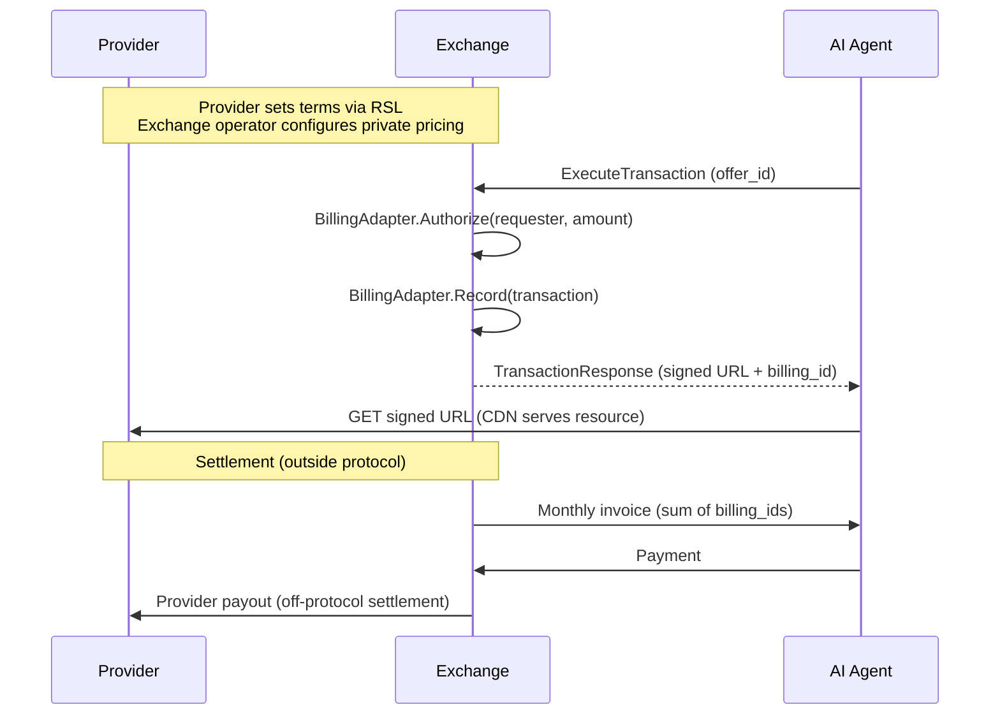

## The Billing Chain

FORA never touches money. It follows the OpenRTB model: the protocol handles authorization and logging, while actual settlement happens outside the protocol through existing billing infrastructure.

The chain works like this:

```
Provider -> Exchange operator -> AI Company (the agent's account holder)
```

1. The **Exchange** (operated by an Exchange operator, provider, or third party) handles all billing through its pluggable Billing Adapter
2. The Exchange operator **invoices the AI company** via its existing system (monthly invoicing, prepaid balance, etc.). A purchase made through a Broker is billed to the agent's own account, as a direct one is
3. The Exchange operator **pays the provider** via its existing revenue-share agreement. The operator sets the Exchange's fee for each provider (a tenant of the Exchange) in basis points of gross, with `AdminService.SetTenantFeeRate` on the operator plane

Each paid item of a `TransactionResponse` carries a `TransactionResultItem.billing_id`, minted by the Exchange's Billing Adapter. A denied item has none, and neither does an item with a zero price, which FORA Server sells without calling the Billing Adapter. It is an invoice line item, not a payment confirmation. Settlement happens offline, same as programmatic advertising.



## Pricing Models

`PricingModel` is the charging **structure** only — a closed set of three. The open-ended metering basis ("per what") lives in `Pricing.unit` as a vocabulary, so per-access / per-token / per-fetch / per-page / per-minute / per-record are all `PER_UNIT` with a different `unit`.

| Model | Description | RSL Equivalent |
|---|---|---|
| `PRICING_MODEL_FREE` | No charge (state explicitly; absent Pricing ≠ free) | free |
| `PRICING_MODEL_PER_UNIT` | Rate per `Pricing.unit` (metering basis: `accesses`, `tokens`, `fetches`, `pages`, `minutes`, `records`, …) | crawl / use / inference / training / metered purchase |
| `PRICING_MODEL_FLAT` | One-time flat fee; `rate` is the total, no unit | one-time purchase |

A `PER_UNIT` price is metered. A `PER_UNIT` offer may carry an `estimated_quantity` in its `unit`, or none; whether to state one is the publisher's decision. The purchase charges estimate × rate, or one unit's rate without an estimate, and the charge is final. A disagreement about the quantity consumed is a dispute. See [Charging a metered purchase](/protocol/transaction-flow/#charging-a-metered-purchase).

A **subscription** is `FREE` + a `subscription:*` scope (settled off-protocol). **Attribution** and **contribution** are `Obligation`s, not pricing models. There is no revenue-share model — settlement is off-protocol.

Providers set their preferred pricing model and rate in their RSL file. The Exchange operationalizes these into live Offers. RSL pricing serves as a price ceiling (public declaration); private pricing between provider and Exchange may be lower.

## unit_cost: Normalized Pricing

Different pricing models make direct comparison difficult. An article priced at $0.05 per access is not directly comparable to a resource priced at $0.00002 per token.

**unit_cost** normalizes all pricing to a per-unit basis, analogous to eCPM in advertising. It is stated in the comparison unit of the content type: tokens for text, seconds for video, records for data, calls for APIs.

```
unit_cost = price of one purchase / size of the resource in the comparison unit
```

The denominator is the size of the resource, **not** `estimated_quantity`. `estimated_quantity` is always counted in the offer's own `Pricing.unit`, so it is the comparison size only when the offer is priced in the comparison unit. A price per access has an estimate in accesses — one access — never a token count.

For example:
- Article at $0.05 per access (`unit: "accesses"`, `estimated_quantity: 1`), 3,300 tokens long: unit_cost = $0.05 / 3,300 = $0.00001515 per token
- Per-token pricing at $0.00002 (`unit: "tokens"`): unit_cost = $0.00002 per token, the rate itself
- Data at $0.002 per record (`unit: "records"`, `estimated_quantity: 500`): unit_cost = $0.002 per record, the rate itself
- Video at $0.50 per minute (`unit: "minutes"`, `estimated_quantity: 45`): unit_cost = $0.50 / 60 = $0.0083 per second

The Broker uses `unit_cost` to compare offers across Exchanges and pricing models, selecting the most cost-effective option regardless of how the provider originally priced it.

Every `Offer` in a `ResourceResponse` includes both the native pricing and the computed `unit_cost` value. Here the article priced per access:

```json
{
  "pricing": {
    "model": "PRICING_MODEL_PER_UNIT",
    "rate": "0.05",
    "currency": "USD",
    "unit_cost": "0.00001515",
    "estimated_quantity": 1,
    "unit": "accesses"
  }
}
```

The purchase charges estimate × rate = 1 × $0.05, and the charge is final. Its usage report counts accesses too (`consumed_quantity: 1`, `consumed_unit: "accesses"`).

## base_currency

Each Exchange declares a `base_currency` in its manifest (ISO 4217 code, e.g., "USD", "EUR"). All `unit_cost` values in offers from that Exchange are denominated in this currency. This enables cross-exchange price comparison by the Broker without requiring currency conversion at query time.

## Subscription vs. Per-Request Billing

The protocol supports two billing patterns:

### Per-Request Billing

The default model. Each transaction is independently authorized and billed:

1. Agent sends `ExecuteTransaction` with a selected offer
2. Exchange calls `BillingAdapter.Authorize` for the offer's charge. The adapter reserves the amount against the requester's balance, or checks that the requester can pay
3. If authorized, Exchange issues a signed URL, writes the transaction to its log, and calls `BillingAdapter.Record` to confirm the charge
4. The AI company is invoiced for the sum of all transactions

An item with a zero price skips the Billing Adapter: FORA Server calls neither `Authorize` nor `Record` and issues no `billing_id`, and still issues the signed URL and logs the transaction.

### Subscription Billing

The AI company pays for a subscription off-protocol. On-protocol, a subscription is a `LicenseTerm` priced `PRICING_MODEL_FREE` whose `LicenseTerm.scopes` include a `subscription:` scope:

1. During `DiscoverResources`, FORA Server presents the term only when the request carries a delegation chain (`Requester.delegation`) that verifies against the subscription record owning that scope, bound to the key that signed the request, and whose scopes cover the term's. It ignores `Requester.scopes` for such a term. A query a Broker originates is signed by the Broker alone, so it never yields the term
2. During `ExecuteTransaction`, the item carries the agent's signed `AgentAcceptance`, and the Exchange verifies the delegation chain against the key that signed it
3. The price is zero, so the Exchange skips the Billing Adapter and issues no `billing_id`
4. Usage reporting is still required, unless the term's metering is `PRICING_METERING_NONE` -- providers need consumption data for subscription renewals

## Overspend Prevention

Two enforcement layers prevent overspend, mirroring how OpenRTB prevents advertiser overspend:

- **Agent/Broker-side**: `RequestConstraints.max_unit_cost` -- the agent will not accept offers above this threshold. `BrokerService.Resolve` may filter out offers that would exceed the agent's budget (`max_price`, and `period_budget` for its `budget_scope`) and answers a URI left with none with `OFFER_ABSENCE_REASON_BUDGET_EXCEEDED`. How the budget is computed is the Broker's own behaviour, not part of the protocol. Resolve never charges.
- **Exchange-side**: The Exchange operator's Billing Adapter checks the requester's balance or credit before authorizing each item. An item the requester cannot afford is denied in the response body (`DENIAL_REASON_INSUFFICIENT_BALANCE`), also when it is the only item.

Each Exchange independently tracks per-requester balance. The Broker keeps its own view of spend for budget filtering, but the Exchange is authoritative for "can this requester afford this transaction." Currency conversion is out of scope for this version: totals are never summed across currencies.

## Example Transaction: End to End

Here is a concrete transaction with dollar amounts.

**Setup:**
- Provider: *The Daily Meridian*, a mid-size tech publisher
- Exchange: SSP-Alpha, which sells The Daily Meridian's catalog
- Article: "AI Regulation: What Providers Need to Know" (2,500 words, ~3,300 tokens)
- RSL price ceiling: $0.08 per crawl
- SSP-Alpha private pricing: $0.05 per article (below RSL ceiling)
- Requester: Acme AI, whose agent has a registered account at SSP-Alpha (account handle `acct_7f3e21c9` — an opaque value minted by the Exchange at registration, meaningless on its own)
- Acme AI has an annual subscription to The Daily Meridian through SSP-Alpha

**What happens:**

| Step | Action | Cost |
|---|---|---|
| 1 | Acme AI's agent queries SSP-Alpha via `DiscoverResources`, signed with its own key and carrying its delegation from Acme AI | $0 |
| 2 | SSP-Alpha returns two offers: per-access ($0.05) and subscription ($0.00) | -- |
| 3 | The agent selects the subscription offer (zero marginal cost) | $0.00 |
| 4 | `ExecuteTransaction` -- SSP-Alpha verifies the delegation chain; the price is zero, so no Billing Adapter call and no `billing_id` | $0.00 |
| 5 | Signed URL issued, the agent fetches the article from CDN | -- |
| 6 | Usage report filed: 3,150 actual tokens consumed | -- |

**Financial attribution:**
- `cost.amount`: $0.00 (subscription)
- The annual subscription fee is settled off-protocol between Acme AI and SSP-Alpha

**Without the subscription**, the per-request path would have charged $0.05 for this article, with a `unit_cost` of $0.00001515 per token.

## Dispute Credits

When an agent files a dispute via `DisputeTransaction`, `DisputeResponse.resolution` carries the outcome once the dispute reaches `RESOLVED`, `SETTLED` or `FINAL`; while the dispute is in progress, the field is absent. The outcome is one of four `ResolutionType` values, each named with the prefix `RESOLUTION_TYPE_`, and one of them is a credit:

| Resolution | When | Effect |
|---|---|---|
| `CREDIT` | CDN delivery failure, signed URL expired before fetch, content hash mismatch, token-count discrepancy corroborated by CDN response size | Account credit applied to the agent's next billing cycle |
| `REDELIVERY` | Transient failure, content still available | New signed URL issued for the same resource, no credit |
| `REJECTED` | The dispute, once reviewed, is not corroborated | No remedy |
| `INVESTIGATION` | The dispute needs pattern analysis across transactions | Escalated to Tier 3 pattern analysis |

See [Dispute Resolution](/protocol/dispute-resolution/) for the tiers and the rules for each dispute reason.

Credits are applied to the agent's balance with the Exchange. They reduce the next invoice -- same as ad-tech billing discrepancy adjustments. The protocol does not prescribe how credits are settled between Exchange operator and provider; that follows the existing revenue-share agreement.

## Pricing Transparency

A Broker's fee has no field. It is additive and disclosed out of band, never folded into the offer price the Exchange signed, so the agent sees what it pays for the resource and what it pays for brokerage (see [Selection Engine](/components/broker/selection-engine/)).

## Reconciliation

Three independent records ensure transaction integrity:

1. **CDN access logs** (provider controls): every signed URL access with transaction ID, agent ID, timestamp
2. **Exchange transaction log** (Exchange operator controls): every transaction with its `billing_id` (none for a zero-price item), unit cost and currency, the requester, the signed offer and the agent's signed acceptance, with the public keys their Ed25519 signatures verify under
3. **Usage reports** (agent files): what the agent actually did with the resource (token count, function, citation)

All three records must agree. Discrepancies are resolved offline, like ad-tech billing discrepancies.

A provider registered on the operator's publisher console sees its sales there. "Overview" totals transactions, gross, the Exchange fee and net for a period. "Transactions" lists each sale, filterable by domain and by usage-report status, and "Verify" checks the sale's two Ed25519 signatures in the browser. "Income" shows daily totals, with "Download CSV". The console is the operator's tool, not part of the protocol. See [After setup](/getting-started/publisher-onboarding/#after-setup) in Publisher Onboarding.

## Next Steps

- [Publisher Onboarding](/getting-started/publisher-onboarding/) -- register a site and see what its pages earn
- [Transaction Flow](/protocol/transaction-flow/) -- detailed protocol messages for each step
- [Scenario Walkthrough](/protocol/scenario-walkthrough/) -- a complete end-to-end scenario with all wire formats
