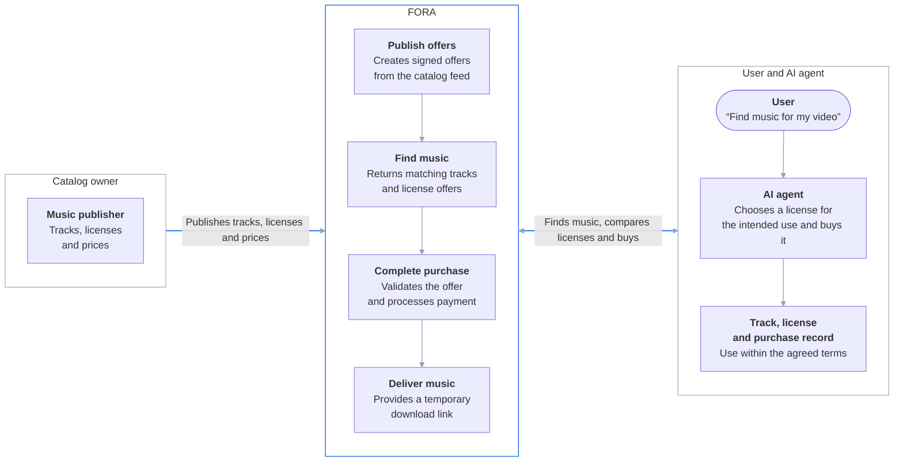

import { Aside } from '@astrojs/starlight/components';
import { Image } from 'astro:assets';

import catalogSearch from '../../../assets/walkthrough-music/01-catalog-search.png';
import licenseDocument from '../../../assets/walkthrough-music/02-license-document.png';
import searchResults from '../../../assets/walkthrough-music/03-search-results.png';
import licenseOptions from '../../../assets/walkthrough-music/04-license-options.png';
import choiceYoutube from '../../../assets/walkthrough-music/05-choice-youtube.png';
import purchaseYoutube from '../../../assets/walkthrough-music/06-purchase-youtube.png';
import balanceBefore from '../../../assets/walkthrough-music/07-balance-before.png';
import balanceAfter from '../../../assets/walkthrough-music/08-balance-after.png';
import timeline from '../../../assets/walkthrough-music/09-timeline.png';
import choiceBroadcast from '../../../assets/walkthrough-music/10-choice-broadcast.png';
import balanceAfterBroadcast from '../../../assets/walkthrough-music/11-balance-after-broadcast.png';
import receiptMarkerBroadcast from '../../../assets/walkthrough-music/12-receipt-marker-broadcast.png';

Let's continue the [Live Demo](/getting-started/poc-walkthrough/) with a case from the music industry. There, an agent bought a license to read one article. Here, an agent buys a license to use a music track in a video.

Today, licensing music for a video is manual work: every library has its own tiers and terms, and it is easy to buy the wrong one. An agent can do this work only if it can read and compare the terms before it pays.

The scenario we recorded: an AI agent is editing a short video clip and needs background music. It searches the Demo Music Catalog through FORA, reads the three licenses offered for the track it picks, buys one and places the audio on the timeline. Then we give it the same task again, but with a different customer and a different use. The first video is for the creator's own YouTube channel, the second for a broadcaster's program. Same track, same agent, same catalog — and the agent buys a different license, because the one that fits a personal channel does not cover broadcast.

In short: for the personal YouTube video, the agent buys Online Creator for €29, and the license asks it to record the video URL for Content ID. For the broadcast program, it buys Broadcast for €450, and the license asks for a cue sheet. See the [full comparison](#side-by-side) at the end of the page.

Each step shows the screen and the protocol call under it, so you can see which part of the protocol does the work.

<Aside type="caution" title="Fictional licenses, test money">
The Demo Music Catalog and its licenses are fictional. The music is real: tracks from the [Free Music Archive](https://freemusicarchive.org/), each under its own license, CC BY, CC BY-SA or CC0. Each audio file is a 30-second excerpt of the recording. The ISRC and UPC codes in the catalog are generated demo identifiers, not real ones. The fictional licenses do not change what a track's own license allows. The video in the editing project is a clip from [Tears of Steel](https://mango.blender.org/) (© Blender Foundation), used under [CC BY 3.0](https://creativecommons.org/licenses/by/3.0/). The purchases are real transactions on the demo Exchange, paid from a test balance, so nothing is billed or owed. No real rights were cleared, no royalties were paid, no cue sheet was filed and nothing was registered with YouTube Content ID.

The deployment can be reset without notice, which removes accounts, registrations and transaction history, including the transactions shown on this page.
</Aside>

<video
  controls
  preload="metadata"
  playsinline
  poster="https://fora-protocol-media.s3.us-east-1.amazonaws.com/videos/live-demo-music-catalog-poster.jpg"
  style="width: 100%; height: auto;"
>
  <source src="https://fora-protocol-media.s3.us-east-1.amazonaws.com/videos/live-demo-music-catalog.mp4" type="video/mp4" />
  <a href="https://fora-protocol-media.s3.us-east-1.amazonaws.com/videos/live-demo-music-catalog.mp4">Download the walkthrough video</a>
</video>

## Agent-ready licensing without custom development

The Demo Music Catalog (the fictional music publisher in this demo) wrote no code. It described its catalog in one file, called a feed, and pushed that file to the Exchange. See the [example feed](#for-catalog-owners) at the end of the page.

After a one-time setup of its domain and CDN, FORA gives the catalog everything the agent uses on this page:

- **Search.** Agents find tracks by genre, mood, tempo and other music fields.
- **Terms an agent can read.** Each license becomes a signed offer with the price and the main terms. The full license text is at a public URL, so an agent can read it before it pays.
- **Payment.** The Exchange checks the offer, charges the agent's account and records the transaction.
- **Delivery.** The agent gets a short-lived signed download link. The CDN checks the link before it serves the file.
- **Evidence.** Each purchase leaves signed records that anyone can check later.

The catalog owner publishes one feed, and FORA handles discovery, purchase and delivery for compatible AI agents. Here's how the pieces fit together:



## The setup

For this demo, we used Claude Desktop with two MCP servers connected:

- **The FORA demo MCP server**, with an agent identity that is already registered with the Exchange. This is the same setup as in the Live Demo: [add the server](/getting-started/poc-walkthrough/#1-add-the-demo-mcp-server), [get an identity](/getting-started/poc-walkthrough/#2-connect-and-get-an-identity) and [register with the Exchange](/getting-started/poc-walkthrough/#4-register-with-the-exchange). We do not repeat those steps here.
- **DaVinci Resolve (the free version) with the [davinci-resolve-mcp](https://github.com/samuelgursky/davinci-resolve-mcp) bridge**, so the agent can work in the editing project: import the audio, place it on the timeline and add markers.

The editing project holds a 40-second clip from [Tears of Steel](https://mango.blender.org/): two people talk on a bridge. The music goes under their conversation.

## The catalog and its three licenses

The Demo Music Catalog is on [demo-music.fora-protocol.org](https://demo-music.fora-protocol.org/). It holds 5,931 tracks from the Free Music Archive, each as a 30-second clip. Its search page lists them with the fields people search music by: title, artist or album, genre, mood and energy, instrument, vocals, tempo and length. The catalog shows no prices, because a price belongs to a license, not to a track.

<Image src={catalogSearch} alt="Demo Music Catalog search page: 5931 of 5931 tracks match, with filters for title, artist or album, genre, mood (energy), instrument, vocals, BPM and track length, above a table of tracks with their genre, mood, BPM, length and vocals." />

To keep the demo simple, every track is offered under the same three licenses, at the same prices:

- **Online Creator** — for an individual's own online channel. €29.
- **Broadcast** — for broadcasters and commercial clients, including TV. €450.
- **Advertising** — for paid advertising. €1,200.

For the same reason, [one plain-language license document](https://demo-music.fora-protocol.org/licensing/demo-music/music-v0.1.txt) describes all three, one section per license. This is the text a music supervisor would read, and it is the same text the agent reads.

<Image src={licenseDocument} alt="The Demo Music Catalog license document open in a browser at demo-music.fora-protocol.org/licensing/demo-music/music-v0.1.txt. Its opening lines say it contains three alternative licenses: EUR 29 Online Creator, EUR 450 Broadcast, EUR 1200 Advertising." />

<Aside title="What a license looks like to the protocol">
Each license is one `LicenseTerm` on the track, and the Exchange emits one offer per term. The term summarizes the license in machine-readable fields: who may use the track and for what (restrictions), for how many productions (quotas), the price, and what the licensee must do after release (obligations: credits, notices, a cue sheet). It points to the license document by `uri`, with a `uri_digest` of the text. The file at the URL can still change, but anyone can compare it with the digest and see that it is not the text the offer was signed with. All three licenses are a one-time flat fee with metering `NONE`, and none of them requires a usage report. See [Licensing Terms](/protocol/licensing-terms/).
</Aside>

## First run: a personal YouTube video

### 1. Searching for a track

The creator asks the agent for music:

> I'm making a sci-fi video for my own personal YouTube channel. It starts with a scene featuring a conversation. I'm an individual creator, not a company.
>
> Find background music in the FORA demo catalog with low energy, a dark or mysterious mood, a tempo of 40–100 BPM and no vocals, for this video. List all the tracks you find. Show me the license options for the best track, compare them for my use, pick the one that fits, and explain why the others do not fit.

The agent does not know the catalog or the track names. It describes what it needs, and the FORA search service finds the tracks that match. The search returned fifteen tracks, and the agent listed them. It picked Portals by Three Chain Links: at 48 BPM it is the slowest of them, it uses only a synthesizer, so it leaves room for the voices, and its source license is CC BY without a share-alike condition.

<Image src={searchResults} alt="Claude Desktop reply: the start of the list of tracks the search found, Aether, Monolith, Portals, Architects, Angels and Solace by Three Chain Links, with the tempo, the instruments and the CC BY 4.0 source license of each. Portals, at 48 BPM, is marked as the best match." />

The same answer carries the track's three offers, one per license. This is where the prices first reach the agent: they come from the signed offers, not from the catalog page. The agent turns the offers into a table: the price, who can buy, the allowed uses, the scope, the extra duties and the quota.

<Image src={licenseOptions} alt="Claude Desktop reply: the license options for Portals, Online Creator EUR 29, Broadcast EUR 450 and Advertising EUR 1,200, compared by who can buy, permitted uses, scope, extra duties and quota." />

<Aside title="How the search works">
The agent sends a short natural-language `DiscoveryRequest.query`, and it can add `search_filters` that every result must match. In this run it sent:

```text
query:          sci-fi background music for a dialogue scene
search_filters: music.energy     low
                music.mood       dark, mysterious
                music.bpm_range  40-100
                music.vocals     false
```

The Broker's `Resolve` call does the rest. This deployment runs the tag-based catalog search: the Broker reads search fields from the text — mood, vocals, duration and so on — matches them and the filters against the `music.*` fields that the catalog's feed carries in `ext` for each track, and ranks the results. For each track it returns one `OfferGroup` with the Exchange's signed offers, unchanged. `Resolve` only discovers; buying is a separate call to the Exchange. See [Broker: natural language](/components/broker/overview/#3-natural-language).

<details>
<summary>What came back in the recorded run</summary>

The answer held fifteen groups, one per track. This is the group for the track the agent chose, shortened:

```jsonc
{
  "offer_groups": [
    {
      "uri": "https://demo-music.fora-protocol.org/tracks/133/133672.mp3",
      "discovery_method": "DISCOVERY_METHOD_SEARCH",
      "offers": [
        // Online Creator
        {
          "offer_id": "2c359b17-0c22-46b1-a46d-74e667c2d1f2",
          "pricing": { "model": "PRICING_MODEL_FLAT", "rate": "29", "currency": "EUR", "metering": "PRICING_METERING_NONE" },
          "signature": "881f2fe753a46dad…",
          "terms": [
            {
              "semantics": "TERM_SEMANTICS_REFERENCE_ONLY",
              // license: the same license document for all three offers, see the next step
              "restrictions": [
                { "kind": "RESTRICTION_KIND_FUNCTION", "permitted": ["sync", "stream"], "prohibited": ["ai-train", "advertising", "broadcast"] },
                { "kind": "RESTRICTION_KIND_USER_TYPE", "permitted": ["individual"] },
                { "kind": "RESTRICTION_KIND_GEOGRAPHY", "permitted": ["*"] }
              ],
              "quotas": [ /* … */ ],
              "obligations": [ /* … */ ]
            }
          ]
        },
        // Broadcast
        {
          "offer_id": "3a4c232e-9691-42e5-80ce-b74d2d97f0ac",
          "pricing": { "model": "PRICING_MODEL_FLAT", "rate": "450", "currency": "EUR", "metering": "PRICING_METERING_NONE" },
          "signature": "e8f47625b9ca0eba…",
          "terms": [
            {
              "semantics": "TERM_SEMANTICS_REFERENCE_ONLY",
              // license: the same license document for all three offers, see the next step
              "restrictions": [
                { "kind": "RESTRICTION_KIND_FUNCTION", "permitted": ["sync", "broadcast", "stream"], "prohibited": ["ai-train", "advertising"] },
                { "kind": "RESTRICTION_KIND_USER_TYPE", "permitted": ["broadcaster", "commercial_entity"] },
                { "kind": "RESTRICTION_KIND_GEOGRAPHY", "permitted": ["*"] }
              ],
              "quotas": [ /* … */ ],
              "obligations": [ /* … */ ]
            }
          ]
        },
        // Advertising
        {
          "offer_id": "551d9c8d-a799-4636-9375-b3992338e84c",
          "pricing": { "model": "PRICING_MODEL_FLAT", "rate": "1200", "currency": "EUR", "metering": "PRICING_METERING_NONE" },
          "signature": "5895090e47f00d49…",
          "terms": [
            {
              "semantics": "TERM_SEMANTICS_REFERENCE_ONLY",
              // license: the same license document for all three offers, see the next step
              "restrictions": [
                { "kind": "RESTRICTION_KIND_FUNCTION", "permitted": ["sync", "advertising", "broadcast", "stream"], "prohibited": ["ai-train", "editorial"] },
                { "kind": "RESTRICTION_KIND_USER_TYPE", "permitted": ["commercial_entity"] },
                { "kind": "RESTRICTION_KIND_GEOGRAPHY", "permitted": ["*"] }
              ],
              "quotas": [ /* … */ ],
              "obligations": [ /* … */ ]
            }
          ]
        }
      ]
    }
  ]
}
```

Each track comes back as one `OfferGroup`. This is the group for Portals: three offers, each with its own price, its own term and its own Exchange signature. The terms differ in who can buy (`RESTRICTION_KIND_USER_TYPE`) and which uses are allowed (`RESTRICTION_KIND_FUNCTION`). The next step explains how the agent reads a term.

</details>
</Aside>

### 2. Reading the terms

The agent now has three offers for the same track and has to pick one. It compares each license with what it was told: a personal video for the creator's own YouTube channel.

<Image src={choiceYoutube} alt="Claude Desktop reply: the agent picks Online Creator (EUR 29), the only option open to individuals, which covers one personal YouTube video. It explains why Broadcast (EUR 450) and Advertising (EUR 1,200) do not fit, and lists what the license requires: a credit for the track, the published video URL recorded for Content ID, and no sponsorship or paid promotion." />

The license document gives a clear answer for each offer:

- **Online Creator fits.** It is for an individual making their own production, and it covers one YouTube video streamed online.
- **Broadcast does not fit.** It is for a broadcaster or a commercial company making a television program. The customer here is an individual, and the video is not going to TV.
- **Advertising does not fit.** It is for one paid advertisement for a named advertiser. The document says directly that it is "not an upgrade covering every use", and that it does not cover a personal YouTube video. It is also the most expensive offer.

This is the grant the agent buys, section 2 of the Online Creator license in the [license document](https://demo-music.fora-protocol.org/licensing/demo-music/music-v0.1.txt):

> For EUR 29 in demo funds, the offer models a non-exclusive, worldwide, perpetual right to synchronize the identified sound recording and its musical composition into one personal YouTube video and stream that completed video online. Necessary production copies, trimming, fades and mixing under dialogue are included. Platform ad-revenue monetization of the personal video is allowed. The fee is charged once for the one production, not per view, stream or download.

The rest of the section covers what a music licensing professional checks next. The grant covers both the recording rights and the composition rights, for the use it names. It does not cover performance royalties paid through collecting societies. It excludes client work, sponsorship, paid promotion and AI training. The licensee must credit the track's real creator, and record the published video URL for Content ID clearance.

The Exchange does not check who the customer is. The agent picks the license from what it was told about the customer and the use, and the person who gave the task is responsible for that statement being true. In the second run, the customer and the use change, and nothing else.

<Aside title="The same term, as the protocol sees it">
The Online Creator term has `TERM_SEMANTICS_REFERENCE_ONLY`. This means the license document is the authoritative text, and the machine-readable fields summarize it. The agent can filter on the fields, but it must read the document before it uses the track. The term's `NOTICE` obligation points the agent to the Online Creator section of the shared document. See [Term semantics](/protocol/licensing-terms/#term-semantics).

<details>
<summary>The Online Creator term</summary>

This is the term from the offer the agent received, with the digest shortened. It carries no price: an offer states its price once, in `Offer.pricing` (EUR 29 here), and the term it sells carries none.

```json
{
  "semantics": "TERM_SEMANTICS_REFERENCE_ONLY",
  "license": {
    "id": "demo-music-catalog-v0.1",
    "name": "Demo music catalog illustrative alternatives (Online Creator / Broadcast / Advertising)",
    "uri": "https://demo-music.fora-protocol.org/licensing/demo-music/music-v0.1.txt",
    "uri_digest": "sha256:bfab2a189c05b6e4…"
  },
  "restrictions": [
    { "kind": "RESTRICTION_KIND_FUNCTION", "permitted": ["sync", "stream"], "prohibited": ["ai-train", "advertising", "broadcast"] },
    { "kind": "RESTRICTION_KIND_USER_TYPE", "permitted": ["individual"] },
    { "kind": "RESTRICTION_KIND_GEOGRAPHY", "permitted": ["*"] }
  ],
  "quotas": [{ "limit": "1", "metric": "vendor:productions", "window": "QUOTA_WINDOW_TOTAL" }],
  "obligations": [
    {
      "kind": "OBLIGATION_KIND_NOTICE",
      "trigger": "OBLIGATION_TRIGGER_ON_USE",
      "detail": "Apply the Online Creator section of the referenced document (EUR 29). Fictional one-production, worldwide, perpetual license; no actual rights grant."
    },
    {
      "kind": "OBLIGATION_KIND_ATTRIBUTION",
      "trigger": "OBLIGATION_TRIGGER_ON_DISTRIBUTION",
      "detail": "\"Portals\" by Three Chain Links, from the Free Music Archive (freemusicarchive.org), licensed under CC BY 4.0 (http://creativecommons.org/licenses/by/4.0/). This audio is the dataset's 30-second excerpt of the recording; retain the source and license links and identify any further edits. The offers are demo examples; the source license's permissions are unchanged."
    },
    {
      "kind": "OBLIGATION_KIND_OTHER",
      "trigger": "OBLIGATION_TRIGGER_ON_DISTRIBUTION",
      "detail": "Personal YouTube production only; client work, sponsorship and paid promotion excluded. Record the published video URL for simulated Content ID clearance; no real clearance service or completed clearance is claimed."
    }
  ]
}
```

</details>
</Aside>

### 3. Buying the license

The agent buys the Online Creator offer. The Exchange confirms the purchase and returns a transaction ID, a billing ID and a signed link to the audio file. The link is valid for five minutes. The agent downloads the MP3 through that link and checks that it is exactly the file the offer describes.

<Image src={purchaseYoutube} alt="Claude Desktop reply: the purchase details, transaction ID 193eb04b-3dc3-4ed1-87e2-36d9a50c043c and the balance going from EUR 9,942 to EUR 9,913, a drop of exactly 29." />

The €29 comes from the agent's test balance. The agent reads its balance with the `Fora status` tool, which asks the Exchange.

**Before the purchase:**

<Image src={balanceBefore} alt="Claude Desktop reply: the FORA account on exchange.demo.fora-protocol.org is registered and active, with 9942 EUR available to spend, checked at 09:21 UTC." />

**After the purchase:**

<Image src={balanceAfter} alt="Claude Desktop reply: the FORA balance is EUR 9,913 at 10:04 UTC, EUR 29 lower than in the morning because of the license for Portals." />

In the Live Demo, the agent filed a usage report after it read the article. This purchase requires no usage report: the Exchange's answer contains no reporting obligation. The license's credit and Content ID obligations still apply, but they are between the licensee and the publisher, not part of the protocol.

<Aside title="What happened under the purchase">
1. **`Fora execute`** (`BrokerService.ExecuteTransaction`, via the Broker) — the agent sends back the signed offer it chose, with its acceptance, and the Broker re-packages the purchase into a request to the offer's Exchange, signed with its own key, with the agent's acceptance in the body. The Exchange verifies `Offer.signature`, so the terms and price cannot have changed since discovery. It charges the balance and returns `transaction_id`, `billing_id` and a signed `retrieval_endpoint`.
2. *Fetch* — the signed URL carries the agent's key thumbprint (`agent_id`) and an expiry time (`exp`). The delivery edge checks the signature and the expiry, and serves the MP3. An edge can also check that the request comes from the agent the URL was issued to. After the download, the agent compares the file's SHA-256 hash with `content_hash` in the offer.

An offer is valid for five minutes. The offers from the search had expired before the purchase, so the agent asked for the track's offers again and bought a new Online Creator offer. It has a new ID and a new signature, but the same terms and price.

`reporting_obligation` in the answer is empty, so no `ReportUsage` call follows. See [ExecuteTransaction](/protocol/transaction-flow/#rpc-2-executetransaction).

<details>
<summary>The request and the answer</summary>

This is what the agent sent, shortened. The idempotency key is the one the Exchange recorded with the transaction:

```jsonc
{
  "offers": [
    {
      "offer_id": "79b7be49-e398-4d2c-b75d-29f378ffc83e",
      "expires_at": "2026-11-10T10:06:58.590001206Z",
      "pricing": { "model": "PRICING_MODEL_FLAT", "rate": "29", "currency": "EUR", "metering": "PRICING_METERING_NONE" },
      "signature": "2bbdc0ff23995782…",
      "signature_algorithm": "EdDSA"
      // … the rest of the signed offer, unchanged
    }
  ],
  "idempotency_key": "portals-online-creator-79b7be49"
}
```

And what the Exchange returned, with the agent's key thumbprint and the URL signature shortened:

```json
{
  "exchanges": [
    {
      "exchange": "exchange.demo.fora-protocol.org",
      "agent_identity_hash": "GHpENLL5vGgF…",
      "offer_ids": ["79b7be49-e398-4d2c-b75d-29f378ffc83e"]
    }
  ],
  "items": [
    {
      "transaction_id": "193eb04b-3dc3-4ed1-87e2-36d9a50c043c",
      "billing_id": "b9c6ef7dc06f4ef0c591da0fb299de53",
      "offer_id": "79b7be49-e398-4d2c-b75d-29f378ffc83e",
      "resource_title": "Portals — Three Chain Links",
      "cost": { "amount": "29", "currency": "EUR", "unit_cost": "29" },
      "delivery_method": "DELIVERY_METHOD_INSTRUCTIONS",
      "retrieval_endpoint": "https://demo-music.fora-protocol.org/tracks/133/133672.mp3?agent_id=GHpENLL5vGgF…&exp=1794305235&kid=4QSzECKtgJeix7wyRx8ADEI4o4x3darNVEef6BKkP4I&sig=yEPjxr93eGf0…",
      "expires_at": "2026-11-10T10:07:15.912766823Z",
      "reporting_obligation": {}
    }
  ],
  "request_id": "b96936a9-c1ae-40dc-a8b5-c77017673b88",
  "totals": [{ "amount": "29", "currency": "EUR" }]
}
```

</details>
</Aside>

### 4. Placing the music on the timeline

With the MP3 downloaded, the agent switches to DaVinci Resolve. Through the Resolve MCP bridge, it makes three edits:

1. Imports the track and places it on its own audio track under the dialogue.
2. Fades it out over the last 3 seconds.
3. Lowers its level by 18 dB, so the voice stays clear.

The agent applied the fade and the level to the audio file and placed it on the timeline. The track is a 30-second excerpt, so the music ends ten seconds before the dialogue does.

<Image src={timeline} alt="DaVinci Resolve project Personal YouTube Channel: the Tears of Steel clip on Video 1 with its dialogue on Audio 1, and Portals by Three Chain Links on a separate Music track under it, from the start of the timeline to 0:30, with a receipt marker at 5 seconds. The file name records the 18 dB level reduction and the 3-second fade-out." />

This step has nothing to do with FORA. It is here because it shows that the download worked: the file delivered through the signed link is the file that plays in the project.

### 5. Keeping the receipt

The agent does not keep a receipt on its own. We asked it to, and it wrote the receipt in two places: as a note on a timeline marker in the Resolve project, and as `license-receipt.json` next to the project. The receipt holds everything that identifies the purchase: the transaction and billing IDs, the track, the offer, the license name with a fingerprint of its document, the price, the time, and the Exchange's signature over the offer. The second run shows the marker in the timeline.

<details>
<summary>`license-receipt.json` from the first run</summary>

This is the receipt, shortened:

```jsonc
{
  "transaction_id": "193eb04b-3dc3-4ed1-87e2-36d9a50c043c",
  "billing_id": "b9c6ef7dc06f4ef0c591da0fb299de53",
  "offer_id": "79b7be49-e398-4d2c-b75d-29f378ffc83e",
  "track": {
    "title": "Portals",
    "artist": "Three Chain Links",
    "release_title": "Phantoms",
    "isrc": "XFFMA0133672",
    "isrc_note": "Generated by the demo catalog, not a real ISRC.",
    "proprietary_ids": ["fma:133672"]
  },
  "resource": {
    "uri": "https://demo-music.fora-protocol.org/tracks/133/133672.mp3",
    "content_hash": "sha256:d18d7e20180ce64d…",
    "local_file_hash_verified": true
  },
  "license": {
    "name": "Demo music catalog illustrative alternatives (Online Creator / Broadcast / Advertising)",
    "tier": "Online Creator",
    "id": "demo-music-catalog-v0.1",
    "uri": "https://demo-music.fora-protocol.org/licensing/demo-music/music-v0.1.txt",
    "uri_digest": "sha256:bfab2a189c05b6e4…"
  },
  "price": { "amount": "29", "currency": "EUR" },
  "exchange": "exchange.demo.fora-protocol.org",
  "timestamp": "2026-11-10T10:06:00Z",
  "timestamp_note": "When this receipt was written. The exchange returned no purchase timestamp; the purchase was made at about 10:02 UTC (the delivery URL expires 2026-11-10T10:07:15Z, about 5 minutes after purchase).",
  "signed_offer": {
    "offer_id": "79b7be49-e398-4d2c-b75d-29f378ffc83e",
    "expires_at": "2026-11-10T10:06:58.590001206Z",
    "pricing": { "model": "PRICING_MODEL_FLAT", "rate": "29", "currency": "EUR", "metering": "PRICING_METERING_NONE" },
    "signature": "2bbdc0ff23995782…",
    "signature_algorithm": "EdDSA"
    // … the rest of the signed offer, unchanged
  }
}
```

The time in the receipt is when the agent wrote it, and the receipt says so. The Exchange's own records carry the real time.

</details>

The agent wrote this file itself, so the file alone proves nothing. It is useful because each value in it can be checked against a record the agent does not control:

- **The offer signature** proves which terms and price the Exchange offered. Anyone can verify it with the Exchange's public key. The license digest ties those terms to the exact license text.
- **The agent's signed acceptance** proves that this agent accepted this exact offer. The agent signs it with its own key when it buys, and the Exchange keeps it with the transaction.
- **The Broker's record** shows, from a second party, that the Broker sent this offer to this agent in its search results.
- **The Exchange's transaction record** proves that the purchase happened and which signed link the Exchange issued for it.
- **The edge delivery log** proves that the edge verified that same link and released the request for the file. It does not prove that the download finished — the audio in the timeline shows that.

None of this proves that the publisher owns the rights, that Content ID was cleared, or that any real money was paid.

The transaction ID is the key to all of these records. With it, the demo operator collects the evidence from every party in the purchase — the Exchange, the Broker and the delivery edge — and checks that the records agree with each other. For the first purchase, all seven checks pass.

<details>
<summary>The evidence for the first purchase</summary>

This is the demo operator's report. The tenant line and the correlator column are left out, and long values are shortened:

```text
FORA evidence chain
  transaction 193eb04b-3dc3-4ed1-87e2-36d9a50c043c

PARTY     STEP                      EVENT                                                                  CRYPTO
Exchange  1. offer signed           issued and signed offer 79b7be49-e398-4d2c-b75d-29f378ffc83e           EdDSA 2bbdc0ff2399578201…
Broker    2. offer routed           offered 79b7be49-… among 3 candidates for …/tracks/133/133672.mp3      unsigned audit row
Agent     3. offer accepted         signed an acceptance as requester agent-pxrlfn7z.mcp.demo.fora-…       EdDSA 44a6d7cc0be2f9a549…
Exchange  4. URL minted             minted a signed retrieval URL, expiring 2026-11-10T10:07:15Z           sha256 240103906875e673b…
Edge      5. URL verified           verified the signature on GET /tracks/133/133672.mp3 and authorized    sha256 240103906875e673b…
                                    delivery, served from us-east-1
Edge      6. origin fetch released  released the request to the CDN for the origin fetch (cdn-origin-      —
                                    fetch); no origin response was observed by this witness
Exchange  7. reporting              — no reporting obligation was minted for this transaction

ASSERTIONS
  [v] Exchange offer signature re-verifies offline
        ed25519.Verify accepted 3543 canonical bytes against the stored Exchange key
  [v] Agent acceptance signature re-verifies offline
        ed25519.Verify accepted 326 canonical bytes against the stored agent key
  [v] Acceptance binds this exact agreement (all 4 signed members)
        offer_sig, requester_id, requester_domain and idempotency_key inside the signed bytes all match the row
  [v] Transaction-log key derives from the signed request key
        "portals-online-creator-79b7be49:79b7be49-e398-4d2c-b75d-29f378ffc83e" = signed key + ":" + offer id
  [v] Broker independently recorded offering this offer
        selection sel-e50f6e00-adab-4531-97f1-47692bc3718f recorded at 2026-11-10T10:01:58Z lists offer 79b7be49-e398-4d2c-b75d-29f378ffc83e among its candidates
  [v] Broker's agent and the signing agent are the same identity
        Exchange and Broker both name "agent-pxrlfn7z.mcp.demo.fora-protocol.org"
  [v] Delivered URL is the URL the Exchange minted
        sha256 240103906875e673b95531c2b2c04f15f0e99f8c5667309b939de9b51fb93680 on both sides

7 of 7 checked assertions hold.
```

</details>

The evidence does not include billing: the €29 charge is shown by the balance before and after the purchase.

## Second run: a broadcast program

### 1. The same task, a different customer

We start again with the same project setup and the same agent. This time the editor says the video is for a broadcaster's television program:

> This is a separate job. I'm an editor at Northwind Television, a broadcaster. We are preparing a 30-second documentary segment that starts with a scene featuring a conversation, for a non-advertising TV programme on our channel. The same segment will run in the programme's online version. Northwind Television is the licensee, and I'm acting for the company.
>
> Find a track with low energy, a dark or mysterious mood, a tempo of 40–100 BPM and no vocals, for this video for this segment. Show me the license options for the best track, compare them for this use, pick the one that fits, and explain why the others do not fit.

The prompt says 30 seconds, but the project holds the same 40-second clip as in the first run, so the music again ends before the dialogue does. The search returns the same fifteen tracks. The best match is again Portals, offered under the same three licenses at the same prices. Nothing in the catalog has changed.

### 2. Reading the terms again

<Image src={choiceBroadcast} alt="Claude Desktop reply for the broadcast run: the license options for Portals again. The agent picks Broadcast (EUR 450), because Northwind Television, a broadcaster, can be the licensee and the license covers a non-advertising TV programme and its online version as one production. It explains why Online Creator and Advertising do not fit." />

The same license document now gives a different answer:

- **Online Creator does not fit any more.** It is only for an individual's own production. It excludes client work and television broadcast.
- **Broadcast fits.** It is for a broadcaster or a commercial company making a non-advertising TV program. It covers the broadcast, repeat transmissions of the same program, and its online version, including catch-up.
- **Advertising still does not fit.** The program is not an advertisement, and the document says the Advertising license does not cover "a non-advertising editorial television programme".

The Broadcast section also says who is responsible for the customer's statement: "The producer must state the represented customer and authority accurately; the Exchange does not verify that representation." The agent chose Broadcast because it was told the customer is a broadcaster. FORA did not check that.

### 3. Buying, editing and the second receipt

The rest of the run repeats the first one. The agent buys the Broadcast offer, and €450 comes from the test balance. It places the track on the timeline with the same edits, and writes a second receipt. The second receipt goes to a separate project folder, so it does not overwrite the first one.

**Before the purchase:**

<Image src={balanceAfter} alt="Claude Desktop reply: the FORA balance is EUR 9,913 at 10:04 UTC, after the Online Creator purchase." />

**After the purchase:**

<Image src={balanceAfterBroadcast} alt="Claude Desktop reply: the FORA balance is EUR 9,463 at 10:32 UTC. It started the day at EUR 9,942: EUR 29 went on the Online Creator license and EUR 450 on the Broadcast license for Northwind Television." />

<Image src={receiptMarkerBroadcast} alt="DaVinci Resolve project TV Broadcast with the marker at 5 seconds open. Its name is Music license: Portals (Broadcast), and its note starts with the FORA license receipt for Portals by Three Chain Links (FMA, CC BY 4.0), license Broadcast (demo-music-catalog-v0.1), EUR 450." />

<details>
<summary>`license-receipt.json` from the second run</summary>

This is the second receipt, shortened to the fields that differ from the first one:

```jsonc
{
  "transaction_id": "84907881-51d9-47f0-9fcc-01a1a1a23d2c",
  "billing_id": "c705ae61f61958f0c51e98ddc8444a1e",
  "offer_id": "c5833bae-f6dd-434b-8893-183cce7f2667",
  "license": {
    "tier": "Broadcast"
    // … name, id, uri and uri_digest: the same license document as in the first receipt
  },
  "price": { "amount": "450", "currency": "EUR" },
  "licensee": {
    "intended": "Northwind Television",
    "type": "broadcaster",
    "note": "Bought through the FORA account with billing_ref cdda5fe8-1fc7-4fab-b12f-431b4095b62c; the exchange's records tie the license to that account, not to Northwind by name."
  },
  "timestamp": "2026-11-10T10:34:00Z",
  "signed_offer": {
    "offer_id": "c5833bae-f6dd-434b-8893-183cce7f2667",
    "expires_at": "2026-11-10T10:35:59.191018506Z",
    "pricing": { "model": "PRICING_MODEL_FLAT", "rate": "450", "currency": "EUR", "metering": "PRICING_METERING_NONE" },
    "signature": "c6ac092a17137ccd…",
    "signature_algorithm": "EdDSA"
    // … the rest of the signed offer, unchanged
  }
  // track and resource: the same as in the first receipt
}
```

</details>

The agent added the `licensee` object on its own. The same demo account bought both licenses, first as an individual and then for Northwind Television. Before it bought, the agent asked whether the purchase should go through an account of Northwind's own, and in the receipt it notes that the Exchange's records tie the license to the account, not to Northwind by name. This is the limit described in the previous step, and the receipt records it.

### 4. The cue sheet

The Broadcast license adds an obligation that the Online Creator license does not have: a cue sheet. A cue sheet lists the music used in a program — the track, its composer and publisher, where the cue starts, how long it plays and how it is used. Broadcasters pay collecting societies for the right to broadcast music, and the cue sheet tells the society whose music was used, so it can pay the right writers and publishers.

The license is clear that the €450 does not include those royalties. The sync fee pays for putting the music into the program. Performance royalties are a separate payment, made through the broadcaster's arrangement with the collecting societies.

This demo does not create a cue sheet. There is no real program and no broadcaster to send it to. In a real production, the cue sheet is prepared when the edit is final and delivered to the broadcaster. Like the credit in the first run, it is an obligation of the license, not of FORA. Neither purchase asks for a usage report.

## Side by side

Same track, same agent, same catalog, same three licenses. The only thing that changed between the runs is what the agent was told about the customer and the intended use.

| | Personal YouTube video | Broadcast program |
|---|---|---|
| **License bought** | Online Creator | Broadcast |
| **Price** | €29 | €450 |
| **Key terms** | Individual's own production; one YouTube video, streamed online | Broadcaster or commercial company; one TV program and its online version |
| **Obligations** | Credit the track; record the video URL for Content ID | Credit the track; cue sheet; performance royalties not included |
| **Rejected** | <ul><li>**Broadcast**: the customer is an individual</li><li>**Advertising**: not an ad</li></ul> | <ul><li>**Online Creator**: individuals only, no broadcast</li><li>**Advertising**: not an ad</li></ul> |

All three licenses share the same base: one production, worldwide and perpetual; the recording and the composition in one grant; a credit to the track's real creator; no AI training; a one-time flat fee with no usage reports.

## For catalog owners

Nothing in this demo is specific to this catalog. Each line of its feed describes the audio file, the search fields, the license document, and the licenses the publisher sells with their prices. This is the line for the track the agent bought, shortened:

```jsonc
{
  "domain": "demo-music.fora-protocol.org",
  "path": "/tracks/133/133672.mp3",
  "title": "Portals — Three Chain Links",
  "content_id": "fma-133672",
  "content_hash": "sha256:d18d7e20…",
  "ext": {
    "music.title": "Portals", "music.artist": "Three Chain Links",
    "music.release_title": "Phantoms", "music.release_date": "2016-03-04",
    "music.isrc": "XFFMA0133672", "music.upc": "020001336724", "music.proprietary_ids": ["fma:133672"],
    "music.genre": "experimental", "music.subgenres": ["ambient", "instrumental"], "music.mood": ["dark"],
    "music.bpm": 48, "music.energy": "low", "music.vocals": false, "music.instruments": ["synthesizer"],
    "music.duration_seconds": 30.0,
    "source_license": { "name": "CC BY 4.0", "uri": "http://creativecommons.org/licenses/by/4.0/", "share_alike": false, "modified": true },
    "attribution": "\"Portals\" by Three Chain Links, from the Free Music Archive (freemusicarchive.org), licensed under CC BY 4.0 (http://creativecommons.org/licenses/by/4.0/).",
    "demo_generated": ["music.isrc", "music.upc"], "fictional_offers": true
    // "sources": where each field came from: fma, analysis or generated
  },
  "license": {
    "name": "Demo music catalog illustrative alternatives (Online Creator / Broadcast / Advertising)",
    "uri": "https://demo-music.fora-protocol.org/licensing/demo-music/music-v0.1.txt",
    "uri_digest": "sha256:bfab2a18…"
  },
  "terms": [
    { "user_types": ["individual"], "pricing": { "model": "flat", "rate": "29", "currency": "EUR", "metering": "none" } /* … */ },
    { "user_types": ["broadcaster", "commercial_entity"], "pricing": { "model": "flat", "rate": "450", "currency": "EUR", "metering": "none" } /* … */ },
    { "user_types": ["commercial_entity"], "pricing": { "model": "flat", "rate": "1200", "currency": "EUR", "metering": "none" } /* … */ }
  ]
}
```

The publisher, or a catalog contributor it authorizes, pushes the feed to an Exchange. The Exchange turns each term into a signed offer, and this deployment's Broker builds its search index from the `music.*` fields in `ext` of the same feed. These fields follow the [fora-music-v1 profile](/protocol/ext-music/), which defines each field and the search filters an agent can send.

Besides the search fields, this record fills in some of the profile's release, identifier and credit fields: `music.release_title` and `music.release_date` for the release, `music.isrc`, `music.upc` and `music.proprietary_ids` as identifiers, and `music.artist` as the display credit. The profile defines more fields in this group, for example `music.label`, `music.grid`, `music.iswc` and `music.contributors`, and this record leaves them empty. See [Release, Identifiers and Credits](/protocol/ext-music/#release-identifiers-and-credits) for the full list. The demo catalog generated the ISRC and the UPC, and `demo_generated` says so. The other fields — `source_license`, `attribution`, `sources`, `demo_generated` and `fictional_offers` — belong to this deployment, not to the profile, and a consumer that does not know them ignores them.

The Exchange can be run for you by an operator, or you can run your own. See [Deployment Models](/architecture/deployment-models/) for the options, [Publisher Onboarding](/getting-started/publisher-onboarding/#without-a-publisher-console) for what a publisher sets up to push its own feed, and [JSONL Ingestion](/protocol/jsonl-ingestion/) for the feed format.

## Further reading

- [Live Demo: First License](/getting-started/poc-walkthrough/) — the setup this page skips, and the protocol calls in more detail
- [Licensing Terms](/protocol/licensing-terms/) — how terms become offers, and what `reference_only` means
- [Transaction Flow](/protocol/transaction-flow/) — every message of discovery and purchase, with payloads
- [Extension: fora-music-v1](/protocol/ext-music/) — the `music.*` fields and the music search filters
- [Broker Overview](/components/broker/overview/) — how the Broker searches and ranks offers
- [CatalogService API Push](/components/content-ingestion/sources/#source-7-catalogservice-api-push) — how a publisher, or a contributor it authorizes, pushes a catalog to an Exchange

## Credits

- **Video:** [Tears of Steel](https://mango.blender.org/download/), (CC) Blender Foundation | [mango.blender.org](https://mango.blender.org/), licensed under [CC BY 3.0](https://creativecommons.org/licenses/by/3.0/). A 40-second excerpt is used, with music added under the first 30 seconds of the dialogue.
- **Music:** "Portals" by Three Chain Links, from the [Free Music Archive](https://freemusicarchive.org/), licensed under [CC BY 4.0](https://creativecommons.org/licenses/by/4.0/). The audio is the dataset's 30-second excerpt of the recording. Its level is reduced, and it fades out at the end.

The video and the music are real works under Creative Commons licenses. The Online Creator and Broadcast licenses bought in this demo are fictional examples of the Demo Music Catalog, paid with test money. They do not license Tears of Steel or the music, and no real rights were cleared. The Blender Foundation does not endorse FORA.
