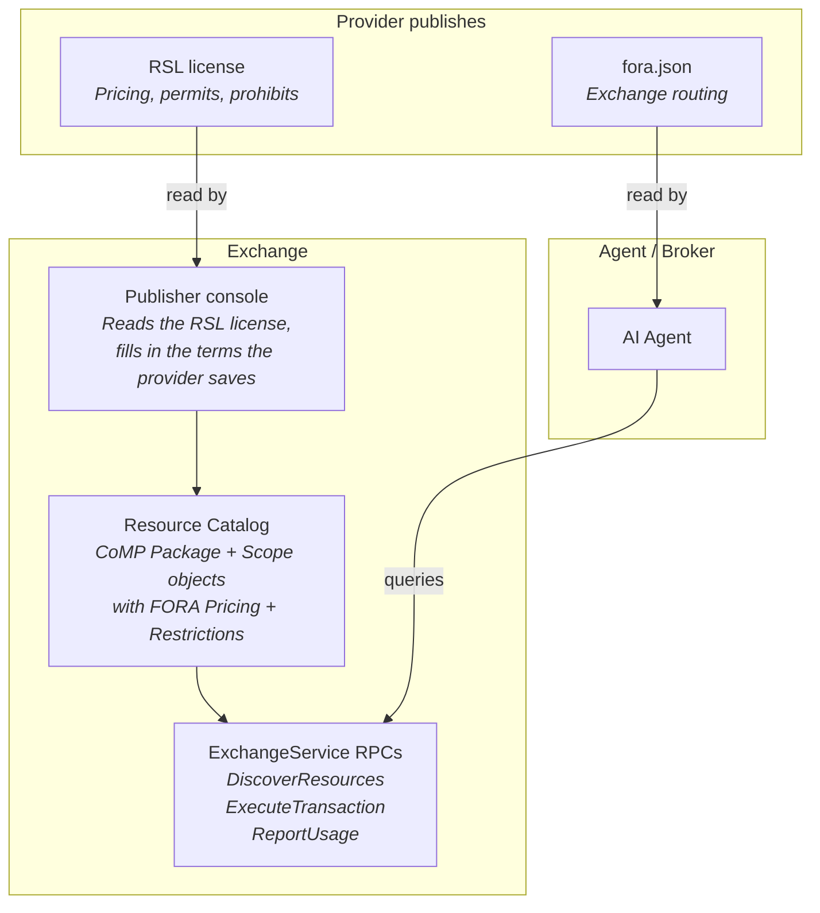
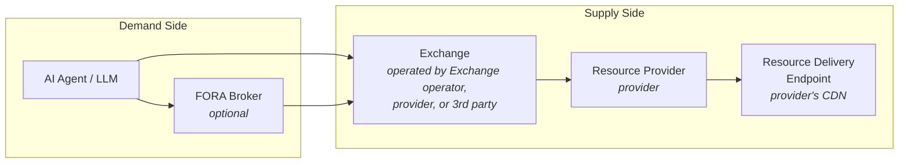

## Three Standards, One Stack

FORA does not replace RSL or CoMP. The three standards work together, each handling a distinct concern:

| Standard | What It Does | Provider Action | File / Endpoint |
|---|---|---|---|
| **RSL 1.0** | Declares licensing terms and pricing | Publish an RSL license and point to it | Any URL, named by a `License:` line in `robots.txt` or another [RSL carrier](#where-an-rsl-license-is-found) |
| **CoMP V1** | Defines content metadata objects | (Used internally by Exchange) | -- |
| **C2PA 2.x** | Content provenance and authenticity | Embed Content Credentials in assets | (In-asset or sidecar manifest) |
| **FORA** | Transaction protocol + discovery | Drop `fora.json` on domain | `/.well-known/fora.json` |
| **Content Attestation** | Cryptographic content verification | Publish keys in the WBA directory | `/.well-known/http-message-signatures-directory` |
| **MCP Interface** | Convenience tool layer for MCP agents | Deploy MCP server | (MCP server binary) |

In plain terms:

```
RSL                 = "Here's what my content costs and what you can do with it"
CoMP                = "Here's how to describe content in a standard way"
C2PA                = "Here's who created this content and its full edit history"
FORA               = "Here's where and how to buy it"
Content Attestation = "Here's cryptographic proof that the content is what it claims to be"
MCP Interface       = "Here's how to access FORA from any MCP-capable agent without an SDK"
```

C2PA and FORA are orthogonal: C2PA proves **what content IS** (provenance, creator identity, transformation history). FORA manages **what you can DO with it** (commercial access, pricing, transaction, dispute). The [`fora-c2pa-v1` extension profile](/protocol/ext-c2pa/) bridges them -- C2PA validation results are carried in FORA attestations, and C2PA training/mining restrictions are enforced through FORA access controls.

### Web Bot Auth Conformance

The IETF [webbotauth working group](https://datatracker.ietf.org/wg/webbotauth/about/) is standardising cryptographic bot identity: bots sign HTTP requests with RFC 9421 HTTP Message Signatures and publish their keys in a directory at a well-known path. Its only adopted document is [draft-ietf-webbotauth-httpsig-protocol-00](https://datatracker.ietf.org/doc/draft-ietf-webbotauth-httpsig-protocol/00/) (1 September 2026), and that version is the one FORA targets.

Every FORA request signature is a conformant signature under that draft, so a CDN or origin that verifies Web Bot Auth can verify a FORA agent without FORA-specific integration. In the other direction, FORA accepts signatures from any Web Bot Auth library, with or without `alg`, provided that on a FORA RPC the signature also covers the request method, target URI, body digest and `Authorization` header, its key is Ed25519, and the signer's key directory meets the rules where FORA departs from the draft. FORA asks for those components through Web Bot Auth's own `Accept-Signature` mechanism. Conformance does not come from sharing the cryptography: it depends on the header forms, the covered components, the signature parameters and the directory format, which [Authentication](/protocol/authentication/#the-web-bot-auth-profile) specifies, together with the [three places FORA departs from the draft](/protocol/authentication/#where-fora-departs-from-wg-00), all in the key directory. The SDKs implement that profile from v1.1.0; those released as v1.0.8 do not, and Authentication lists the differences. Web Bot Auth solves identity (Layer 2); FORA adds the transaction layer (Layer 4) on top of that identity.

## How They Compose



A provider that wants to monetize AI traffic does two things:

1. **Sets its terms** -- pricing and usage rules, in the publisher console. A provider that publishes an RSL license finds the console's terms form filled in from it. The Exchange's catalog carries the terms the provider saves.
2. **Drops `fora.json`** -- declares which Exchanges are authorized to sell this provider's resources. Agents read this file to find where to transact.

Everything else is handled by the Exchange and the protocol.

## Roles



| Role | Description | Standard |
|---|---|---|
| **AI Agent** | The LLM, RAG system, or agentic application that needs content. Authenticates via Ed25519 signatures. Identity is the RFC 9421 request signature; the scopes it states decide which terms it is shown, and a delegation can back them where an Exchange requires one. | CoMP: "Requesting Party". FORA v1.0 uses the `Requester` message (not CoMP `AISystem`); CoMP's `lid` is a public agent identifier with no counterpart field on the FORA request — not a credential. |
| **FORA Broker** | Optional demand-side router. Queries multiple Exchanges, compares offers by unit_cost, deduplicates by ResourceIdentity, enforces budget constraints. | FORA v1.0: "FORA Broker" |
| **Exchange** | Exposes resource catalog with pricing. Authorizes transactions. Issues delivery instructions (signed URLs). | FORA v1.0: "Exchange"; implementation of CoMP endpoints |
| **Resource Provider** | The provider. Owns the resources, sets terms via RSL. | CoMP: "Content Owner"; RSL: "Licensor" |
| **Resource Delivery Endpoint** | The CDN that serves resources. Verifies signed URLs natively. | CoMP: "Content Delivery Endpoint" |
| **Edge Function** | Lightweight CDN function. Refuses unlicensed bots with 403 and two discovery headers: `X-Content-Rules`, the URL of the provider's `/.well-known/fora.json`, and optionally `X-FORA-Exchange`, the bare domain of an Exchange that manifest lists. Verifies signed URL requests. | FORA edge discovery headers, specified in the `fora.proto` file header (not in CoMP or RSL) |

## RSL Integration

### Where an RSL license is found

An RSL license is an XML document, of media type `application/rsl+xml`, linked at any URL the provider chooses, or embedded in the page, feed or file it licenses. RSL 1.0 fixes no file name. It defines five ways to associate a license with content, and states: "All mechanisms are functionally equivalent; clients MUST honor whichever is provided." ([RSL 1.0, §4.2](https://rslstandard.org/rsl#_4-2-discovery-and-association-mechanisms))

| Carrier | What the provider adds | Spec |
|---|---|---|
| `robots.txt` | A `License:` line with the license's absolute URL, for all crawlers or inside one `User-agent` group | [§4.4](https://rslstandard.org/rsl#_4-4-robots-txt-license-association) |
| HTTP header | `Link: <https://publisher.example/license.xml>; rel="license"; type="application/rsl+xml"` on a response | [§4.5](https://rslstandard.org/rsl#_4-5-http-header-license-association) |
| HTML | A `<link rel="license" type="application/rsl+xml">` element, or the license embedded in a `<script type="application/rsl+xml">` element | [§4.6](https://rslstandard.org/rsl#_4-6-html-license-association) |
| RSS feed | An `<rsl:content>` element inside each licensed `<item>` | [§4.7](https://rslstandard.org/rsl#_4-7-rss-license-association) |
| Media or data file | The license in the file's metadata, such as XMP, ID3 or EPUB `<metadata>` | [§4.8](https://rslstandard.org/rsl#_4-8-media-and-data-file-association) |

A `License:` line in `robots.txt` looks like this:

```
License: https://publisher.example/license.xml
```

When several licenses apply to the same content, the most specific one takes precedence, and clients honor the most restrictive combination of conflicting terms ([§4.9](https://rslstandard.org/rsl#_4-9-precedence-and-specificity)).

### How FORA Server reads it

The publisher console reads a provider's RSL license when the provider opens the terms step for a domain, as part of reading the domain's site. If it cannot read the site, it reads no license. It reads `/rsl.txt` first. If nothing is there, it tries, in order, each `License:` address in `robots.txt` that is on the same site (the bare name or its `www.` form) and carries no credentials, and uses the first document found. It takes `License:` lines from every `User-agent` group. A document it finds but cannot read ends the search, and the form opens on the defaults with a note saying so.

The console maps the license's rule for a page of the domain to FORA terms, and opens the terms form on them when the form can express them. The provider confirms or changes the form, and the Exchange's catalog carries the terms the provider saves.

Behind the FORA edge function, `/rsl.txt` is the only address for an RSL license that reaches every client: the edge function [passes it through](/components/edge-function/overview/#forajson-and-rsltxt-pass-through) with `/.well-known/fora.json`, ahead of its checks. `robots.txt`, and a license at any other path, are gated like any other page: inside the licensed paths, an AI agent without a license is refused them. A provider behind the edge function keeps its license at `/rsl.txt` and names it with `License: https://publisher.example/rsl.txt`, which RSL allows because a `License:` line takes any absolute URL. Otherwise it keeps both `robots.txt` and the license outside the licensed paths.

RSL permits and prohibits map directly to FORA `Restriction` entries carried on each `LicenseTerm.restrictions` (on that term's own offer, at `Offer.terms[0]`):

| RSL Term | FORA Field |
|---|---|
| `<permits type="usage">ai-input</permits>` | `terms[].restrictions: [{ kind: RESTRICTION_KIND_FUNCTION, permitted: ["ai-input"] }]` |
| `<prohibits type="usage">ai-train</prohibits>` | `terms[].restrictions: [{ kind: RESTRICTION_KIND_FUNCTION, prohibited: ["ai-train"] }]` |
| `<payment type="crawl"><amount currency="USD">0.05</amount></payment>` | `pricing.model: PRICING_MODEL_PER_UNIT, pricing.unit: "fetches", pricing.rate: 0.05` |

Spellings other vocabularies use for the same tokens are accepted aliases, authored beside the tokens in the proto and canonicalised at ingest: AIPREF's `train-ai` is FORA's `ai-train`, `scrape` is `crawl`, the industry's `generative-ai` is `ai-input`, and `tdm` is `text-and-data-mining`. A feed may carry either spelling; the catalog stores the registered token.

## CoMP Integration

IAB CoMP is **not** nested in FORA's core messages. It is an **extension profile** (`fora-comp-v1`) whose objects are carried as flat `comp.*` keys in `Offer.ext`. The FORA core does not embed CoMP types: the core carries `Offer.title` plus the single `LicenseTerm` the offer sells (at `Offer.terms[0]`) for licensing, and the requester states `acceptable_restrictions` rather than a CoMP intended-use object.

The `fora-comp-v1` profile maps CoMP objects to `comp.*` extension keys:

The keys are FLAT -- `comp.<name>`, not a nested `comp.package.*` namespace -- because
`Offer.ext` is a `google.protobuf.Struct` and one level keeps the projection readable.
The full key list is on [CoMP Extension Profile](/protocol/ext-comp/).

| CoMP Object | Carried as (extension) |
|---|---|
| `Package` | `comp.package_id`, `comp.title`, `comp.packager`, `comp.seller`, `comp.license_url`, `comp.report_url` -- describes the content unit |
| `Scope` | `comp.scope_type`, `comp.scope_max`, `comp.content_types`, `comp.language`, `comp.countries`, plus the commercial terms CoMP V1 folds onto Scope: `comp.allowed_use`, `comp.price_type`, `comp.price_tier`, `comp.unit_price`, `comp.currency`, `comp.license_duration_days` |
| `Text`, `Video`, `Image`, `Audio` | the per-media taxonomy keys `comp.cattax` and `comp.cat` |
| `Retrieval` | `comp.retrieval_type`, `comp.retrieval_auth`, `comp.retrieval_endpoint` -- access method and endpoint, including signed URLs |

CoMP V1 has **no separate License object.** Every commercial and licensing term lives on
`Scope` (`ause`, `pricetype`, `pricetier`, `unitprice`, `cur`, `country`, `licensedur`),
which is why the licensing keys above sit in the `Scope` row. `proto/comp/v1/comp.proto`
records the same thing at the top of the file.

The requesting AI system is identified by the core `Requester` message (which replaces CoMP `AISystem` in FORA v1.0). The core `Requester` does **not** nest a CoMP `RequesterUse`/`AISystemUse` or an `intended_use` field; intended use was removed. Instead, the request states `acceptable_restrictions` -- the restriction axes (e.g. `FUNCTION`) the requester is willing to accept.

FORA adds its own objects on top of CoMP:

| FORA Object | Purpose |
|---|---|
| `Pricing` | Rate, currency, pricing model, unit_cost normalization |
| `Offer` | Wraps a CoMP Package with pricing, license terms (`terms[]`), identity, attestations, and exchange signature |
| `ResourceIdentity` | Cross-exchange content deduplication (canonical URL, IPTC GUID, SimHash) |
| `ResourceAttestation` | Signed claim envelope for content integrity verification (v1.0, replaces ContentQuality) |
| `LicenseTerm` / `Restriction` | Permitted/prohibited functions (and geography/user-type) mapped from RSL, carried on `Offer.terms[0].restrictions` |
| `ReportingObligation` | Usage reporting requirements and deadlines |
| `ResourceMutability` | Signals whether resource is static, dynamic, or live -- drives hash verification behavior (v1.0) |
| `OfferAbsenceReason` | Per-URI diagnostic when no offers available (v1.0) |
| `RateLimitInfo` | Rate limit signaling on discovery responses (v1.0) |

## The Full Stack

```
+----------------------------------------------------------+
|                       FULL STACK                         |
+----------------------------------------------------------+
|                                                          |
|  +----------+   Provider declares terms                 |
|  |  RSL 1.0 |   license: pricing, permits, prohibits    |
|  +----+-----+                                            |
|       | ingested by                                      |
|       v                                                  |
|  +----------+   Content metadata objects                 |
|  | CoMP V1  |   Package, Scope, Retrieval,               |
|  |          |   Text/Video/Image/Audio (FORA v1.0        |
|  |          |   uses Requester for CoMP AISystem)         |
|  +----+-----+                                            |
|       | used by                                          |
|       v                                                  |
|  +------------------------------------------------------+|
|  |                      FORA                            ||
|  |                                                       ||
|  |  fora.json --- Discovery (where to transact)         ||
|  |  Edge function - Fallback discovery (403 redirect)    ||
|  |  DiscoverResources - Browse offers with unit_cost pricing  ||
|  |  ExecuteTransaction - Buy content, get signed URL     ||
|  |  ReportUsage --- Post-usage compliance                ||
|  |  DisputeTransaction - Content dispute signaling (v1.0)||
|  |  ResourceIdentity - Cross-exchange dedup            ||
|  |  ResourceAttestation - Cryptographic verification(v1.0)||
|  |  LicenseTerm.restrictions - RSL permits/prohibits    ||
|  |  DomainVerification - Provider onboarding (v1.0)     ||
|  |  Signed URLs --- CDN-native delivery (implementation) ||
|  |  WBA directory ------- Verifier keys (v1.0)         ||
|  |  ResourceMutability -- Static/Dynamic/Live resources    ||
|  |  Streaming delivery - WebSocket/SSE/HLS (v1.0)       ||
|  |  fora.json (ROLE_EXCHANGE) - Exchange manifest (v1.0)||
|  |  MCP Server --------- Zero-SDK agent interface  (v1.0)||
|  |                                                       ||
|  +------------------------------------------------------+|
|                                                          |
|  +------------------------------------------------------+|
|  |              Extension Profiles                      ||
|  |                                                       ||
|  |  fora-news-v1 ---- News, podcasts, broadcasting      ||
|  |  fora-academic-v1  Scholarly articles, datasets       ||
|  |  fora-legal-v1 --- Legislation, case law, patents     ||
|  |  fora-c2pa-v1 ---- C2PA provenance + rights bridge   ||
|  |  (Domain communities publish profile specs)           ||
|  |                                                       ||
|  +------------------------------------------------------+|
|                                                          |
+----------------------------------------------------------+
```

## Extension Profile Governance

FORA uses a three-layer governance model to prevent fragmentation (the "USB-C problem" where technical compliance does not guarantee interoperability):

| Layer | Scope | Governance | Example |
|---|---|---|---|
| **1. Core Proto** | Fields in `fora.proto` | Protocol version bump | `resource_mutability`, `data_as_of` |
| **2. Standard Extensions** | `fora.*` namespace in ext | Defined in FORA spec | `fora.compliance.dua_required` |
| **3. Domain Profiles** | Domain namespace in ext | Published by domain communities | `news.iptc_guid`, `academic.doi` |

**Layer 1** inclusion criteria: cross-cutting need across 30%+ of validated use cases, affects fundamental protocol behavior, meaning is consistent across domains.

**Layer 2**: needed by multiple domains but too specialized for proto. Documented in the FORA specification. Consumers SHOULD support.

**Layer 3**: domain-specific vocabularies. Each profile is a standalone specification defining ext field keys, attestation claim names, and behavioral conventions. Exchanges declare conformance via `supported_profiles` in their manifest.

Three proto fields create a complete declaration chain: `DiscoveryRequest.supported_profiles` (agent to Broker), `ResourceQuery.supported_profiles` (Broker to Exchange), and `WellKnownManifest.supported_profiles` (Exchange self-description published at `/.well-known/fora.json` with `role=ROLE_EXCHANGE`).

## Pricing Models and Delivery Methods

FORA v1.0 supports unit-agnostic pricing via `unit_cost` + `estimated_quantity` + `unit`, replacing the text-specific per-token pricing fields from earlier versions.

**Pricing models** are `PRICING_MODEL_FREE`, `PRICING_MODEL_PER_UNIT`, and `PRICING_MODEL_FLAT`. `PER_UNIT` is unit-agnostic — `Pricing.unit` names what is metered (`articles`, `fetches`, `pages`, `minutes`, `records`, `tokens`, …), so legal documents (pages), video/audio (minutes), and database records (records) are all priced through one model. Subscriptions are modeled as `FREE` + a `subscription:` scope on the `LicenseTerm` (settled off-protocol, access scope-gated); revenue settlement is off-protocol and not a pricing model.

**Delivery methods**: `DELIVERY_METHOD_INSTRUCTIONS` (signed URL for static fetch), `DELIVERY_METHOD_DIRECT` (content in response), and `DELIVERY_METHOD_STREAMING` (signed URL to a streaming endpoint -- WebSocket, SSE, HLS, Icecast). Streaming is used for live broadcasts, quote feeds, and monitoring feeds.

## Scope Boundary

FORA covers metered access to resources that exist before the transaction:

- **In scope**: static resources (articles, papers, patents), dynamic resources (credit reports, drug databases), streaming resources (quote feeds, live broadcasts), database lookups (drug interactions, property records)
- **Out of scope**: job execution where the transaction creates something new from agent input (translation, ML inference, document generation)

**The test**: "Does the resource exist before the transaction?" If yes, FORA applies. If the transaction creates something new, use a different protocol.

## Discovery: Three Complementary Files

Discovery uses three documents that work together. FORA itself defines one well-known file -- `/.well-known/fora.json` -- which every participant serves; the `role` field says which participant it is (provider, exchange, agent, publisher). The other two are existing web standards:

```
robots.txt              -> who can crawl (existing standard)
RSL license             -> licensing terms and pricing signals (RSL 1.0, any URL)
fora.json              -> role-tagged WellKnownManifest (FORA, all participants)
```

`/.well-known/fora.json` is a static JSON file. When served by a provider it declares:
- Which Exchanges are authorized to sell this provider's content (like `ads.txt`)
- The endpoint for each Exchange
- Which third parties are authorized to push catalog metadata (`catalog_contributors`, v1.0)

A verification vendor serves its `fora.json` (typically `role=ROLE_PUBLISHER`, or `role=ROLE_EXCHANGE` for a standalone vendor) declaring:
- Supported claims schema in `ext["fora.attestation.claims_schema"]` (what claim fields the verifier attests to). Its Ed25519 attestation-signing keys live in its WBA directory (the JWK Set at `/.well-known/http-message-signatures-directory`), referenced by RFC 7638 thumbprint (the attestation `keyid`)

An Exchange serves its `fora.json` (`role=ROLE_EXCHANGE`) declaring:
- ExchangeService endpoint URL; its offer-signing keys live in its WBA directory at `/.well-known/http-message-signatures-directory`
- Supported protocol versions, pricing models, and delivery methods
- Accepted verification vendors and hash methods
- See [Exchange Manifest](/protocol/exchange-manifest/) for details

```json
{
  "ver": "1.0",
  "provider": "cdn.fora-protocol.org",
  "catalog_contributors": [
    { "domain": "gumgum.com", "relationship": "verifier" }
  ],
  "exchanges": [
    {
      "domain": "exchange.ssp-example.com",
      "endpoint": "https://exchange.ssp-example.com/fora/v1",
      "relationship": "DIRECT"
    }
  ]
}
```

`fora.json` carries no content policy (what is licensed, what is free, what is blocked). That lives in the terms the provider saves in the publisher console, which the console fills in from the provider's RSL license when it has one.

## FORA in the Universal Agent Protocol Stack

FORA occupies a specific layer in the emerging agent protocol stack:

```
MCP (tool discovery)  →  FORA (metered access)  →  Payment rails (settlement)
```

| Layer | Protocol | Responsibility |
|---|---|---|
| **Discovery** | MCP | Agents discover FORA Exchanges as MCP tools/resources. MCP provides the "how do I find available tools?" layer. |
| **Metered Access** | FORA | Handles supply discovery, pricing, transaction execution, resource delivery, and usage reporting. This is the core metered resource access layer. |
| **Settlement** | x402, MPP, AP2, Stripe, etc. | Handles payment settlement. FORA is payment-rail agnostic -- it issues transaction records; the settlement mechanism is an implementation choice. |

This makes FORA **Layer 4** in the emerging agent protocol stack: above transport (HTTP/gRPC), above identity (Ed25519 signatures), above tool discovery (MCP), and below payment settlement. FORA is the protocol that answers "how does an agent pay for and receive licensed content?" without prescribing how the money moves.

## Coexistence with edge-side ad insertion

FORA signed-URL verification at the edge is independent of Server-Side Ad Insertion (SSAI), the IAB Tech Lab standard for stitching ad creatives into a publisher's media stream -- see the [SSAI VAST Macros v1.0 specification](https://iabtechlab.com/wp-content/uploads/2020/11/IABTechLab_SSAI_VAST_Macros_v1.0-Nov-2020.pdf). The two run at different stages of the request (signature verification on viewer-request; SSAI on origin-response) and operate on different artefacts (URL query string vs response body). Every major CDN exposes a primitive that lets them run in series on the same distribution. FORA does not preclude SSAI, and SSAI does not preclude FORA.

The FORA edge function itself is also not required for delivery: any surface that verifies the signed URL -- CDN-native (CloudFront trusted key groups), publisher-operated (an LLM-optimised origin serving Markdown), or vendor-operated -- satisfies the protocol. See [Edge Function Composition](/components/edge-function/composition/) for the per-CDN composition primitives, verified per-stage compute budgets, and the SSAI coexistence pattern.

## Next Steps

- [Discovery Paths](/protocol/discovery-paths/) -- all the ways an agent can enter the FORA flow
- [Transaction Flow](/protocol/transaction-flow/) -- the Exchange protocol in detail
- [Authentication](/protocol/authentication/) -- Ed25519 signature chain and key announcement
- [Role Composition](/protocol/role-composition/) -- how a single operator can run multiple FORA roles
- [Edge Function Composition](/components/edge-function/composition/) -- FORA coexistence with SSAI and other edge logic
